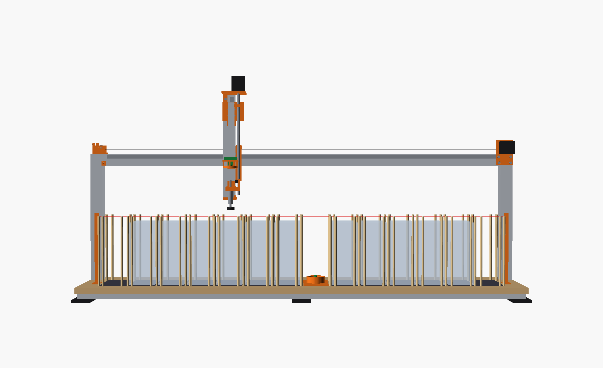
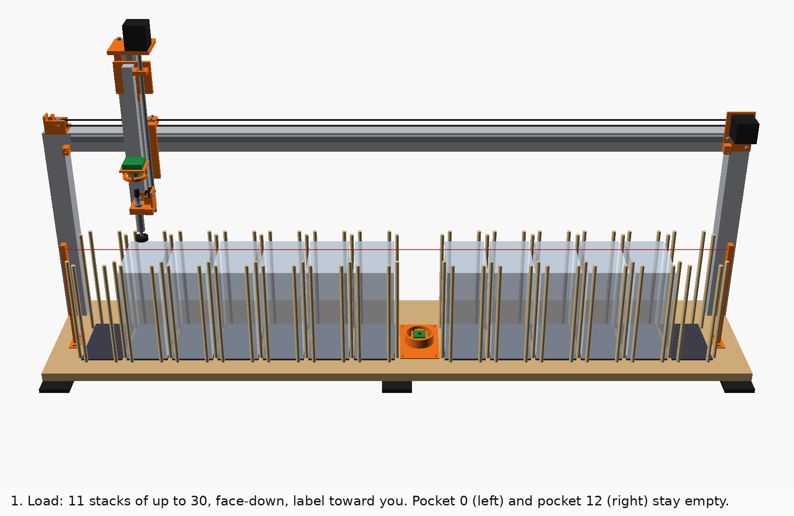
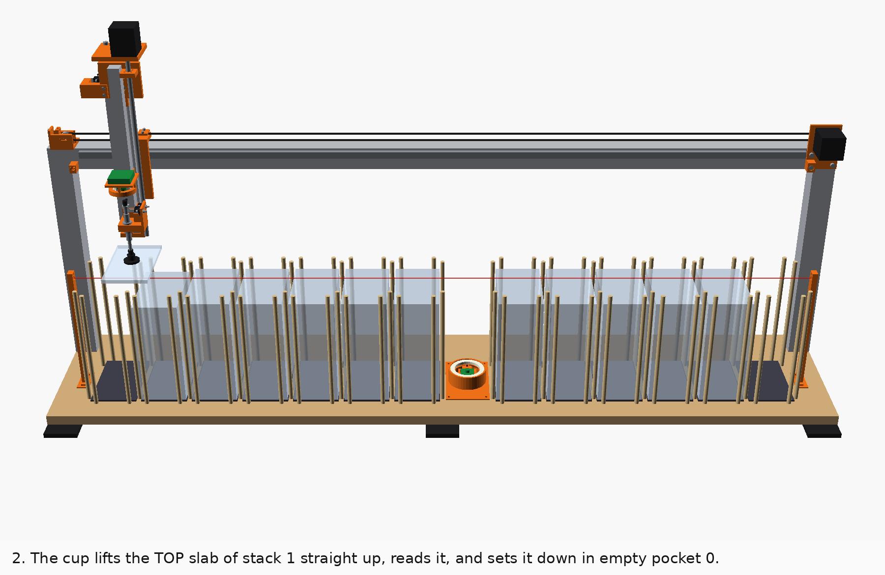
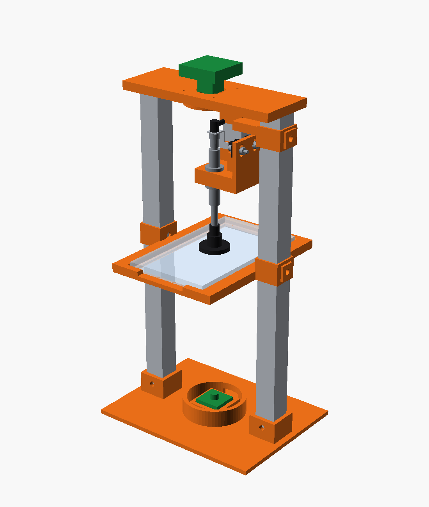
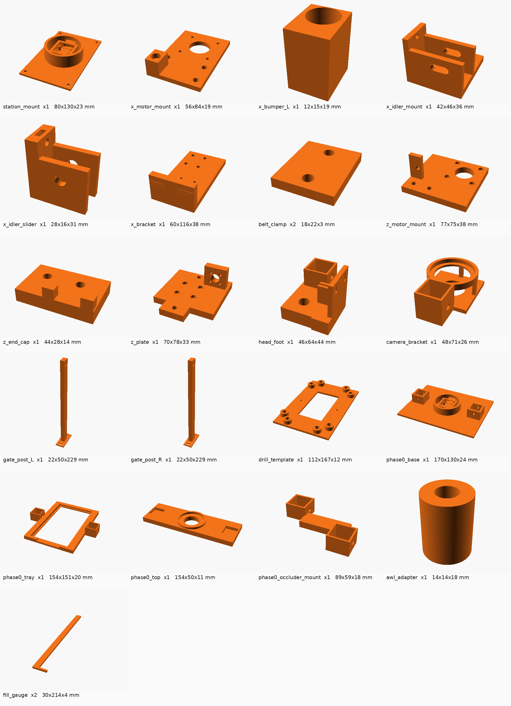
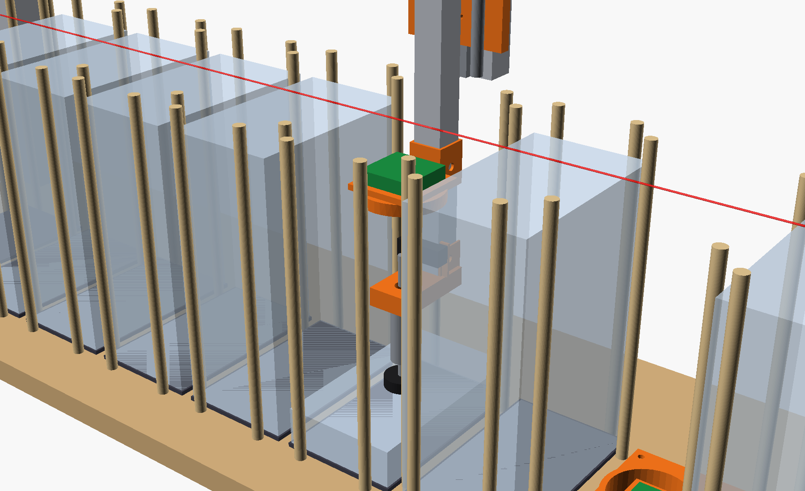
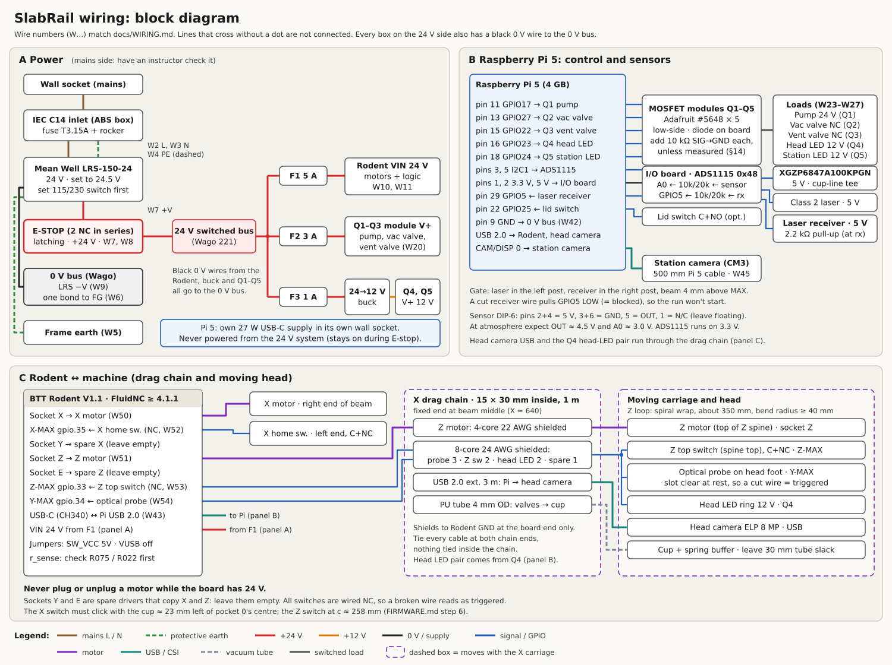
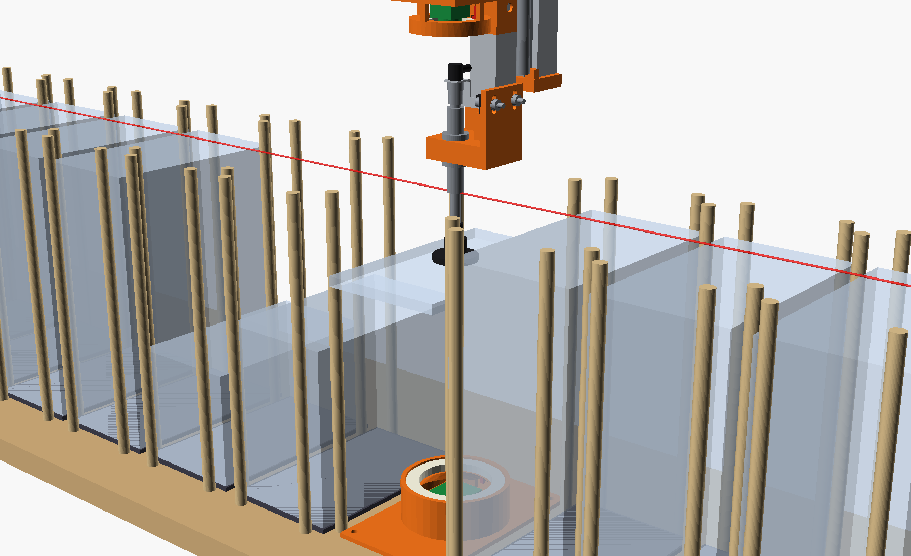

# SlabRail build guide

Step by step, from the first camera test to the first batch of real slabs. It is written for a
tech-school student working with mechatronics instructors. Interfaces (pins, axes, paths) come
from [CONTRACT.md](CONTRACT.md). Wiring is in [WIRING.md](WIRING.md), firmware in
[FIRMWARE.md](FIRMWARE.md), parts in [BOM.md](BOM.md), and the software in
[../software/README.md](../software/README.md). Day-to-day use is in [OPERATING.md](OPERATING.md).

Confidence tags: **[Certain]** = read in the CAD, the code, a datasheet, or tested in the
simulator. **[Likely]** = strong inference or several secondary sources. **[Guessing]** = a gap I
filled. Every time estimate is **[Guessing]**.

## Read this first

- **Phase 0 is two gates, and both come before any motion parts.** [Likely, BOM.md order plan]
  - **0A, camera test: ≈ $457**, or ≈ $293 if you borrow a school Pi 4 or Pi 5 (a Pi 5 4 GB costs
    about $110 by itself in October 2026). Buy your own Pi only after 0A says GO.
  - **0B, cup test: ≈ $198**, with a spare SMC cup and buffer. A hand vacuum pump on the bench: no
    mains wiring, no electronics.
- **The full machine costs about $1,973.** [Likely ±15%] That is with a 15% allowance; it is about
  $1,703 if the school supplies its usual shop stock and about $1,616 with the lean swaps. A
  realistic worst case buying everything is about $2,235, inside the $2,500–3,000 you said is
  fine. Use the school's shop stock anyway: it is the cheapest headroom. Upgrades are in the BOM as
  qty-0 lines: buy one only when its test fails.
- **Nothing here has moved a real slab yet.** [Certain] The CAD passes its clearance checks and the
  software passes its tests against a simulator. Real labels, the real cup and real wiring are
  untested. That is why Phase 0 comes first and section 13 has the tests to pass before you trust
  the machine with inventory.
- **Plan on 60–85 hours of hands-on work over 6–10 weeks**, plus about 40 hours of printer time.
  [Guessing] Drilling 82 rod holes, the wiring and the acceptance tests are most of it.
- **The CAD and BOM still have small gaps you fix during the build.** [Certain, from reading the
  CAD and BOM] Each one is handled where it comes up:

| Gap | Where it is handled |
|---|---|
| The CAD has no brackets, and the bed covers the base-rail tops where the upright brackets would go. | §4.3 |
| The SMC cup code `ZPT25UUK20-B5-A10` comes from SMC's catalog (25 mm pads come only in 10/20/30/40/50 mm stroke [Certain]), but no listing of this exact code was found [Likely orderable]. Get it confirmed. `head_foot` now has a flag guide, so the rotating "J" buffer works too. | §2, §7.6 |
| The flag, guide and sensor post are built on bought-part numbers you must check on arrival: the buffer's catalog heights [Certain, SMC catalog], the M-5ALU-4 elbow's height (9.3 mm) [Likely], and the endstop board's header position and component heights (unknown). Measure them before you cut the flag; the board slots give ±4 mm. | §3.3, §7.6 |
| The head camera's board-to-lens-front length (20 mm) and its 32 mm hole pattern are guesses in the CAD. | §1.5, §3.3 |
| The Z lead screw must be cut to 340 mm below the motor face. | §7.3 |
| Two screw lengths in the CAD have no margin: the jig's M5×10 through 1.8–2.0 mm walls may bottom in the slot, and the probe board's M3×12 leave no thread. Washers and M3×16 fix them. [Likely] | §1.5, §7.6 |
| The head foot hides the card window that the learned face-down check needs [Certain, CAD ray cast: 0 of 75 points visible]. Until a CAD change clears it, that check stays off and every slab without a PSA back QR stops for you. | §1.7, §13.8 |

## Contents

0. [What you're building](#0-what-youre-building)
1. [Phase 0: camera and cup test](#1-phase-0-camera-and-cup-test-go--no-go)
2. [Ordering](#2-ordering)
3. [Printing](#3-printing)
4. [Frame](#4-frame)
5. [Bed and guide rods](#5-bed-and-guide-rods)
6. [X axis](#6-x-axis)
7. [Z axis and head](#7-z-axis-and-head)
8. [Vacuum plumbing](#8-vacuum-plumbing)
9. [Electronics](#9-electronics)
10. [Firmware](#10-firmware)
11. [Software install](#11-software-install)
12. [Calibration](#12-calibration)
13. [Acceptance tests](#13-acceptance-tests-before-real-slabs)
14. [First real batch](#14-first-real-batch-supervised)
15. [Troubleshooting](#15-troubleshooting)

---

## 0. What you're building

SlabRail is one straight row of 14 cells under one gantry beam.

- **Cells:** 92 mm apart, centres at X = 42 + 92·cell.
  - Cell 7 (X = 686) is the read station, an upward camera.
  - The other 13 cells are pockets 0–12, left to right.
- **Loading:** pockets 1–11 hold up to 30 slabs each, face-down. Pocket 0 starts empty. Pocket 12
  is the exception pocket.
- **Run:** a suction cup on a two-motor gantry moves every stack one pocket to the left, one slab
  at a time. It reads each slab's label on the way and writes `certs.csv`.




**How a run looks:** loaded, then the first transfer. The whole sequence, with all four frames, is
in [OPERATING.md §4](OPERATING.md#4-what-the-machine-does).





| Item | Value | Source |
|---|---|---|
| Footprint | 1416 × 290 mm bed, about 0.65 m tall | `cad/model.py` [Certain] |
| Motors | X: NEMA17 on a GT2 belt. Z: NEMA17 with a T8×8 lead screw, cut to 340 mm. | CONTRACT [Certain] |
| Rails | X: MGN12 1300 mm on a 4040 beam. Z: MGN12 330 mm on a 2040 spine. | CONTRACT [Certain] |
| Pocket | 84 × 139 mm inside, made by 8 mm dowels 218 mm tall | `cad/layout.py` [Certain] |
| Capacity | 11 × 30 = 330 PSA slabs | [Certain] |
| Cycle time | about 14 s per slab, so about 80 min for 330 (`sim --slabs 330`) | software [Guessing until measured] |

### 0.1 Build order and time

The section numbers follow the parts of the machine, but the real order is different in one
place. The rod holes are drilled *by the machine itself* (the head carries an awl that aligns the
drill template), so §5 is split: 5A now, 5B after the machine moves (§12).

| # | Step | Section | Hands-on | Printer / waiting | Instructor needed |
|---|---|---|---|---|---|
| 1 | Phase 0A: camera test (and the probe flag, if the SMC cup has arrived) | §1 | 6–7 h | about 15 h print | no |
| 2 | Phase 0B: cup bench test (hand pump) | §1.10 | 3–4 h | 24 h test | no |
| 3 | Order the machine parts | §2 | 1 h | 1–4 weeks delivery | no |
| 4 | Print the machine parts | §3 | 3 h | about 25 h | no |
| 5 | Frame | §4 | 4–6 h | | **yes: squaring** |
| 6 | Bed, part A (cut, notch, bolt down, cut pads) | §5A | 3–4 h | | for power-tool rules |
| 7 | X axis | §6 | 4–5 h | | helpful for the dial indicator |
| 8 | Z axis and head | §7 | 4–6 h | | no |
| 9 | Vacuum plumbing (finish) | §8 | 2–3 h | | no |
| 10 | Electronics | §9 | 10–15 h | | **yes: mains, crimp review, first power-up** |
| 11 | Firmware | §10 | 2–3 h | | first homing: yes |
| 12 | Software | §11 | 1–2 h | | no |
| 13 | Bed, part B: mark, drill, glue rods, pads | §5B | 8–12 h | 24 h glue cure | for power-tool rules |
| 14 | Calibration | §12 | 2–3 h | | no |
| 15 | Acceptance tests | §13 | 6–8 h | about 3 days elapsed | first E-stop test: yes |
| 16 | First real batch | §14 | 2 h | | no |
| | **Total** | | **about 60–85 h** | | |

### 0.2 Cost

From [BOM.md](BOM.md), with its 15% allowance. No price is a live checkout price. [Certain that
they are search-extract prices dated 2023 to August 2026]

| | Cost |
|---|---:|
| Order 1a: Phase 0A (Pi, cameras, rings, USB extension, jig parts, flag sheet) | ≈ $457 (≈ $293 with a borrowed Pi) |
| Order 1b: Phase 0B (two cups and buffers, pads, elbows, tube, fittings, hand vacuum pump) | ≈ $198 |
| Order 2: the machine (frame, motion, bed, vacuum system, electronics, mains box, cables) | ≈ $1,317 |
| **Full list** | **≈ $1,973** |
| With school shop stock (filament, wire, glue, fuses, screws) | ≈ $1,703 |
| Lean (also generic valves and Home Depot plywood) | ≈ $1,616 |
| Optional light roof, only if Phase 0 shows glare (conditional BOM lines) | + ≈ $39 |
| Worst case buying everything (tools, HT1 cups, roof, [Guessing] prices 20% high) | ≈ $2,235: under $2,500 |
| Upgrades, each only if its test fails (HIWIN rail, Z motor, counterweight, flex USB, VXB pump, branded E-stop) | + $20–380 each, about $815 if all of them |
| Junk slabs for §13, if they don't come from your stock | + $150–400 |

**Keep a tally** of what you actually paid after each order (BOM.md).

---

## 1. Phase 0: camera and cup test (go / no-go)

**Why:** the two riskiest unknowns are (a) whether the cameras read *your* labels, and (b)
whether the cup marks a slab. Both can be tested on a bench for a fraction of the machine's cost.
If either fails, you have not bought any motion parts. **Order the machine only if both 0A and
0B pass.**

### 1.1 What Phase 0A needs

Rows marked "PHASE 0A" in BOM.csv. [Certain for the list; prices as in the BOM]

| Part | From | Cost |
|---|---|---:|
| Raspberry Pi 5 4 GB, 27 W PSU, 64 GB microSD, Active Cooler | BOM, or borrow a school Pi | $143 (or $0) |
| Camera Module 3 (standard) + 500 mm Pi 5 cable | BOM | $27.50 |
| ELP 8 MP IMX179 USB camera, 3.6 mm M12 lens | BOM | $66 |
| 3 m USB 2.0 extension (the BOM line has two; Phase 0A needs one) | BOM | $22 |
| LED rings: 40 mm for the head, 60 mm for the station (12 V COB) | BOM | $24 |
| 12 V DC wall adapter, 1 A or more | BOM | $10 |
| Two 2020 × 312 mm extrusion posts, cut square to ± 0.5 mm, and one 2020 × 66 mm arm stub | BOM | $16 |
| M2 screw kit and M2 standoff kit; 6 × M5×10 + 12 M5 washers + 6 M5 slot-6 T-nuts; 1 × M5×30 + nylock; 2 × M3×16 + 4 washers + 2 nuts | BOM / school stock | $17 |
| Optical endstop board (for `head_foot`'s sensor post) | BOM | $9 |
| 1 mm soft aluminium sheet, at least 25 × 56 mm (the probe flag) | BOM / school stock | $3 (or $0) |
| Hookup wire, heat shrink, filament | BOM / school stock | $60 (or $0) |
| Printed: `phase0_base`, `phase0_tray`, `phase0_top`, `phase0_occluder_mount`, and `head_foot` (the machine's own part) | §3 | |
| **Total** | | **≈ $398 + 15% ≈ $457**, ≈ $293 with a borrowed Pi, ≈ $220 if the school also supplies the wire, filament and sheet |

- **Why the 12 V adapter:** it powers the LED rings without any mains wiring, because the
  `phase0` tool leaves the lights on and never switches them. [Certain, `tools/phase0.py`] The
  rings and the cameras are the only powered parts in Phase 0A.
- **Why the USB extension and `head_foot` already:** in the machine the head camera reaches the
  Pi through about 4 m of USB, and the foot, buffer, flag, elbow, sensor and cup sit between the
  lens and the slab, inside the ring light. The jig reproduces both, so a GO means the machine's
  conditions. [Certain, `checks.txt`: the jig's occluder sits 0.0 mm from the machine's, relative
  to the lens, and blocks the same share of the camera's view of the slab]
- **The SMC cup is the real occluder.** It is in order 1b, but its lead time can be 2–8 weeks
  [Likely]. Order it with 0A if you accept $42 at risk. Otherwise use an M10 bolt with a 25 mm
  washer as a dummy and leave the flag off; the label view does not depend on it [Certain,
  `checks.txt`: nothing on the head blocks the label].
- **With a Pi 4:** use the 15-pin camera cable that ships with the Camera Module 3, not the Pi 5
  cable. [Likely]

### 1.2 Measure five of your slabs (15 min)

The CAD's slab size is in `cad/dims.py`: 80.3 × 135.5 × 6.6 mm nominal, design maximum
82.6 × 136.5 × 7.0. Use calipers to measure five slabs from your stock, including the newest and
the oldest holders.

- **Width over 83.0 mm** or **length over 137.0 mm:** stop. The pockets (84 × 139) are too tight for
  them, so the CAD must change before anything is printed. [Certain, from `layout.py` play of
  ±1.85 / ±1.75 mm]
- **SGC holders are about 86 mm wide and do not fit at all.** [Likely, `layout.py` comment] Measure
  one if you deal SGC.
- **Also measure one CGC, one BGS and one TAG holder** if you deal them. [Guessing: no width for
  them has been measured; BGS may be wider than PSA] Anything wider than 82.6 mm is "do not load"
  (OPERATING.md §2). CGC matters most, because the machine reads CGC normally.
- **On two PSA slabs, measure from the slab's label-end edge to the card's top edge** (through the
  plastic). The learned face-down check looks at a window on the card back that starts about 35 mm
  from the slab's label-end edge (`face_down_window_mm`, y −33 … −17 mm from the cup axis). It
  assumes the card starts about 32 mm from that edge. [Guessing] If your number is above 34 mm,
  the window reaches the label: note it for §1.7.

### 1.3 Print the jig (about 15 h printer time)

Print `phase0_base`, `phase0_tray`, `phase0_top` and `phase0_occluder_mount` in black PLA or PETG,
and `head_foot` in PETG (settings in §3; it goes on the machine later). Black matters around the
cameras, because it cuts stray light. Before printing `head_foot`, check the optical endstop
board (§3.3).

### 1.4 Set up the Pi (1–1.5 h)

Do §11.1–11.4 now: the operating system, copying the repository, and `setup_pi.sh`. Phase 0 uses
the same software as the machine.

### 1.5 Assemble the jig (1.5 h)



1. Screw the Camera Module 3 onto the four bosses in the base's camera mast with M2 self-tapping
   screws. Lead the ribbon out through the slot in the mast and ring wall. Use the 500 mm cable to
   the Pi's CAM/DISP 0 port, fitted with the Pi off.
2. Put the 60 mm LED ring in the base's ring seat around the lens.
3. Push the two 2020 posts into the base sockets, down to the socket floors. Fix each with an
   M5×10 screw through the socket's cross hole into a T-nut in the post's slot.
   - **Test the first screw:** it must pull the part tight before it bottoms in the slot. The
     printed walls here are only about 2 mm, so a bare M5×10 can reach the profile's core first.
     Two M5 washers under the head fix that. [Likely; I could not get a 2020 slot drawing] Do the
     same for every M5×10 in the jig.
   - **Slide `phase0_occluder_mount`'s clamp onto the RIGHT post now**, with a T-nut in the post's
     outer slot, before the bridge goes on. Leave its screw loose.
4. **Face both tray ledges with a strip of the pad microfiber** (spray adhesive): the slab's
   front label rests on them. Slide the tray onto the posts. Set the **top of the cloth on the
   ledges 140 mm above the station lens front** (± 2 mm; if you measure to the bare ledge, set it
   140 mm minus the cloth thickness), then fix both clamps with M5 screws and T-nuts. [Certain,
   `model.py`: slab front at lens + 140]
5. **Head camera on the bridge.** The bridge carries the board on four M2 standoffs.
   - Measure your ELP board's **board-to-lens-front length L**: from the board's underside to the
     front of the M12 lens holder, with the lens roughly in focus. The CAD guessed 20 mm.
     [Guessing in the CAD]
   - Standoff height = **L − 7.4 mm** (12.6 mm for L = 20). Use brass M2 standoffs from the kit
     (stack two if needed); they screw into the bridge's 1.8 mm blind holes.
   - The CAD assumes a 32 mm square hole pattern. Measure your board first; if it differs, drill
     new 1.8 mm holes in the bridge. [Guessing in the CAD]
   - Fix the board with four M2 screws. Put the 40 mm LED ring in the bridge's ring seat.
6. **The bridge sits on the post tops in its blind sockets,** so the 312 mm posts set its height.
   [Certain, CAD: post tops at 314, socket roof at 314] Put a slab in the tray and measure the
   **head lens front to the slab's top face (its back): 140 ± 2 mm**. If it is off, change the
   standoff height (washers on the standoffs, or a shorter or longer standoff). Don't pack the
   post tops unless you have to.
7. **Put the machine's occluders under the lens** on `phase0_occluder_mount`. The jig then holds
   them exactly where the machine does, relative to the lens. [Certain, `checks.txt`: 0.0 mm
   offset; the same share of the slab view blocked]
   1. **Arm stub:** push the 66 mm 2020 stub into `head_foot`'s arm socket until it bottoms. Clamp
      it square and match-drill the 5.5 mm cross hole through the printed hole and the stub
      together (19 mm from the stub's end). Fix it with an M5×30 and a nylock nut.
   2. **Occluder parts:** fit the buffer and cup, the flag, the elbow and the endstop board as in
      §7.5–7.6. With the M10-bolt dummy, leave the flag off.
   3. **Into the mount:** push the stub up into the mount's socket, the arm stub toward the back
      (away from the label end) and the sensor post on the right, exactly as in the machine. Fix
      it with an M5×10 and a T-nut in the stub's +X slot.
   4. **Height:** put a slab in the tray. Slide the mount down the post until the cup rests on the
      slab's back and the **foot's underside is 62.0 ± 0.5 mm above the slab's back**. The buffer
      is then pushed in by its 2 mm trip travel, as in the machine. Tighten the clamp screw.
   5. The cup lands on the lens axis by construction. [Likely ± 1 mm, print tolerance] Check it by
      eye from above.
   6. **To change slabs,** push the cup up by hand, only as far as the change needs.
   7. **For the face-up pass (§1.7),** slide the whole mount 3 mm up the post. Never slide the stub
      in the mount instead: the sensor post meets the mount's beam after 2.5 mm. [Certain, CAD]
8. Plug the ELP camera into a black USB 2.0 port **through the 3 m USB extension**, as in the
   machine. Power both rings from the 12 V adapter (ring + to adapter +).

### 1.6 Focus both cameras (30 min)

Put one slab in the tray **face-down, label end toward you** (the finger-notch side), exactly as it
will sit in the machine.

```bash
cd ~/psa-slab-scanner/software && source .venv/bin/activate
python -m slabscan focus head --no-motion              # turn the M12 lens; watch the score peak; lock the lens nut
python -m slabscan focus station --no-motion --save    # sweeps LensPosition, saves the best one to config/calibration.toml
```

- **Head:** with the occluders in place (§1.5 step 7), turn the lens slowly past the peak and
  come back to it. The line shows `READ …` when something decodes. Lock the lens nut once you are
  at the peak.
- **Station:** note the recommended LensPosition. The machine's station uses the same 140 mm
  distance, so the value carries over. [Certain, CAD]

### 1.7 Scan 30–50 of your own slabs (1–2 h)

```bash
python -m slabscan phase0 --out phase0_results --lens-position 7.1   # use the value focus station printed
python -m slabscan phase0 --out phase0_results --lens-position 7.1 --face-up 15 --save   # with the face-up pass (below)
```

For each slab the tool asks you to type the printed cert number, then saves both images and what
each camera decoded. **Type the cert every time:** the typed number is how it catches a *wrong*
read, which is the failure that matters, and GO needs every slab typed. [Certain,
`tools/phase0.py`] Scan five 2024+ slabs (back QR) first: they teach the ITF format, in the same
order the machine learns it.

**Include in the 30–50:**
- new labels (2024+, 9-digit certs) and old ones (8-digit);
- at least 3 labels from before 2017 (no back QR) and, if you have them, from before December 2015
  (no back barcode) [Certain, RESEARCH.md label eras];
- the 2024+ holder and the older holder;
- 3–5 CGC slabs;
- scratched or scuffed labels and holders;
- one slab with a visible ceiling-light reflection, to check the light-roof question.

Type `q` when you are done. **The read-rate report (`phase0_report.txt`) is written at that point,**
so stopping later loses nothing. [Certain, `tools/phase0.py`]

**The face-up pass (optional; for the learned face-down check).** The machine can learn what a card
*back* looks like through the slab and pick slabs without a back QR when their card window matches
(OPERATING.md §8.4). Phase 0 measures whether that can work: how well the backs match each other,
and how well face-up slabs match the backs.
- **With today's head, expect HOLD.** The foot hides the card window from the head camera, in the
  jig as on the machine [Certain, CAD ray cast; in the simulator the face-up slabs then score like
  the backs]. The pass then tells you nothing new. Run it anyway if you want the numbers on record;
  skip it if you are short of time.
- Start the tool with `--face-up 15`. After `q` it asks for 15 slabs **face-up**.
  1. First slide the occluder mount 3 mm up the post (§1.5 step 7). The free cup then hangs 1.0 mm
     above the slab's front, so nothing touches it. [Certain, `checks.txt`] Use junk or low-value
     slabs anyway [Guessing: print tolerance could close a 1 mm gap].
  2. Change slabs with the cup pushed up no more than about 12 mm. [Certain, `checks.txt`: 3.2 mm
     clear at 12 mm; only 0.2 mm left at the full 20 mm with the mount lifted]
  3. Use 15 different cards, face-up, label end toward you, **including at least one plain card
     (one colour, little print) and one full-art card**: they are the hardest to tell from a back.
  4. `s` (or Ctrl-C) ends the pass early; the slabs so far still count. Slide the mount back down
     to 62.0 mm afterwards.
- **Open `phase0_results/window_check.jpg`.** The red boxes are the card window
  (`face_down_window_mm`). They must lie on the card back, clear of the label and of the cup and
  foot. With today's head they lie on the foot. If the label shows at the *bottom* of the image
  instead of the top, the camera is turned: put
  `face_down_window_mm = [[-28, 17, 28, 33]]` in `config/calibration.toml` and run Phase 0 again.
  [Guessing which way up the real camera is]
- `--save` writes `face_down_threshold` and `face_down_threshold_sig` to
  `config/calibration.toml` and the backs to `config/card_backs.npz`, **only on a GO**. Without
  `--save` it writes nothing to `config/`. [Certain, `tools/phase0.py`]

### 1.8 Record what the labels actually encode

Open `phase0_results/phase0.csv` and `phase0_report.txt`. Fill this in and keep it with the
machine: it settles the open questions in RESEARCH.md.

| Question | Where to look | Your answer |
|---|---|---|
| Back QR payload format (e.g. `https://www.psacard.com/cert/<n>`) | `back_reads` column, `QRCode:` entries | |
| Front barcode symbology (ITF expected) | `front_reads`, the part before `:` | |
| Digits in the front barcode for a 9-digit cert (10 = padded or check digit) | `front_reads` | |
| ITF format learned | report line `ITF format learned:` (`zero_pad` or `check_digit`) | |
| CGC QR payload | `back_reads` for CGC slabs | |
| Any prefix or suffix around the cert | raw payloads | if yes, set `custom_regex` (§11.5) |
| Time per side (`back_ms`, `front_ms`) | CSV | replaces the [Guessing] frame times in `cli.py` |
| Cert lengths seen (8, 9 digits …) | `typed` column | set `psa_cert_digits = [8, 9]` in `calibration.toml` (§11.5) |
| Widths of your CGC / BGS / TAG holders | your calipers (§1.2) | wider than 82.6 mm: do not load |
| Label-end edge to the card's top edge | your calipers (§1.2) | the CAD assumes about 32 mm |
| Card window on the card back? | `window_check.jpg` | boxes on the card / on the label / on the foot |
| Learned check: how well backs match each other | report line `lowest back-to-back similarity:` | |
| Learned check: how well face-up slabs match a back | `highest face-up similarity:` | |
| Backs unlike the others (Japanese cards, other games, CGC) | lines `slab N matches none of the other backs` | |
| Learned check verdict | `GO for face_down_check = "learned"` with a threshold, or `HOLD for the learned check` and why | expect HOLD with today's head |

### 1.9 The gate

| Result | Decision |
|---|---|
| `WRONG certs vs what you typed` is **0**, every slab typed, and `confident read (ok)` is **≥ 95 %** | **GO** [Certain: the tool's own criteria]. The report also prints the rule-of-three bound (with 0 wrong in n slabs, the true wrong-read rate is probably below 3/n) and the ok rate as if the ITF format had been learned from the start. |
| Any wrong cert at all | **NO-GO.** One silent misread is worse than 20 unread slabs. Follow the steps the report prints for the failing slabs and re-run; buy nothing else until a re-run gives 0 wrong. |
| ok below 95 % but no wrong certs | **Hold.** Look at the failing images. Typical fixes: refocus, move the ring, block room light. Then run again. |
| Back camera fails on most post-2017 labels | **Hold.** Every one of those would need the station detour (+3–5 s each). Fix the head image first. [Likely] |
| Glare spots over the label in the head images | Plan to build the optional light roof (CONTRACT). |
| Learned face-down check: **HOLD**, or no face-up pass | **Does not block the build.** The machine then stops at every slab without a PSA back QR for you to check, as before. Expect HOLD with today's head. [Certain, CAD] |
| Learned face-down check: **GO** (with `--save`) | The threshold, its sig and the seed backs are saved. GO means: on your slabs, the backs matched each other at least 0.10 better than any face-up slab matched a back; the threshold is the midpoint, never below 0.55. It is not a promise. [Guessing] that 15 face-up slabs show the worst case. On the machine the check still needs 5 references and a clear view of the window on 5 proven slabs before it accepts anything, and you check the back photo of every learned acceptance in the first batches (§14). |

### 1.10 Phase 0B: cup bench test (after 0A passes)

**What it proves:** the cup seals on your holders, the cup line holds, and the cup leaves no mark.
**Parts:** order 1b, the rows marked "PHASE 0B": the SMC cup and buffer, spare pads, PU tube and
push fittings, IPA, and a hand vacuum pump with a gauge (brake-bleeder type). **No mains wiring, no
electronics, no instructor needed.** The machine's pump, valves, sensor and power supply come in
order 2 and are tested in §8.3 and §13.

1. **Bench set-up** (30 min):
   - Clamp the buffer body in a bench vise by its M10 nuts (not by the rod), cup pointing down.
   - Screw the `M-5ALU-4` barb elbow into the buffer's top port, with thread sealant on its
     thread (§7.6 step 6; the flag is not needed here). Push about 1 m of 4 mm PU tube onto the
     barb and run it to the hand pump's hose (a stretch fit, or a fitting from the kit).
   - Wipe the cup lip with IPA.
2. **Seal** (on each slab): lay a junk slab face-down on a soft cloth on a block under the cup and
   raise the block until the buffer is pushed in about 2 mm, the machine's trip point. Pump to
   −60 kPa (about 18 inHg). **Pass:** it gets there in a few strokes and holds. [Guessing target]
3. **Leak:** stop pumping and watch the gauge for 60 s. **Pass: it loses less than 5 kPa in a
   minute.** [Guessing target] Faster means the tube is not seated, the fitting leaks, or the lip
   has grit on it. Fix it and repeat. The rate also tells you how often step 5 needs re-pumping.
4. Do steps 2–3 on 5 different slabs, both holder generations, and a CGC if you deal CGC.
5. **24 h static mark test on a junk slab:**
   1. Photograph the junk slab's back under raking light: a phone torch held almost flat to the
      surface, about 10–20°, in a dim room.
   2. Set it up as in step 2, the cup on the back centre, and pump to −60 kPa.
   3. **Keep the clamp on.** The closed line leaks, so re-pump to −60 kPa every time you check, at
      least every 30–60 min while you are around. Write down the time and the reading *before*
      each re-pump, and the reading next morning.
   4. After 24 h, open the pump's release valve, then photograph the same spot the same way.
   - **This is a screen, not the final test.** If most of your readings are above −40 kPa
     (overnight they will drift), most of the 24 h tested only the buffer spring's ~1.2 N, not the
     ~19 N vacuum clamp. The binding test is §13.2 on the machine, where the pump re-holds the
     line every few seconds for 24 h and logs it.
6. **Gate:**
   - **No ring, haze or residue that survives a dry microfiber wipe → GO.** Order the machine
     (order 2).
   - Anything that needs more than a dry wipe → try the Schmalz HT1 cup (BOM conditional line)
     and repeat.
   - The cup won't seal on your holders → stop and find out why before ordering anything else.

---

## 2. Ordering

Use [BOM.md](BOM.md) and [BOM.csv](BOM.csv). Order 2 is everything not marked "PHASE 0A" or
"PHASE 0B". Get the Misumi extrusion quote first, because it moves the total most (BOM.md).

BOM.csv already has the parts this guide uses: the 285 mm drop arm, the Z spine with both ends
tapped, the Adafruit #5648 MOSFET modules, bare SPDT microswitches, the 1 A / 3 A / 5 A branch
fuses, 2.2 kΩ resistors and 100 nF capacitors, the I/O perfboard, mains and earth wire, the closed
mains box, a Class 2 laser, an E-stop with two contact blocks, the 12 V adapter, the hand vacuum
pump and the probe-flag strip. [Certain, BOM.csv]

**Check these lines when you order:**

| BOM line | What to do | Why |
|---|---|---|
| SMC cup + buffer `ZPT25UUK25-B5-A10` | Confirm the code in SMC's configurator or with a distributor: a 25 mm flat urethane pad on a **non-rotating (K)** M10 buffer with 25 mm stroke (20 mm is an acceptable fallback). | The code is built from SMC's pattern (J = rotating, K = non-rotating) and was not found in any listing. [Certain for the letters; Guessing that this exact code is orderable] A rotating rod lets the probe flag swing out of the sensor (§7.6). |
| Z motor with lead screw | Buy one that lists 1.5–2.0 A per phase, ≤ 4 mH and an **8 mm lead** (T8×8). Not a 0.4–0.6 A "integrated" motor. | The firmware runs Z at 0.8 A and 750 rpm; a high-impedance motor stalls there, and nothing detects a Z stall. |
| M5 screws | M5×25 for the 16 bed bolts, M5×30 for the 4 bracket-through-plywood bolts, M5×16/20 and M5×12 button heads as the CSV notes say | An M5×30 through the bed bottoms on the profile core before it clamps (§4.3). |
| Overfill laser | The listing must say ≤ 1 mW or Class 2. | It is on whenever the Pi is on, at face height (WIRING.md §8). |
| Light roof (foam board, tape, 2 × 2020 posts, qty 0) | Buy only if Phase 0 showed glare (§1.9) | The roof is optional (CONTRACT). |

**Lead times** [Guessing]: Amazon 2–5 days, Misumi about 1 week, AliExpress 2–4 weeks, the SMC
buffer can be weeks. The Rodent showed sold out at BIQU US (BOM.md); check the BIQU AliExpress
and Amazon stores.

**When the parts arrive:**
- check that the 4040 profile is 20-series slot 6 with **two slots per face**;
- check that the Z motor's lead screw is **T8×8** (8 mm lead), not T8×2, and **measure the motor's
  phase resistance: about 1–2 Ω is right; 10 Ω or more is a high-impedance motor, don't use it**;
- check that the SMC buffer rod does not turn (K) before you design anything around it;
- count the balls in the MGN12 carriages before you slide them anywhere (§6.1).

---

## 3. Printing

### 3.1 Printer and material

- **Height and bed size** [Certain, `print_list.json` sizes]:
  - The gate posts are exported **standing upright, 229 mm tall: they need ≥ 230 mm of Z
    height.** A Prusa MK3S (210 mm) or MK4 (220 mm) can't do that: there, lay each post on its
    side with supports.
  - The fill gauge is exported lying flat and is 214 mm long: it needs 214 mm in one direction
    (or diagonally).
- **PETG**, 0.4 mm nozzle, 0.2 mm layers. Prusa's PETG settings are 230 °C nozzle on the first
  layer and 240 °C after, with the bed at 85 °C then 90 °C, on a powder-coated or textured sheet.
  [Certain, Prusa knowledge base as quoted in search results] Use your filament maker's numbers if
  they differ.
- **Don't print PETG on a bare smooth PEI sheet.** It can bond hard enough to tear the sheet.
  [Certain, Prusa] Use a textured sheet, or a glue-stick release layer.
- **Part cooling:** 30–50 % for PETG. [Likely]
- **Colour:**
  - matte black for `camera_bracket`, `station_mount` and the Phase 0 jig, to cut stray light near
    the cameras;
  - any colour for the rest.

### 3.2 Parts

STL files are in `cad/out/printed/` (`print_list.json` has every size and note). Times are for a
classic 0.2 mm printer (Prusa MK3-class, Ender 3) running about 5 mm³/s, estimated from each
part's volume. Fast printers (Bambu, MK4) take roughly half. [Guessing]

| STL | Qty | Material | Orientation | Walls / infill | Supports | Time |
|---|---:|---|---|---|---|---:|
| `phase0_base` | 1 | PLA/PETG black | as exported (plate down) | 3 / 25 % | none | 6.5 h |
| `phase0_tray` | 1 | PLA/PETG | as exported (ledges down) | 3 / 25 % | none | 2.8 h |
| `phase0_top` | 1 | PLA/PETG | as exported (ring up) | 3 / 25 % | none | 3 h |
| `head_foot` (Phase 0A, then the machine) | 1 | PETG | as exported | 5 / 40 % | none | 1.7 h |
| `station_mount` | 1 | PETG black | as exported (base plate down) | 3 / 25 % | none; the ribbon slot bridges | 3 h |
| `x_motor_mount` | 1 | PETG | as exported: beam face down | 5 / 40 % | none | 1.3 h |
| `x_bumper_L` | 1 | PETG | as exported: beam face down | 4 / 40 % | none | 0.2 h |
| `x_idler_mount` | 1 | PETG | as exported (foot down) | 5 / 40 % | none | 1 h |
| `x_idler_slider` | 1 | PETG | as exported | 5 / 50 % | none | 0.3 h |
| `x_bracket` | 1 | PETG | as exported: flat on its spine face | 6 / 50 % | none | 3.9 h |
| `belt_clamp` | 2 | PETG | flat | 100 % | none | 0.1 h each |
| `z_motor_mount` | 1 | PETG | as exported: motor face down, tab up | 5 / 40 % | none | 2.5 h |
| `z_end_cap` | 1 | PETG | as exported (lips up) | 5 / 50 % | none | 0.5 h |
| `z_plate` | 1 | PETG | as exported: carriage face down, nut shelf up | 6 / 50 % | none | 2.3 h |
| `camera_bracket` | 1 | PETG matte black | as exported: shelf face down | 4 / 40 % | tree supports under the ring seat if your printer sags (it bridges about 30 mm between its 4 legs) | 0.9 h |
| `gate_post_L`, `gate_post_R` | 1 + 1 | PETG | as exported: upright on the foot, 10 mm brim (needs 230 mm Z) | 4 / 30 % | none upright; on its side: supports | 2.2 h each |
| `drill_template` | 1 | PETG (or PLA) | as exported (plate down) | 4 walls, 50 %, bosses solid | none | 3.6 h |
| `awl_adapter` | 1 | PETG | as exported | 100 % | none | 0.2 h |
| `fill_gauge` | 2 | PLA | as exported (lying flat) | 3 / 20 % | none | 0.6 h each |
| **Total** | | | | | | **≈ 39 h** (≈ 26 h after the Phase 0 prints) |

**Notes**
- **Gate posts:** slow down the last 50 mm of the upright print; a tall thin part wobbles. If your
  printer is shorter than 230 mm, lay each post on its side with supports from the build plate.
- **`camera_bracket`:** print it shelf face down, as exported; the LED ring seat hangs between four
  legs and bridges about 30 mm. Use a brim.



### 3.3 Check before you print the head and camera parts

Measure the real parts first, because the CAD guessed these [Guessing in the CAD, BOM.md open gap 4]:

| Part | CAD value | Fits into |
|---|---|---|
| ELP camera board hole pattern | 32 × 32 mm, M2 | `camera_bracket`, `phase0_top` |
| ELP board-to-lens-front length (board underside to the lens holder front) | 20 mm (`HEAD_LENS_PROJ`) | `camera_bracket` shelf height; the `phase0_top` standoffs (§1.5) |
| ELP lens-holder footprint | 16 mm square (a 25 mm window passes it) | `camera_bracket`, `phase0_top` |
| Optical endstop board hole spacing | 19 mm, M3 self-tapping | `head_foot` sensor post |
| Head LED ring OD/ID | 40 mm ring: seat bore 41 mm, lip 33 mm | `camera_bracket`, `phase0_top` |
| Station LED ring OD/ID | seat 52–60 mm | `station_mount`, `phase0_base` |
| Camera Module 3 holes | 21 × 12.5 mm, M2 | `station_mount`, `phase0_base` |

If anything differs, fix the CAD and re-export (`cd cad && python build.py` on a PC with
CadQuery), or drill new holes by hand.

### 3.4 After printing

- **Clearance holes:** run a 3.4 mm drill through every M3 clearance hole and a 5.5 mm drill
  through every M5 hole by hand. Printed holes come out undersize. [Likely]
- **`awl_adapter`:**
  - The insert pocket is drawn **6.4 mm**, the size for common M5 heat-set inserts (for example
    ruthex M5×9.5). [Certain, CAD; Likely for your insert] If your insert's maker gives another
    size, drill to it before you set the insert with the iron.
  - Press a 3 mm hardened pin (or a 3 mm drill-bit shank, ground to a point) into the 3.1 mm
    bottom hole with a drop of CA glue.
  - The point must be on the cup axis within 0.3 mm. Spin the adapter on the buffer and watch the
    tip: it should not wobble visibly.
  - **Check how your cup pad attaches to the buffer.** The adapter assumes an M5 male stud where
    the pad goes. [Guessing] If your buffer differs, make an equivalent: a sleeve that fits where
    the pad goes, carrying a 3 mm point on the axis.
- **Test-fit before assembly:**
  - each MGN12 carriage's four M3×8 screws through `x_bracket` and `z_plate` (counterbored);
  - the T8 nut flange on the `z_plate` shelf, and its four M3×16 + nuts;
  - the M10 buffer body through `head_foot`;
  - both LED rings in their seats;
  - the `x_idler_slider` sliding between the `x_idler_mount` cheeks, its M3 nut in the slot;
  - the M3 nuts in the `x_bracket` tab's nut traps, under the `belt_clamp` caps;
  - an M3 set screw in each gate post (2.5 mm hole: let it form its own thread, or tap M3).

---

## 4. Frame

### 4.1 Cut list

From `cad/out/cut_list.csv` [Certain]. Misumi cuts to ±0.5 mm with square ends (BOM.md).

| Profile | Use | Length | Qty |
|---|---|---:|---:|
| 2040 | base rail, lying flat under the bed | 1416 | 2 |
| 4040 | upright | 401 | 2 |
| 4040 | X beam, on top of the uprights | 1416 | 1 |
| 2040 | Z spine, **both ends tapped M5** (the two centre bores) | 340 | 1 |
| 2020 | head drop arm | 285 | 1 |
| T8×8 lead screw | Z screw, measured from the motor face: cut the motor's 400 mm screw (§7.3) | 340 (311–356 works) | 1 |
| 2020 | Phase 0 jig posts (not in `cut_list()`) | 312 | 2 |
| 2020 | optional rear brace stock (§6.7) | 600 | 1 |
| 8 mm hardwood dowel | guide rod | 236 | 82 |
| 18 mm plywood | bed | 1416 × 289.5 | 1 |

### 4.2 Where everything sits

Machine coordinates in mm, from `cad/model.py` [Certain]:
- X runs left to right along the row; Y runs front (−) to back (+); Z = 0 is the pad top surface.
- The bed top is at Z = −3, and the base rails' bottom is at Z = −41.

| Part | X | Y | Z |
|---|---|---|---|
| Front base rail (2040 lying flat) | −68 … 1348 | −87.5 … −47.5 (30 mm in from the bed's front edge) | −41 … −21 |
| Back base rail | −68 … 1348 | 107 … 147 | −41 … −21 |
| Bed plywood | −68 … 1348 | −117.5 … 172 | −21 … −3 |
| Left upright (4040) | −68 … −28 | 107 … 147 (on the back base rail) | −21 … 380 |
| Right upright | 1308 … 1348 | 107 … 147 | −21 … 380 |
| X beam (4040) | −68 … 1348 | 107 … 147 | 380 … 420 |
| X rail (MGN12) | −10 … 1290 | front face of the beam | centre 410, upper front slot |

The uprights stand **on** the back base rail and pass through 41 × 41 mm notches in the bed. The
beam sits **on top of** the uprights, flush with their outer faces.

### 4.3 Joints (the CAD has none; this is my recommendation)

[Guessing on the exact layout; Certain that the CAD and BOM leave it open]

**Beam to upright (×2):**
- two 4040 L brackets in the inside corner, on the upright's inner face and the beam's bottom
  face, one in each slot pair;
- one flat L joining plate on the back face, across the upright and the beam.
- **No brackets on the front faces.** The X rail ends only 18 mm from each upright (BOM.md open gap 1),
  and at the right end the `x_motor_mount` plate covers the beam's front face (§6.4).

**Upright to back base rail (×2):**
- The bed covers the base-rail top all round the notch, so an L bracket can't reach the rail
  directly.
- Use two L brackets on the upright's **inner face**, sitting on top of the plywood.
- Bolt each one down with an M5×30 screw and a washer through its foot, the 18 mm plywood and a
  T-nut in the base rail's top slot (slots at Y = 117 and 137).
  - **Test one on a rail offcut first:** the screw must pull the bracket down hard before it
    bottoms in the slot. If it bottoms, add a second washer. Don't go to M5×25 here: with the
    bracket foot it leaves only 1–2 mm of thread in the T-nut. [Likely]
- The plywood then acts as part of the joint. Fit these after the bed (§5A).
- If it still racks, end-tap the upright bottom M5 (4 corner holes) and bolt up through drilled
  holes in the base rail.

**Bed to base rails:**
- **16 × M5×25** with washers into T-nuts, 8 per rail, in the rail's **outer** slot. [Likely] An
  M5×30 through 18 mm plywood leaves about 11 mm below the rail face, but the slot is only about
  6 mm deep to the profile core, so it bottoms before it clamps the bed. **Test one on a rail
  offcut before you drill the bed.**
  - front rail at Y = −77.5, which is 40 mm from the front edge;
  - back rail at Y = 137, which is 35 mm from the back edge.
- Put the front-rail bolts on the cell wall lines (X = −4 + 92·k). That keeps them 16 mm clear of
  the nearest front rod hole and outside the pads. [Certain, CAD arithmetic]
- **Feet:** six rubber feet into the base rails' bottom slots, at both ends and at midspan
  (X ≈ 640). Shim every foot to the bench: a free midspan sags 1–3 mm under a full load. [Certain,
  CAD has the six; Guessing on the sag]

### 4.4 Assembly steps (4–6 h, with the instructor for squaring)

1. Slide T-nuts into every slot you will need **before** you close any joint. Drop-in T-nuts can
   be added later, but sliding ones can't. Count them per the BOM: about 124 M5 and 65 M3.
2. Lay both base rails on a flat bench, 194.5 mm apart centre to centre (Y = −67.5 and 127).
3. Bed part A (§5A) goes on now, because the upright brackets bolt through it.
4. Stand the uprights in the notches on the back rail. Brackets snug, not tight.
5. Lift the beam onto the uprights. Brackets and back plates snug.
6. Square everything (below), then tighten from the bottom up and re-check.

### 4.5 Squareness checks (instructor)

**Why these tolerances are loose:** the machine drills its own rod holes (§5B), so it doesn't
matter if the beam sits a little skewed to the bed. These checks keep the motion axes straight and
the rods vertical. [Certain, by construction of the drill-template method]

| Check | How | Target |
|---|---|---|
| Base rails parallel | centre-to-centre at both ends | 194.5 ± 0.5 mm |
| Base rectangle square | the two diagonals between rail ends | equal within 1 mm |
| Bed flat | straightedge along the row centre line (Y = 0) | gap ≤ 0.5 mm per metre [Guessing] |
| Bed not twisted | level, or winding sticks, across the depth at both ends | ≤ 0.5 mm across 290 mm [Guessing] |
| Uprights plumb, in X and in Y | machinist square on the bed plus feeler gauge, or a digital level | ≤ 0.5 mm over 400 mm (≈ 0.07°) [Guessing] |
| Upright spacing | inner faces at the bottom and at the top | 1336 ± 0.5 mm, equal top and bottom [Certain, CAD] |
| Gantry not racked | diagonals of the back face: beam top corner to the opposite base-rail bottom corner | equal within 1 mm |
| Beam height | bed top to beam bottom, at each upright | 383 ± 0.5 mm, equal both ends [Certain, CAD] |
| Beam sag | same, at midspan | within 0.3 mm of the ends (DESIGN: 0.18 mm under 20 N) |
| Beam front face straight | string line or a 1.5 m straightedge along the rail face | ≤ 0.5 mm bow [Guessing] |

---

## 5. Bed and guide rods

### 5A. Now, before the X axis (3–4 h)

**5.1 Cut the bed.**
- Cut 1416 × 289.5 mm from the 18 mm Baltic birch blank (305 × 1524). One rip and one crosscut.
- If you used Home Depot plywood instead, drill a test hole away from the pockets first: voids
  ruin rod holes. (BOM.md)

**5.2 Cut the two upright notches** at the back corners, one at each end.
- Each notch is 41 mm along X (open to the end) by 41 mm along Y.
- It runs from **24.5 mm to 65.5 mm in from the back edge** (Y 106.5 … 147.5). [Certain, CAD]
- Jigsaw or bandsaw, then file to fit. The upright must drop in without forcing.

**5.3 Bolt the bed to the base rails** (§4.3), with the frame square.

**5.4 Prepare the rods** (do this while the printers run):
1. Roll every dowel on a flat table. Reject bowed ones. Buy 100 so you can.
2. Cut 82 to **236 mm**: 15 mm in the plywood + 3 mm of pad + 218 mm above the pad. [Certain,
   CAD]
3. **Dome one end now.** Chuck the dowel in a cordless drill, spin it against 120 then 220 grit,
   and round the top to a 2–3 mm radius. This is the lead-in for slabs going in by hand.
   Thirty seconds each.
4. Lightly chamfer the other (bottom) end so the glue isn't scraped off on insertion.
5. **Test hole in scrap plywood:** drill 8 mm × 15 mm deep with the brad-point bit. A dowel must
   be a firm push fit.
   - Too loose: use a fresh bit, or a 5/16 in bit with 5/16 in dowels.
   - Too tight: sand the dowel end.

**5.5 Cut the pads:**
- 13 pads of **83 × 138 mm**: 2 mm black EVA, faced with tight-weave microfiber, bonded with spray
  adhesive. Total thickness about 3 mm. [Certain, CAD `PAD_T`]
- Cut with a sharp knife and a steel rule, corners square.
- **Don't lay them yet.** The template sits on bare plywood.

### 5B. After §11, once the machine homes and jogs

**Order:** §6–§11 first. You need X and Z moving, the probe working (FIRMWARE.md step 7), and the
software installed. The bed must be bare: no rods, no pads.

**5.6 Mark and drill, one cell at a time** (4–6 h for 13 cells).

What the template does:
- `drill_template` is a one-cell jig with two cone dimples, 40 mm either side of the cell centre,
  on the row centre line, plus 8 drill-guide bosses. [Certain, `model.py`]
- The awl on the head drops into both dimples, so the template lines up with the machine's *own*
  X axis and cup path. Belt stretch, the switch position and beam skew are therefore all built
  into the holes.

Set-up:
- Fit the `awl_adapter` in place of the cup.
- Set its point level with where the cup face was, within 2 mm (`mark` asks for this).
- Make a **drill guide block**: drill an 8 mm hole straight through a 30 mm hardwood block on the
  school's drill press.
  - The printed template sets each hole's *position*, not its *angle*. [Certain, BOM.md] The
    block sets the angle.
  - Why it matters: a rod leaning 0.5° puts its top 1.9 mm off at 218 mm, and the slab has only
    ±1.85 mm of play. [Certain, arithmetic]

```bash
python -m slabscan mark --dry-run     # prints the order and every dimple position
python -m slabscan mark               # the real thing
```

For each pocket the software:
1. Drives the awl over the left dimple and lowers it until it touches (a bounded probe).
2. Asks you to nudge the template until the point sits in the left dimple.
3. Moves to the right dimple. You swing the template on the left dimple until the right one is
   under the point, then **clamp the template** (two small clamps, or double-sided tape plus a
   clamp).
4. Parks the head three pockets away and prints **which holes to drill** for this pocket.
5. Waits until you type **`clear`** (drill and hands off the bed). Only then does the head move
   on. `s` = this pocket is drilled, stop here; `q` (or no keyboard) = stop without recording it.
   Every sideways move is slow (1500 mm/min), because the drill is right there. [Certain,
   `ops.mark`]

Drilling each hole:
1. Hold the guide block on top of the template boss, hole over hole.
2. Drill through boss and block with the 8 mm brad-point bit.
3. **Depth collar at 57 mm from the bit's cutting lips:** 30 mm block + 12 mm boss + 15 mm into the
   plywood. [Certain, CAD for the boss and the 15 mm] The collar stops on the top of the block.
   - The brad point's centre spur goes 1–2 mm deeper than the lips, and the plywood is only
     18 mm. Check on the §5.4 scrap test hole that it doesn't break through the bottom. If it
     does, drill 14 mm: the rod tops end 1 mm higher, which is harmless. [Likely]
4. Vacuum the chips out of each hole.

Order and the end pockets:
- The order is pockets 1–11 first, then 0 and 12. [Certain, `mark --dry-run`]
- One dimple of each end pocket is past the X travel. For those, push two 8 mm pins (drill bits)
  through the template's shared-side holes into the neighbour's finished holes. The one dimple
  you can reach is then a check: **more than 1 mm off means stop.** Either the neighbour was
  drilled off, or X lost steps.
- The station cell (7) needs no holes of its own: its side rods belong to pockets 6 and 7.
  [Certain]
- Neighbouring cells share side holes. **Don't drill through the bosses over a neighbour's holes:**
  `mark` tells you which side to skip. Each template is placed by its own dimples, a few tenths of
  a mm off the neighbour's, so drilling those holes again would cut them oval and the dowels
  would lean. [Certain, `ops.drill_instruction`]
- Break: `python -m slabscan mark --start N` carries on **in the marking order** from pocket N, so
  pockets 0 and 12 still come last. `--only 0,12` does just those.

**5.7 Glue the rods** (2 h + 24 h cure).
1. Put a drop of Titebond II in each hole and spread it with a cotton swab.
2. Push the rod to the bottom with a twist, domed end up.
3. Wipe the squeeze-out with a damp cloth.
4. Hold a small square against the rod in X and in Y. Over 200 mm it must be within 1 mm.
   [Guessing target, from the play budget]
5. Do one pocket wall at a time, and check rods against their neighbours by eye along the row.
- Titebond II: about 3–5 min open time, clamp 30–60 min, no load for 24 h. [Likely, Franklin
  guidance via secondary sources] Longer if the shop is cold.

**5.8 Rod check: the slab drop test.** After 24 h, lower a junk slab flat between the rods of every
pocket, from the rod tops to the plywood. Do it both ways round (rotated 180°). It must drop
freely and never catch. If it catches, the rod at fault leans. Either pull it now, before the
glue's full strength, or ream the hole and re-glue.

**5.9 Lay the pads, the station mount and the gate posts.**
- **Pads:** spray adhesive on the pad backs and the plywood, then press them in.
  - 0.5 mm clearance to the rods each side. [Certain, 83 vs 84 mm]
  - Use 3M Super 77 outdoors or in a ventilated room, and let it cure overnight before use.
    [Likely]
- **Station mount:** in cell 7, in place of a pad.
  - It has its own 3 mm base plate. Fix it with four #8 wood screws.
  - The camera ribbon exits toward the back.
  - Measure the station lens front height above the pad tops. It should be 23 ± 1 mm. If it
    isn't, set `station_read_c = <your height> + 148.6` in `calibration.toml`. [Certain:
    `STATION_READ_C = 23 + 140 + 6.6 + 2`, the last 2 mm being the free cup's hang below its
    calibrated height]
- **Gate posts:**
  - Left post at X = −20 (laser), right post at X = 1300 (receiver), both on Y = 0. [Certain,
    `model.py`]
  - **They stand on the bare plywood, with no shim.** The CAD puts the barrel 217 mm above the
    foot, so the beam lands at 214 mm above the pad top. [Certain, `model.gate_post`] A shim would
    lift the beam to 217 mm, and a stack up to about 216 mm would then pass the overfill check.
  - Fix each post with two wood screws through the slotted foot holes (they allow about ±9° of
    yaw for aiming).
  - Push the Class 2 laser into the left post's barrel hole and the receiver into the right one;
    lock each with an M3 set screw. Stick a "LASER - do not stare into the beam - Class 2" label
    on both posts.
  - Final beam alignment is in §12.5.

---

## 6. X axis

**6.1 Rail prep** (30 min). Generic MGN12 rails ship with storage oil and sometimes missing balls.
(BOM.md)
- **Never slide the carriage off the rail** without a holder against its open end (a short scrap
  of rail, or a printed plug), or the balls fall out. [Likely]
- Clean the rail and carriage with IPA.
- Count the balls through the end seals if you can.
- Grease with lithium or PTFE grease.
- The carriage must roll the full length with an even, slightly sticky feel, and no notches.

**6.2 Mount the rail** on the beam's **upper front slot** (centre Z = 410). [Certain, CONTRACT]
- 52 × M3×10 screws into M3 T-nuts.
- Rail ends at X −10 and 1290, which is **58 mm in from each end of the beam**. [Certain, CAD]
1. Put all screws in finger tight.
2. **Align the rail to the beam's top face:** with a caliper depth rod at every screw, the beam top
   to the rail's top edge must read **4.00 ± 0.1 mm**. [Certain, CAD: rail top edge Z 416, beam top
   Z 420]
   - Better, if the shop has one: clamp a dial indicator to the carriage, put the tip on the beam's
     top face, and slide the carriage along. Adjust until the reading varies by ≤ 0.1 mm.
3. Tighten from the middle outward to about **1 N·m**: a firm squeeze on a short hex key, not a
   full-hand torque.
   - The M3 T-nuts are in aluminium. A third-party rail installation table gives 0.98 N·m for M3
     into aluminium. [Likely]

**6.3 Carriage and X bracket.**
- Bolt `x_bracket` to the MGN12H carriage with **4 × M3×8** in the counterbores (20 × 20 mm
  pattern). Not M3×10: the carriage threads are only about 3.5 mm deep. [Likely]
- The belt-clamp tab reaches back over the beam top.
- The carriage must still roll freely end to end. If it binds near the ends, a screw head is
  touching.

**6.4 Motor, idler and end bumpers.** [Certain, CAD]
- **`x_motor_mount`** is a face plate on the beam's **front** face at the **right** end (X 1292 …
  1348): 4 × M5 into T-nuts in both front slots (M5×10 through the 5 mm plate, and an M5×20 with its
  head sunk through the bumper block).
  - The motor sits **in front of the plate, its shaft pointing back** over the beam top. Fix it
    with 4 × M3×8 through the plate (heads on the beam side). A standard 24 mm shaft is long
    enough: the pulley needs 22.5 mm. [Likely]
  - The GT2 20T pulley goes on the shaft, teeth next to the plate, and the grub screw must sit on
    the shaft's flat. Use blue threadlocker.
  - The left end of this plate is the **right X hard stop** (the `x_bracket` lands on it at cup
    X 1262).
  - Because the plate covers the beam's front face here, the right upright gets back-face brackets
    only (§4.3).
- **`x_idler_mount`** goes on the beam top at the **left** end: 2 × M5×10 into T-nuts in the
  **rear** top slot, at X −52 and −26. The toothed idler sits in the `x_idler_slider` between the
  cheeks, on an M5×30 axle through the cheek slots and the slider. The M3×20 tension screw goes
  through the end wall into the nut in the slider's bridge.
- **`x_bumper_L`**, the left X hard stop: 1 × M5×20 (head sunk) into a T-nut in the beam's **lower
  front** slot, its face at X −15, so the `x_bracket` lands on it at cup X 15.

**6.5 Belt.**
1. Route the GT2 belt around the motor pulley and the idler in a vertical plane just above the
   beam top. Both ends come back to the `x_bracket` tab on the upper strand.
2. Lay each belt end **teeth down on the tab's GT2 rack** and press it with a printed `belt_clamp`
   cap: 2 × M3×12 + nut per cap (the nuts sit in the traps under the tab).
3. The lower strand runs **12.9 mm above the beam top** and must not rub it anywhere. [Certain, CAD]
4. Check pulley and idler alignment: the belt runs centred on both flanges, and the lower strand
   sits at the same height above the beam at both ends.

**6.6 Belt tension.** I found no maker's figure for 6 mm GT2. [Certain that the searches came up
empty] Use this as a starting point and check it works:
- **Target 15–25 N.** [Guessing; one third-party calculator suggests 10–15 N, but this span is
  long]
- **Measure by deflection:** hook a 100 g mass (1 N), or a spring scale reading 100 g, under the
  middle of the lower strand and lift.
  - The strand should rise **13–23 mm**, which corresponds to 15–25 N.
  - The formula is T = F·L / (4·d), with L = 1.35 m, the pulley-to-idler distance. [Certain,
    statics]
  - Tighten by re-clamping one belt end one tooth further. Fine-tune with the M3 tension screw:
    it pulls the idler slider toward −X (its axle travels −6 … +2 mm in the cheek slots). Then
    tighten the M5 axle to lock the slider.
- **Functional checks** (after §10):
  - no tooth skips on full-speed moves end to end;
  - homing repeats within 0.2 mm (FIRMWARE.md step 6);
  - `calibrate x` reports a scale error under 0.5 mm across the row (§12.2).
- Too tight shows up as a motor that runs hot or a pulley that wears. Too loose shows as lost
  position.

**6.7 Beam twist check, and the brace.** DESIGN.md estimates 0.8 mm of twist at the cup at
midspan from the head's 127 mm overhang. [Guessing in DESIGN] Measure it once the head is on
(§7):
1. Park the head over pocket 6 (midspan) with the cup about 20 mm above the pad.
2. Put a dial indicator on the bed with its tip against the side of the buffer body, reading in Y
   (front–back).
3. Hang a 0.75 kg weight (a water bottle) from the cup, about the head's own weight. Read the
   movement.
- **Up to 1.0 mm: fine.**
- **More than 1.0 mm: fit the brace** (DESIGN.md's threshold). [Guessing: no CAD for it]
  - Cut a vertical 2020 post (about 401 mm, from the 600 mm stock) and stand it behind the
    pockets at X ≈ 600, under the beam's rear bottom slot.
  - Fix it to the beam with two 2020 corner brackets, and to the bed with corner brackets bolted
    through into the back base rail's T-nuts.
  - Keep it clear of the drag chain and of the station camera ribbon (X ≈ 686).
  - Repeat the measurement.

**6.8 X home switch** (WIRING.md §7):
- Mount it at the left end of the beam so it clicks when the cup axis is at **X ≈ 19 mm**, about
  23 mm left of pocket 0's centre, **± 2 mm**.
- It must click at least 2 mm before the `x_bracket` reaches `x_bumper_L` at X 15 (§6.4). The
  carriage still has 2.3 mm of rail at the bumper. [Certain, `checks.txt`]

---

## 7. Z axis and head



All heights below are from `cad/layout.py` and `cad/model.py`. [Certain]

**7.1 Z spine to X bracket.**
- Bolt the 2040 × 340 spine to `x_bracket` with 4 × M5×12 into T-nuts in **both** of the spine's
  slots (bracket holes at Z 340 and 365).
- The spine sits **10 mm left of the cup axis**, so the Z rail in its right slot lands on the cup
  axis. (CONTRACT)
- **Set the spine's bottom end 275 ± 1 mm above the pad top.** That's 278 above the bare plywood,
  or 57 above a rod top if the rods are in.
- **`z_end_cap`** goes under the spine's bottom end: 2 × M5×12 **button heads** up into the tapped
  end bores (heads sunk). Its two lips sit under the Z carriage's skirts beside the rail: they are
  the **Z bottom hard stop** at c = −14. [Certain, CAD]
- The end cap's underside (267 mm above the pad) sweeps 49 mm over the rod tops, and everything
  fixed to the X carriage stays at least 5 mm above a held slab even at the Z top hard stop.
  [Certain, `checks.txt`]

**7.2 Z rail.**
- MGN12 330 mm in the spine's right slot, 13 × M3×10 into T-nuts. Its bottom is 1 mm above the
  spine bottom, its top 9 mm below the spine top.
- Align it parallel to the spine edge with the caliper (as in §6.2).
- **Plumb:** ≤ 0.5 mm over the rail length, in X and in Y. Check with a square from the bed, or a
  digital level at 0.1°. [Guessing target: the cup's position must not drift across its 250 mm of
  travel]

**7.3 Z motor, lead screw and nut.**
1. **Cut the lead screw first: 340 mm below the motor's mounting face** (anything from 311 to
   356 mm works). [Certain, CAD `Z_SCREW_LEN`] Left at 400 mm, its tip would end about 60 mm
   lower, inside the path of every held slab: each lift would drive the slab's back into it.
   - Wrap the cut point in tape, cut with a fine hacksaw, file the end square, and chamfer the
     first thread so the brass nut starts cleanly. Run the nut over the cut end by hand.
   - A screw sold as "350 mm" fits uncut if it measures 311–356 mm from the motor face.
2. `z_motor_mount` sits **on the spine's top end face**: 2 × M5×16 into the tapped end bores,
   plus 1 × M5×10 through its tab into a T-nut in the spine's **left** slot, 15 mm below the top.
   The tab stays clear of the rail and the carriage.
3. Motor **under** the mount, screw pointing down: 4 × M3×8 from below, heads in the
   counterbores (the `z_plate` meets this face at the top hard stop).
4. `z_plate` on the Z carriage: 4 × M3×8 in the counterbores (20 × 20 pattern). Not M3×10.
5. The brass T8 nut: **flange on top of the shelf**, 4 × M3×16 + nuts through the four holes at
   45°. Leave those screws loose, run the plate up and down the full travel by turning the screw by
   hand, then tighten. The nut then centres itself. The screw runs 8 mm clear of the plate face.
- **The screw must not whip or push the carriage sideways at any height.**

**7.4 Z top switch** (WIRING.md §7):
- On the spine top, hit by the Z plate.
- It must click at c ≈ 258 mm: the cup face 258 above the pad top, ± 2 mm. At that point the
  `z_plate` top is still 4 mm below the `z_motor_mount`, which is the top hard stop at c = 262.

**7.5 Drop arm, foot and cup.**
1. **Drill the two 5.5 mm cross holes in the 2020 × 285 drop arm**, through the centres of two
   opposite faces, **19 mm** (for `head_foot`) and **84 mm** (for `camera_bracket`) from the end
   that goes into `head_foot`'s socket. The arm bottoms on the socket floor. [Certain, `model.py`:
   arm from 65 mm, foot hole at 84, camera hole at 149 above the cup face]
   - **Match-drill the foot hole:** push `head_foot` onto the arm until it bottoms, clamp it
     square, and drill through the printed hole and the arm together on the drill press.
   - Then mark the second hole **65 mm above the first**, centre to centre, and drill it.
   - Deburr both.
2. Fit `head_foot` with an M5×30 cross bolt and a nylock nut.
3. **Spring buffer:** the M10×1 body goes through the foot's 10.4 mm hole, with a nut each side.
   Fit the cup pad (SMC ZP25UU) on the buffer.
4. Bolt the arm to `z_plate` with **2 × M5×12 button heads** into T-nuts in the arm's slot, heads
   in the plate's 2.5 mm recesses. A socket head doesn't fit: there are only 5 mm to the Z rail
   face. The two bolts sit below and above the carriage block. The arm can still slide.
5. **Set the height chain in this order** (buffer at rest, steel rule):
   1. With the camera bracket on (§7.7), move the buffer on its M10 nuts until the **head lens
      front is 140 ± 1 mm above the cup face**.
   2. Then slide the arm in its T-nuts until **the Z carriage's bottom edge is 295 ± 2 mm above
      the cup face**. [Certain, CONTRACT: with this the end cap stops the carriage at c = −14 while
      it is still on its rail, and `calibrate z` lands in −4 … 0]
6. Vacuum tube from the buffer's top port (M5 female, via an M5 push fitting). Leave **30 mm of
   slack**, because the rod rises up to 25 mm on contact. (WIRING.md §11)

**7.6 Contact sensor and flag (set it to trip at about 2 mm).** The sensor is a slotted optical
endstop (TCST2103: 3.1 mm gap, 1 mm aperture [Certain, Vishay datasheet via distributors]) on the
foot's sensor post. The flag is a tab on the buffer rod that moves up into the slot as the cup is
pushed up.

**The flag is not in the CAD.** [Certain] BOM.csv has a strip of flag stock. Make it:
- **Material:** 1 mm aluminium or steel strip, about 6 mm wide.
  - Not thin black PETG: IR sensors can see through thin plastic. [Likely]
- **Shape:**
  - one end is a washer tab with a 5.2 mm hole, clamped between the M5 push fitting and the rod
    top (check the fitting still engages at least 3 threads);
  - it runs sideways to the sensor;
  - its tip turns up into the slot's path.
- **Clearance:** the tip must pass through the 3.1 mm gap with ≥ 0.5 mm to each arm over the full
  25 mm stroke.
- **Rotation:** the BOM specifies the non-rotating ("K") buffer, so the rod and flag cannot turn.
  If you could only get the rotating ("J") buffer, you must add a guide yourself: a slot in a tab
  glued or screwed to the foot that the flag rides in, ≥ 0.5 mm clear each side. The CAD has none.
  [Certain that the CAD has no guide]

**Wiring:** fail-safe (WIRING.md §6). **At rest the slot must be clear**; contact pushes the flag
in.

**Adjust the trip point to 2.0 ± 0.5 mm of buffer travel** (the simulator assumes 2 mm [Certain,
`simworld.TRIGGER_COMPRESSION`]):
1. Power the sensor from 5 V and put a meter on OUT: about 0 V with the slot clear, about 5 V
   blocked (WIRING.md §6).
2. With a caliper depth rod, measure the buffer rod's top above the foot's top face at rest.
3. Push the cup up slowly by hand until OUT jumps. Measure again.
4. The difference is the trip travel. Bend the flag tip, or file the sensor holes into short
   slots so the board can move, until it reads 1.5–2.5 mm.
5. Push the cup through the full stroke. The flag must never touch the sensor, and OUT must stay
   high all the way up.
6. **Write the measured trip travel into `config/calibration.toml`** (after §11):
   `buffer_trip_mm = <your number>` and `buffer_trip_tol_mm = 0.1`. The software places the slow
   part of the peel around that point, and a trip later than 2 mm also raises both travel heights
   by the difference. [Certain, `config.py`, `runner._peel`] Re-measure it after any change to the
   flag or the sensor.

Re-check after any knock. `calibrate z` (§12.1) also checks it in software: the probe must trigger
when you push the cup up by hand, and release when you let go.

**7.7 Camera bracket and LED ring.**
- `camera_bracket` clamps the arm with the second cross bolt (M5×30 + nylock).
- **The head lens front is 140 ± 1 mm above the cup face.** [Certain, CAD `CAM_TO_SLAB`] That is
  the held slab's back. Set it with the buffer nuts (§7.5 step 5).
- Fit the ELP board on the shelf (4 × M2 + nuts) and the 40 mm LED ring in the ring seat around
  the lens. The shelf height assumes a 20 mm board-to-lens-front length (§3.3).
- The lens looks straight down on the cup axis.
- Run the camera USB and the ring wires along the arm in clips every 50 mm (WIRING.md §11).

**7.8 Z hold test and Z lift test** (after §10; the lift test after §12.1)

**Hold test** (FIRMWARE.md open issue 4):
1. Put a 20–30 mm foam or wood block on the bed under the cup, and lower the cup to about 15 mm
   above it. The back-drive torque is the same at any height, so a low test checks the same thing
   and a fall costs nothing. Do the first trial before the camera is fitted.
2. With a 200 g weight hanging on the cup, press the E-stop.
3. Watch for 1 minute.
- **Any creep means a friction brake or counterweight is needed before unattended use.**
  [Guessing in DESIGN: detent torque should hold]

**Lift test** (the Z motor runs at about half its rated current and nothing detects a stall):
1. One junk slab in pocket 1, pocket 0 empty, `calibrate z` done (§12.1).
2. `python -m tools.bench_tests lifts 100`: it probes pocket 0's bare pad, does 100 full-height
   lifts at full Z speed with the slab held, puts it back and probes the pad again without homing.
3. **Pass: the two pad readings agree within 0.1 mm.**
- **Fail:** Z lost steps. Set Z `max_rate_mm_per_min` in `config.yaml` and `feed_z` in
  `calibration.toml` to 3000 and repeat. Check the motor is the specified 1.5–2.0 A, ≤ 4 mH type
  (BOM) and that `run_amps` is 50–70 % of its rating.

---

## 8. Vacuum plumbing

(2–3 h. Phase 0B used only the cup, buffer and tube; the pump, valves, reservoir and sensor are
new here.)

**8.1 Order of parts, from the pump to the cup** [Certain, BOM + `hw.py` + WIRING.md §5]:

```
 pump exhaust → room
 pump inlet ◄── check valve (arrow toward pump) ◄── reservoir (2 in PVC, ~300 mL)
                                                       │
                                     vacuum valve Q2 (NC, GPIO 27)
                                                       │  cup side
                                     tee ── 2 mm silicone ── XGZP6847A sensor (on the I/O board)
                                                       │
                                     tee ── vent valve Q3 (NC, GPIO 22) ── room
                                                       │
                          4 mm PU tube through the drag chain and the Z loop
                                                       │
                                     M5 push fitting ── buffer top port ── cup
```

**8.2 Steps**
1. **Reservoir:**
   - 2 in Sch 40 PVC, 6 in long, two caps solvent-welded on.
   - Drill and tap one cap 1/8 NPT twice (in and out). Push fittings go in with PTFE tape.
   - Let the PVC cement cure for the time on its label before pulling vacuum on it. [Likely]
   - Don't use a PET bottle: it collapses at −80 kPa. (BOM.md)
2. **Check valve** between reservoir and pump inlet, arrow toward the pump.
3. **Valves (Clippard EV-2-24, 10-32 ports, 10-32 → 4 mm fittings).**
   - Put the **inlet** on the side that is at the higher pressure when the valve is closed:
     - vacuum valve: inlet on the **cup side**;
     - vent valve: inlet **open to the room**.
   - [Likely: the inlet pressure normally helps a direct-acting poppet seal. Check the inlet/outlet
     marks on Clippard's drawing; I could not open it from here. The leak test decides.]
4. **Sensor tee** on the cup side of the vacuum valve, so the Pi reads the cup line, not the
   reservoir. Keep the silicone tube short. (WIRING.md §5)
5. **Pump:**
   - on rubber feet, not hard-mounted;
   - a short silicone hose section at its inlet so vibration doesn't fatigue the fittings;
   - check its polarity (WIRING.md W23).
6. **Cup line:** cut the PU tube square with a knife and push it fully into every fitting until it
   bottoms, then tug it.

**Why the reservoir sits on the pump side** [Certain, `hw.py`]: opening the vacuum valve onto a
pre-evacuated reservoir seals the cup within the software's 0.4 s seal window. The cost: when the
power goes (E-stop, mains), the closed valve cuts the reservoir off, and a held slab hangs only on
the small cup line until it leaks down. §13.4 measures how long. **Only if §13.4 fails even with a
tight line**, the alternative is to put the reservoir on the cup side (pump → check valve → Q2 →
reservoir → sensor/vent tee → cup): the slab then hangs much longer on a power cut, but every vent
and every seal has to empty or fill the reservoir. Then raise `vent_s`, `vent_timeout_s` and
`vac_seal_timeout_s` (to about 2–3 s [Guessing]) in `calibration.toml`, re-run `selftest -i`, and
re-time the cycle.

**8.3 Leak test** [Certain for the selftest thresholds, Guessing for my tighter targets]

Run it once §9 has wired the pump, the valves and the sensor. Until the gate posts are on (§5.9),
put `overfill_gate = false` in `config/calibration.toml`, or selftest's `overfill beam` line
fails; §12.5 removes it again.

| Test | How | Pass |
|---|---|---|
| Seal | `python -m slabscan selftest -i`, press a slab on the cup | `seal` reaches −35 kPa |
| Cup line holds | same run: the `leak` line (valves shut, pump off) | < 1 kPa/s (selftest's own pass is < 2.5); the line also prints how long a slab would hang on the closed line |
| Vent | same run: the `vent` line | back **within 1 kPa of atmosphere** after venting (selftest's own pass): at −5 kPa the cup still holds about 3× a slab's weight |
| Reservoir holds | block the cup with a slab, pump down with the valve open, shut both valves, and watch `kpa` | holds −60 kPa for 60 s with the pump off (BOM.md valve test) |

**Finding a leak:**
- Pinch the tube shut at points along the line, moving from the cup toward the valve. The leak is
  on the cup side of the first pinch point where the vacuum starts to hold.
- Usual culprits: a tube not fully seated, the M5 fitting on the buffer, a cup lip with grit on it,
  the vent valve's seat.

---

## 9. Electronics

(10–15 h. **Instructor: mains wiring, crimp review, first power-up.**)

Follow [WIRING.md](WIRING.md) section by section. The block diagram:



**Order of work**
1. **Panel** (1/4 in plywood behind the machine, Pi centred near X ≈ 690). It holds:
   - the PSU (terminal cover on) and the closed mains box with the IEC inlet;
   - the E-stop feed;
   - the Wago buses and fuse holders;
   - the Rodent;
   - the Pi;
   - the I/O board and the five MOSFET modules.
2. **Mains:** the IEC inlet snaps into the ABS mains box, never into the plywood; insulated
   receptacles on every tab; W2–W4 leave through the cable gland to the LRS; PE to the frame
   (WIRING.md §1.1, §12). **Instructor checks it before the first plug-in: box closed, no exposed
   mains metal anywhere with the cord plugged in.** Set the LRS-150's 115/230 V switch to your
   mains (115 V in the US). [Certain, WIRING.md]
3. **24 V side:**
   - E-stop in the +24 V line, **both NC contact blocks in series** (WIRING.md §1.3);
   - fuses F1 5 A (Rodent), F2 3 A (pump/valves), F3 1 A (buck);
   - the 12 V buck.
4. **Rodent:**
   - jumpers per WIRING.md §2;
   - **check the sense-resistor marking first** (FIRMWARE.md step 0: R075 or R022);
   - X motor to socket X, Z motor to socket Z. **Nothing in sockets Y or E.**
5. **Inputs:**
   - X home switch (NC) → X-MAX;
   - Z top switch (NC) → Z-MAX;
   - optical probe → **Y-MAX** (not the Probe connector).
   - All three are fail-safe: a cut wire reads as triggered. (CONTRACT)
6. **Pi side:** MOSFET modules on GPIO 17/27/22/23/24, each with a 10 kΩ SIG-to-GND pull-down
   unless you measured one already there (WIRING.md §4), the I/O board (ADS1115 at 0x48 and the
   sensor divider), and the laser gate on GPIO 5 with its 2.2 kΩ pull-up **at the receiver**. The
   laser is the ≤ 1 mW (Class 2) module, not the kit's KY-008 (WIRING.md §8).
7. **Moving cables:** the drag chain (fixed end at the beam's top-back, X ≈ 640) and the Z service
   loop (WIRING.md §11). The 8-core cable's colours go in WIRING.md's table.
8. **Strain relief and labels on both ends of every cable** (WIRING.md §13).

**Crimping:** JST-XH and Dupont crimps with the proper tool (BOM.md tools). **Pull-test each one,
and have the instructor look at the first ten.** Or buy pre-crimped leads.

**Pre-power checklist:** do every step of WIRING.md §14 with a meter, mains unplugged. The ones
that bite:
- **Mains box closed, nothing at mains voltage exposed.**
- **24 V bus to the Pi 5 V pin: open.** 0 V bus to Pi GND: < 1 Ω.
- **E-stop pressed:** PSU +V to the 24 V switched bus open, and each of the two contact blocks
  opens it on its own.
- **MOSFET SIG to GND ≈ 10 kΩ on all five modules.** Open = add the pull-down now: without it a
  booting Pi can run the pump or open the vent.
- **Motor coils** 1–4 Ω each, coil to coil open, and **Y and E empty**.
- **Sense resistor value in `config.yaml` matches the board.** The file ships with 0.022 (the
  safe guess); change all four lines to 0.075 only if you read "R075". [Certain, FIRMWARE.md]

**First power-up:** WIRING.md §15, in its order:
1. Pi alone: I2C `48`, sensor ≈ 3.0 V at A0, gate ≈ 3 V clear and < 0.4 V blocked.
2. PSU set to 24.5 V with no load.
3. Release the E-stop and check the voltages, and that nothing warms up.
4. One load at a time with `pinctrl`.

---

## 10. Firmware

(2–3 h. Follow [FIRMWARE.md](FIRMWARE.md) steps 0–7.)

| Step | What | The check that matters |
|---|---|---|
| 0 | Board set-up, power off | Resistor marking → `r_sense_ohms` (ships 0.022; R075 → all four lines 0.075). Jumpers 5V / 5V / NPN off / VUSB off / no DIAG. |
| 1 | Flash FluidNC v4.1.1+ (web installer) | The banner appears at 115200 baud |
| 2 | Load `firmware/fluidnc/config.yaml` | Then `$WiFi/Mode=Off`. **Never `$CD=config.yaml`.** |
| 3 | `$SS`, `$CD`, `?`, `$Limits` | No `ERR`; 4 drivers pass; Alarm until homed; nothing active at rest |
| 4 | Motor direction, soft limits off for this test only | +X moves **right**, +Z moves **up**; 100 mm jog = 100 ± 0.5 mm |
| 5 | Switches and probe, fail-safe rows | **Unplugging any switch or the probe must read as triggered.** If not, stop and fix it. |
| 6 | First homing, hand on the E-stop (instructor present) | Z up first, then X left; `MPos:22.000,0.000,255.000`; repeat within 0.2 mm; cup over pocket 0 at X ≈ 42 ± 2; motors below about 50 °C after 10 min holding |
| 7 | `G38.3` probe test over pocket 0, and the probe hard limit | Trips at about −2; spread < 0.1 mm; unplugged probe gives `ALARM:4` and no motion; pushing the cup up during a slow upward `G1` gives the "Probe Hard Limit" alarm |

Then do the Z hold test (§7.8) and the beam twist check (§6.7).

---

## 11. Software install

(1–2 h)

**11.1 Operating system.**
- Use Raspberry Pi Imager. **The contract says Bookworm, but Imager now offers Trixie (Debian 13)
  by default.** [Certain, raspberrytips.com]
- Pick **Raspberry Pi OS (other) → Raspberry Pi OS (Legacy, 64-bit)**, which is Bookworm with
  Python 3.11. [Certain, same source]
- In Imager's settings: hostname `slabrail`, your user, Wi-Fi, and **SSH on**.
- The software's tests also pass on Python 3.13 [Likely: the software agent's report], but
  `setup_pi.sh` has only been written for Bookworm's apt packages. [Certain]

**11.2 Copy the whole repository** to the Pi, e.g. `~/psa-slab-scanner`, by `git clone` or USB
stick. `gen_config` reads `cad/layout.py`, so the `cad/` folder must be there too. [Certain,
`config.from_layout`]

**11.3 Install:**

```bash
cd ~/psa-slab-scanner/software
bash setup_pi.sh            # or: bash setup_pi.sh --service   (web page starts at boot)
sudo reboot
cd ~/psa-slab-scanner/software && source .venv/bin/activate
i2cdetect -y 1                       # 48 = ADS1115
rpicam-hello --list-cameras          # the Camera Module 3
v4l2-ctl --list-devices              # the USB head camera (not /dev/video0 on a Pi 5)
```

**Don't `pip install` numpy or OpenCV into the venv.** A pip numpy hides the apt one and breaks
picamera2. [Certain, software README]

**11.4 Machine config.** `setup_pi.sh` already ran `python -m tools.gen_config`. Run it again
whenever `cad/layout.py` changes. It writes `config/machine.toml` and never touches
`config/calibration.toml`. [Certain]

**11.5 Your own settings** go in `config/calibration.toml`. It overrides `machine.toml`, and the
calibrate commands write there too. A misspelt key is refused when the config loads.

```toml
serial_port = "/dev/serial/by-id/usb-1a86_USB_Serial-if00-port0"   # stable name for the Rodent's CH340 (CONTRACT)
psa_cert_digits = [8, 9]     # the PSA cert lengths Phase 0 saw (§1.8); another length becomes needs_review
buffer_trip_mm = 2.0         # your measured trip travel (§7.6)
buffer_trip_tol_mm = 0.1     # once it is measured
# lid_switch = true          # only if you fitted the optional lid switch on GPIO 25
# custom_regex = "..."       # only if Phase 0 found a prefix/suffix around the cert (one capture group)
# cam_head: see §12.3 (the whole table must be given if you change any part of it)
```

**11.6 Check everything:** `python -m slabscan selftest -i --motion`. It must end `SELFTEST PASSED`
(exit code 0). With `-i` it offers to store the empty-cup vacuum reading as the sensor zero
(`vac_baseline_kpa`): say yes with the cup empty. If you installed the boot service, stop it first
(`sudo systemctl stop slabrail-web`): only one slabscan program may use the machine. The gate
posts go on in §5.9, so keep `overfill_gate = false` (from §8.3) in `calibration.toml` until
§12.5, or the `overfill beam` line fails. A `calibration` WARN is normal before §12.

**11.7 Learn the commands on the simulator** before touching the machine:
`python -m slabscan sim --slabs 330` and `python -m slabscan --sim web`.

---

## 12. Calibration

(2–3 h, after 5B: rods glued, pads down.)

**12.1 `calibrate z`.** Cup fitted, pocket 0 empty.

```bash
python -m slabscan calibrate z
```

What it does:
1. Homes.
2. Asks you to push the cup up by hand (the probe must trigger) and let go (it must release).
3. Probes the bare pad of pocket 0 four times and writes `pad_trigger_c`, and stores the
   empty-cup vacuum zero.
- Probing never goes below Z −7.5. [Certain, `ops.z_floor`]

Pass:
- `pad_trigger_c` between −4 and 0 (FIRMWARE.md step 6);
- repeat spread < 0.1 mm (it warns above 0.3).

If it is off:
- **Outside −4 … 0:** re-check the 295 mm carriage-to-cup height (§7.5) before going on.
- **"No contact down to Z −7.0":** the head sits too high. (−7.0 = 255 − 250 − 12, the default
  `--extra-depth`; it is never lower than −7.5.)

**Re-run it whenever you change the cup pad.**

**12.2 `calibrate x`.** Awl fitted.

```bash
python -m slabscan calibrate x
```

1. Centre the awl over pocket 0's centre: first by eye at the safe height, `ok`.
2. Then low, just above the pad: `z -10`, `z -1`, and so on. Downward moves stop on contact.
   Centre it exactly, `ok`.
3. Repeat for pocket 12.
- It writes `offset_x` and prints the distance error across the row.

Pass:
- **error under 0.5 mm** [Guessing target; the software only warns above 1.5 mm];
- `offset_x` within ± 1 mm. The holes came from `mark`, so the residual should be tiny.

Larger means the belt or a pulley grub screw slipped. Fix that, don't paper over it. [Certain,
`ops.calibrate_x` message]

**12.3 `focus head`.** One slab face-down in pocket 0, label toward you.

```bash
python -m slabscan focus head
```

- The cup comes down and rests on the slab: within about 2 mm of a held slab's distance.
- Turn the M12 lens to the peak score and lock the nut.
- The best frame is saved in `focus/`. Open it: the QR and barcode must look crisp, with no glare
  spot on the label.
- **Check the head-camera crop.** The run crops every head frame to the pocket under the cup,
  because the 3.6 mm lens also sees the neighbours' labels. The crop is computed from `cam_head`'s
  `hfov_deg` (full field of view across the image width), `row_axis` (`"x"` if the image width
  runs along the pocket row) and `lens_to_label_mm`. [Certain, `runner._head_roi`]
  - Lay a ruler across the slab along the row and read the width the saved frame shows: hfov =
    2 × atan(half that width ÷ 140 mm).
  - If the image width does not run along the row, set `row_axis = "y"`.
  - Put the whole table in `calibration.toml`, e.g.
    `cam_head = { type = "usb", device = "auto", width = 3264, height = 2448, hfov_deg = 64.0, row_axis = "x", lens_to_label_mm = 140.0 }`.
  - Too large an `hfov_deg` makes the crop too narrow and cuts the label off: every slab then
    takes the slow station detour. Too small lets a neighbour's label in, which shows up as
    `conflict` rows.

**12.4 `focus station --save`.**

```bash
python -m slabscan focus station --save
```

The machine picks the slab out of pocket 0 and holds it over the station camera at
c = 171.6 (the slab front hangs 140 mm above the lens). It sweeps LensPosition, writes the sharpest value that decodes, then puts the slab
back.



**12.5 Overfill beam.**
1. Measure the beam height at both ends and in the middle (a card held in the beam, then a ruler):
   **214 ± 1 mm above the pad top.** That is above the 210 MAX line and below the 218 rod tops.
   [Certain, CONTRACT] The posts stand on the bare bed and need no shim (§5.9); only if it is more
   than 1 mm low, shim under the foot, and if it is high, file the foot.
2. Aim the laser dot at the centre of the receiver.
3. With the room lights on, turn the receiver's trimmer until a hand in the beam reads blocked.
   (WIRING.md §8: non-modulated receivers can be fooled by room light.)
4. If you added `overfill_gate = false` in §8.3, delete that line from `calibration.toml` now.
   Then `python -m slabscan selftest -i` → `overfill beam` PASS and `overfill beam blocked` PASS.
5. Stand a `fill_gauge` in a pocket's front finger gap, foot on the bed. The **underside of its top
   bar** is the MAX line (the gauge marks it 3 mm low, because the bed is 3 mm below the pad top);
   its top notch (198 mm) is not. The beam must pass about 3 mm above the gauge's top.

**12.6 Check the whole set.** `python -m slabscan selftest -i --motion` → PASSED. Keep a copy of
`config/calibration.toml` somewhere off the Pi.

---

## 13. Acceptance tests before real slabs

**Use junk slabs only:** 15–20 cheap graded cards you can afford to scuff, including at least one
CGC, one BGS or TAG (only if it measures ≤ 82.6 mm wide), one thick holder, and one old label if
you can. **Take the lowest-value slabs from your own stock** and write off the ones the
destructive tests use; buying 15–20 costs about $150–400 and is not in the BOM total (conditional
line). **All tests must pass before your inventory goes in.**

**Destructive on purpose:** §13.3 drops two slabs (one onto the bare pad from about 240 mm).
**May damage a slab:** §13.4 (a slab can fall from carry height when the vacuum leaks down) and
§13.2 (that slab is the marking test). Use your least valuable slabs there.

### 13.0 The bench test tool

The CLI has no command to cycle the cup 300 times on one slab, drop a slab on purpose, or log the
vacuum through an E-stop. `software/tools/bench_tests.py` does, using the runner's own pick, carry
and place code, so each cycle is a real one. Run it from `software/` with the venv active:

```bash
python -m tools.bench_tests cycles 300     # 300 pick-read-place transfers between pocket 1 and pocket 0 (13.2)
python -m tools.bench_tests rest 24        # cup sealed on the top slab of pocket 1 for 24 h, re-held whenever above -40 kPa (13.2)
python -m tools.bench_tests lifts 100      # Z lift test (7.8)
python -m tools.bench_tests drop 2         # DESTRUCTIVE: carry the top slab of pocket 1 over pocket 2 and vent (13.3)
python -m tools.bench_tests powercut 300   # hold a slab at carry height and log the vacuum while you cut the power (13.4)
```

- Add `--sim` to try any test on the simulator first. `tests/test_bench_tests.py` runs every
  subcommand against the simulator. [Certain]
- Every test runs inside the runner's own guard, like a real run: a planned stop or an
  unexpected error (camera, controller ALARM) puts a held slab back or keeps the pump holding it
  and asks you to take it; Ctrl-C halts the motors at once. It never ends with a slab hanging on
  shut valves. [Certain, tested in the simulator]
- `cycles` reads the same slab again and again, so the run's rule "a cert already in the batch is a
  conflict" is switched off inside this tool only.
- It uses private runner methods, so re-run `pytest tests/test_bench_tests.py` after any software
  update. **Not yet run on hardware.**

### 13.1 Dry run: 100 cycles with 10 junk slabs

(about 1.5 h)

1. Put one junk slab in each of pockets 1–10, face-down, label toward you. Write down their certs.
2. `python -m slabscan run --name dry1`. Every slab moves one pocket left and gets read.
3. Move each slab back one pocket to the right by hand (pocket 9 → 10 first, then 8 → 9, … 0 → 1),
   and run again.
4. Ten runs = 100 transfers.
- Make one of the ten runs `--front-photo always`, so the station path gets exercised too.
- If you have them, swap in the BGS/TAG and the old-label slab for two of the runs. The old-label
  (and any CGC) slab stops at the face-down check: check it, then `resume --face-down-ok`. That
  is the expected behaviour; note how often it happens.

**Pass:**
- 100/100 transfers with no unexplained stop;
- every PSA/CGC slab `ok` with the **right** cert (check `certs.txt` against your list);
- BGS/TAG lands in pocket 12 as `other_grader`, without rubbing on the rods;
- `count check: every stack matches` in every summary;
- no visible marks.
- Note `mean cycle` from the summary: that's your real speed.

### 13.2 Cup marking test: 300 cycles + 24 h on one junk slab

(1.5 h of machine time + 24 h)

1. Photograph the junk slab's back under raking light (§1.10).
2. Put it in pocket 1, with pockets 0 and 12 empty.
3. `python -m tools.bench_tests cycles 300`. The slab ping-pongs between pockets 1 and 0, one full
   pick, read and place each time. The CSV also gives you 300 reads of one cert.
4. `python -m tools.bench_tests rest 24`. The cup sits sealed on the same slab for 24 h. The tool
   reads the line every 5 s and re-holds it for 2 s (pump on, valve open) whenever it rises above
   −40 kPa. At the end it prints the mean and minimum kPa, the % of time below −40 kPa, the
   re-holds per hour and the pump duty.
5. Inspect under the same raking light. Then wipe with a dry microfiber cloth and inspect again.

**Pass:**
- no ring, haze or residue after a dry wipe;
- 300/300 reads `ok` with the same cert;
- **zero "Probe Hard Limit" alarms in the 300 cycles.** Any alarm means the probe flag chatters at
  the slot edge during the slow lift: add hysteresis to the sensor output (WIRING.md §6), or set
  `probe_hard_limit: false` in `config.yaml`, and repeat;
- the rest test prints `vacuum: PASS` (**mean ≤ −40 kPa over the 24 h**); otherwise the clamp was
  not held and the marking result doesn't count: fix the leak (§8.3) and repeat;
- the cup lip is undamaged.

**Fail:** switch to the Schmalz HT1 cup (BOM conditional line), re-run `calibrate z`, and repeat.

### 13.3 Drop test from carry height

(30 min)

**DESTRUCTIVE.**

1. Pocket 1: two junk slabs. Pocket 2: a stack of about 10 junk slabs. Pocket 0: empty.
2. `python -m tools.bench_tests drop 2`. The tool says how far the slab will fall (about 170 mm
   here) and drops it only after you type `DROP`; anything else puts the slab back.
3. Put the dropped slab back in pocket 1. Then `python -m tools.bench_tests drop 0`, onto the bare
   pad: about 240 mm, the worst case. [Certain, DESIGN.md]

**Inspect:** corners, edges, both faces, and the top slab of the stack it hit.

**Pass:**
- no crack, chip or new scuff;
- the slab lands flat inside the rods, not hung on a rod top.

**If a corner chips:** you've found DESIGN.md's [Guessing] risk. Slow the X moves while loaded
before going on: there is no config key for that yet, so it's a software change.

### 13.4 Power-cut test while holding a slab (valve fail-safe)

(30 min, **instructor present for the first E-stop**)

**May drop a junk slab from carry height onto the stack in pocket 1.**

1. Pocket 1: three junk slabs.
2. `python -m tools.bench_tests powercut 300`. The machine lifts the top slab to carry height.
3. **Press the E-stop.**
   - The tool logs the cup vacuum every second, using the Pi's own sensor (still powered).
   - The E-stop also cut the pump, and the closed vacuum valve cuts the reservoir off (§8.2): only
     the cup line holds the slab.
   - It stops logging when the vacuum rises above −3 kPa. The slab falls off at about −1.7 kPa.
     [Certain, arithmetic: 65 g over 78 % of a 25 mm cup]
   - Release the E-stop: the pump comes back and holds the slab; type `vent` at the prompt with a
     hand under it.
4. Repeat two more ways:
   - **pull the Pi's USB-C power** with the controller on: the Pi's GPIOs stop driving, so the
     modules' 10 kΩ pull-downs must switch the pump off and let both valves close;
   - **pull the machine's mains cord** with the Pi on its own supply.
   - Time these two with a stopwatch.

**Pass:**
- **the slab stays on the cup for at least 60 s in every case** [Guessing target: long enough to
  reach in and take it];
- nothing moves after the cut;
- after releasing the E-stop, `home` works.

**Fail cases:**
- the pump keeps running when the Pi is unplugged: the 10 kΩ SIG pull-downs are missing (WIRING.md
  §4);
- the slab drops in seconds: there's a leak in the cup line (§8.3);
- it drops in under 60 s with a tight line: see the cup-side reservoir option in §8.2.

### 13.5 Double-pick test

(20 min)

1. Make a clinging pair: two junk slabs with two small loops of painter's tape (sticky side out)
   between them, so they lift as one. The pair is about 13–14 mm thick.
2. Put the pair on top of a 5-slab junk stack in pocket 1.
3. `python -m slabscan run --name double`.
4. Then the realistic case, **untaped pairs, repeated:** wipe two slabs clean, press them together
   face to back, put the pair on top of pocket 1 and run again; do it 10 times. Count how many
   come up as a double. [Guessing target: 0; the slow peel is meant to stop air-film doubles]

**Pass:**
- The pair is carried over the rods without touching. Carry height 248 mm is set so even a double
  of two 11.5 mm thick holders clears the rods by 5 mm. [Certain, CAD]
- The pair is placed without a stop.
- The read slab's row shows `needs_review` with the note **`DOUBLE PICK: an unread slab is directly
  under this one in pocket 0`**, and the slab under it has its own `no_read` row whose note starts
  `UNREAD:` (same `position`, `out_index` one lower) (OPERATING.md §5.4).
- `count check` still matches.
- No untaped pair comes up as a double (step 4).

This is what the simulator does with `sim --clingy-rate 0.15`. [Certain]

### 13.6 Sensor-fault test: the machine must refuse to probe

(20 min)

**A. Probe unplugged, machine idle.** Unplug the optical sensor at the Rodent's Y-MAX connector,
then try each command. [Certain for the messages, from `ops.py`, `runner.py` and FluidNC as
documented in FIRMWARE.md]

| Command | Expected |
|---|---|
| `python -m slabscan selftest` | `[FAIL] probe: reads TRIGGERED at rest …` |
| `python -m slabscan calibrate z` | refuses: "The probe reads TRIGGERED with the head at the top …" |
| `python -m slabscan jog`, then `probe` | "Refused: the probe already reads TRIGGERED …" |
| `python -m slabscan run`, with junk slabs loaded | It homes and goes to pocket 0 at the empty travel height, where the first probe window starts. The first `G38.3` is refused by FluidNC (`ALARM:4`) and the run stops with an `Unexpected error: MotionError … ALARM:4 …` message. **No probe move happens.** [Certain, `runner._find_top`] |

**B. Flag blocked from entering the slot** (tape it back), probe plugged in:
- `run` → the survey of pocket 0 stops with **"Pocket 0: probe never touched anything (not even the
  pad)"**.
- Or, if the cup happens to seal on the pad: "the cup sealed on something but the contact sensor
  did not trip".
- The probe target is bounded, so the buffer is squeezed a few mm at most. [Certain, `runner.py`]

**C. Cut the sensor's 5 V or cover its emitter:** same as A (FIRMWARE.md step 5's fail-safe rows).

**Pass:**
- no probe move in A or C: the cup never goes below the empty travel height;
- a clean stop in B.

Plug back in and run `selftest -i`.

**D. An unplanned error with a slab in the cup** (junk slabs): start a run, and while a slab is
held at carry height, pull the head camera's USB plug. Expect "Unexpected error: … The slab that
was in the cup was put back on top of pocket N". [Certain, `runner._guarded`; tested in the
simulator] If the controller is in ALARM instead, nothing moves: the pump keeps holding the slab
and the prompt asks you to take it.

### 13.7 Stop, E-stop and resume

(30 min, extra but worth it)

1. 20 junk slabs across pockets 1–4. Start a run from the web page.
2. Press **Stop after this slab** mid-stack. Expect a park with nothing held, then **Resume**.
3. Press the **E-stop** while a slab is being carried.
   - The E-stop cut the pump too, so take the slab off **at once**, then put it face-down on top
     of the pocket the message names.
   - Release the E-stop and resume. The machine reconnects and homes first.
4. Press **Ctrl-C twice** (CLI run) while a slab is carried: the motors halt, nothing moves, the
   prompt asks you to hold the slab and type `vent`. Put it back as told and resume.
5. During a stop, take one slab off a stack and resume. It must refuse with "The stacks changed
   since the run stopped …". Put it back and resume.

**Pass:**
- every physical slab has **exactly one row** in `certs.csv`, and no cert repeats. (A double
  pick's `UNREAD` row shares the `position` of the slab above it: that is the one allowed repeat.)
- the count check matches.

### 13.8 Summary

| Test | Pass criterion | Result |
|---|---|---|
| 13.1 Dry run | 100/100, all certs right, count check OK | |
| 13.2 Marking | no mark after dry wipe; 300/300 reads; 0 probe hard-limit alarms; rest mean ≤ −40 kPa | |
| 13.3 Drop (destructive) | no damage, lands in the pocket | |
| 13.4 Power cut | holds ≥ 60 s in all three cases | |
| 13.5 Double pick | flagged with an UNREAD row, carried clear, no crash; no untaped doubles | |
| 13.6 Sensor fault | refuses to probe; clean stop; a slab is put back after an unplanned error | |
| 13.7 Resume | every slab exactly one row | |
| 7.8 Z lift | bare pad within 0.1 mm after 100 lifts | |

---

## 14. First real batch, supervised

1. **Start small:** 30 low-value slabs in one pocket.
   - Before loading, record their certs another way: a phone app, a hand scanner, or by typing.
   - Then you can check the machine against something independent.
   - Slabs without a PSA back QR (older labels, CGC) stop the run at the face-down check: check
     each one and `resume --face-down-ok`. Use `--all-face-down` only once you trust your own
     loading.
2. **Watch the whole run.**
   - Hand near the E-stop for the first ten cycles.
   - Listen for scraping (a rod touched) and watch each set-down.
3. **Check every row:**
   - `certs.txt` against your list;
   - `report.html` photos against the slabs;
   - the slabs themselves under raking light for any mark.
   - **Any wrong cert at all → stop and investigate before the next batch.**
4. **Then 100 slabs** across 4 pockets, supervised.
5. **Then a full load**, staying in the room for the first hour.
6. **Don't leave it unattended** until you have three full runs with no unexplained stop and no
   wrong cert. [Guessing threshold]
   - Even then, keep it where nobody can reach into the bed.
   - Use the web page only on your own network: it has no login. [Certain, software README]

---

## 15. Troubleshooting

| Symptom | Likely cause | Fix |
|---|---|---|
| `selftest`: probe reads TRIGGERED at rest | Cut wire, sensor unplugged, flag sitting in the slot, or a board with an LED circuit that holds the input | Check the flag is clear at rest; FIRMWARE.md step 5; WIRING.md §6 fallback (bare TCST2103) |
| Probe never triggers when the cup is pushed | Flag misses the slot, a rotating buffer turned the flag away, or the sensor is mounted the wrong way round | §7.6; use the K buffer or guide the flag |
| "Probe Hard Limit" alarm during a run | The flag chatters at the slot edge during the slow lift, or something touched the cup during a lift or traverse | §13.2; hysteresis on the sensor output (WIRING.md §6); look for what touched the cup |
| `calibrate z`: no contact down to Z −7.0 | Head sits too high: carriage-to-cup > 297 mm, or the Z switch is low | Re-set 295 ± 2 mm (§7.5), re-check the Z switch position (§7.4) |
| `calibrate z`: spread > 0.3 mm | Loose cup or buffer nuts; pad not flat; flag loose | Tighten the M10 nuts; re-glue pad 0; tighten the flag |
| `calibrate x`: error > 1.5 mm | Belt slipping, pulley grub screw loose, or the holes weren't drilled with `mark` | Grub screw on the flat with threadlocker; re-tension (§6.6) |
| Positions drift during a run | Lost steps: belt too loose, X current too low, or carriage binding | Tension; roll the carriage by hand power-off; check `run_amps` |
| Stop: "cup will not seal" | Dirty cup lip, slab face-up, warped holder, sleeve left on | Wipe the cup with IPA, remove sleeves, check orientation, then resume |
| Seal is slow or fails on every slab | Leak: tube not seated, cracked fitting, vent valve seat | Leak test §8.3, pinch method |
| Stop: "Vacuum lost in transit" | Leak, pump weak, slab knocked a rod | Leak test; watch the next carry; check rods near that pocket |
| Stop: "taller than expected" on a pocket you didn't touch | A slab sitting crooked on a rod; double-placed slab | Seat the slab flat; resume |
| Stop: "contact … above the stack - something is in the way" | Slab crooked in the output pocket, or a rod leaning in | Fix the slab; slab drop test on that pocket (§5.8) |
| Head camera vanishes or errors mid-run | USB extension through the drag chain (about 4 m) | Re-seat; check bend radius ≥ 40 mm; drag-chain-rated USB cable (BOM note). The run puts a held slab back ("Unexpected error: …"). |
| Every slab goes to the station camera ("confirmed by OCR", slow runs) | The head crop cuts the label off: `cam_head.hfov_deg` or `row_axis` is wrong | §12.3 crop check |
| The run stops at every older-label or CGC slab | The face-down check: they have no PSA back QR | Expected. `resume --face-down-ok` per slab, or `run --all-face-down` for stacks you checked |
| "Another slabscan process is using the machine" | The boot web service, or a command in another window | `sudo systemctl stop slabrail-web`, or close the other window |
| Station camera not found | Ribbon backwards or not latched; wrong port | Power off, re-seat per the Raspberry Pi camera guide, CAM/DISP 0 |
| Labels read on the bench but fail on the machine | Focus moved; ring not on; glare from room lights | `focus head` / `focus station --save`; fit the light roof |
| Many `needs_review` "ITF only; padding vs check digit not learned yet" | Not enough slabs yet where QR and ITF both read | Normal on the first batches; it learns from 3 agreeing slabs |
| Overfill beam reads blocked with nothing there | Misaligned laser, receiver trimmer, a receiver wire cut (reads blocked by design) | §12.5; WIRING.md §8 |
| Overfill beam reads clear when blocked | Room light swamps the receiver, or its GND wire is cut | Trimmer under room light; check the GND wire; light roof |
| Controller lost (E-stop) and resume says "still not answering" | The CH340 is slow to come back | Wait 10 s and press resume again; check the USB cable and the 24 V supply |
| Motors hot (> 50 °C) | `r_sense_ohms` doesn't match the board, or the current is above 70 % of the motor's rating | Power off. FIRMWARE.md step 0. |
| Z position drifts after many lifts | Z stalls: motor too weak at 0.8 A / 6000 mm/min, or a high-impedance motor | §7.8 lift test; lower Z speed to 3000 |
| Z drops when the E-stop is pressed | Detent torque too low with the head's weight | Brake or counterweight before unattended use (§7.8) |
| Scraping as the head crosses the row | Spine bottom below 275 mm, an uncut lead screw, a tall rod, a loose cable loop | §7.1 height; §7.3 screw length; trim that rod; re-tie the Z loop (WIRING.md §11) |
| `run` says calibration missing | `calibration.toml` lacks `pad_trigger_c` / `offset_x` | §12.1–12.2 |

---

## Sources

- **Repository files (primary for every [Certain] tag above):**
  - `cad/layout.py`, `cad/model.py`, `cad/out/cut_list.csv`, `cad/out/checks.txt`,
    `cad/out/printed/print_list.json`;
  - `software/slabscan/*.py`, `software/tools/phase0.py`;
  - [CONTRACT.md](CONTRACT.md), [WIRING.md](WIRING.md), [FIRMWARE.md](FIRMWARE.md),
    [BOM.md](BOM.md), [DESIGN.md](DESIGN.md).
- **Prusa PETG settings and the smooth-PEI warning:**
  [help.prusa3d.com/article/petg_2059](https://help.prusa3d.com/en/article/petg_2059)
- **TCST2103 gap and aperture:**
  [Vishay datasheet](https://wwwlegacy.vishay.com/docs/81147/tcst2103.pdf),
  [Farnell listing](https://uk.farnell.com/vishay/tcst2103/sensor-optical-phototransistor/dp/1470060)
- **SMC buffer letters (J rotating, K non-rotating; B5 = M5 female, A10 = M10×1):**
  [Proax ZPT25BNJ10-B5-A10](https://proax.ca/en/product/811689/smczpt25bnj10b5a10),
  [Proax ZPT25BSK20-04-A10](https://proax.ca/en/product/811703/smczpt25bsk2004a10)
- **M3 screw torque into aluminium (0.98 N·m):**
  [AL Motion installation & lubrication PDF](https://www.almotion.nl/wp-content/uploads/2021/09/Installation_lubrication.pdf)
- **GT2 tension, third-party range only:**
  [everycalculators GT2 calculator](https://everycalculators.com/gt2-belt-tension-calculator.html),
  [printpal belt tension wiki](https://printpal.io/wiki/belt-tension-and-calibration)
- **M5 heat-set insert hole (generic 6.4 mm):**
  [heat-set insert spec sheet](https://www.albanycountyfasteners.com/media/64/3d/5a/1764619189/heat-set-insert-specs.pdf)
- **Titebond II times:**
  [woodworkingadvisor glue chart](https://woodworkingadvisor.com/wood-glue-types-comparison-chart-strength-dry-time/),
  [Dictum Titebond II Extend](https://www.dictum.com/en/titebond-ii-extend-wood-glue-473-g/450387)
- **Raspberry Pi OS Trixie default, Bookworm as Legacy:**
  [raspberrytips: Trixie released](https://raspberrytips.com/raspberry-pi-os-trixie-released/),
  [raspberrytips: which version](https://raspberrytips.com/raspberry-pi-os-versions/)
- **Clippard EV-2 (10-32 in-line, 28 inHg vacuum in the 2005 catalogue):**
  [EV-2-24 datasheet](https://www.clippard.com/part/datasheet/EV-2-24.pdf); I could not open it
  from here.
