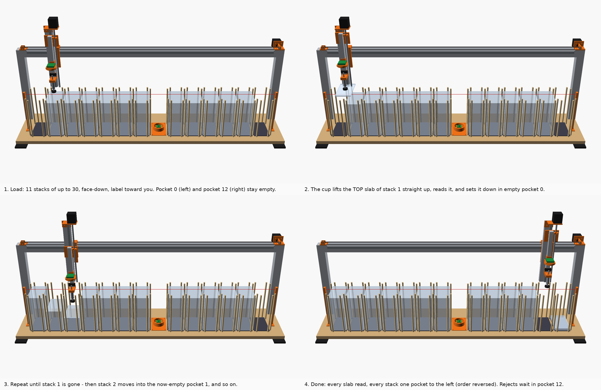

# SlabRail: design rationale and engineering checks

Confidence tags: **[Certain]** = measured, computed, or checked by the CAD/simulator here.
**[Likely]** = strong inference. **[Guessing]** = needs a real-slab test (see "Phase 0").

## 1. What it does

You load up to **330 slabs**: 11 stacks of up to 30, face-down. The machine reads every one,
unattended, and writes a CSV of cert numbers with a photo of each label.

The run works like this:

1. The cup lifts the top slab of stack 1 straight up. A camera on the head reads the back of
   the label (QR code / barcode).
2. The cup puts the slab down in the empty pocket next to it.
3. The next slab is now on top, and the cycle repeats.
4. When stack 1 is gone, stack 2 moves into pocket 1, and so on down the row.

Slabs whose back has no readable code (pre-2016 labels, damage, glare) take a detour. They are
held over an **upward camera** in the middle of the row, which reads the front label
(barcode + printed digits). Anything still unreadable, read only by OCR, or from a grader other
than PSA/CGC, goes to the **exception pocket** at the right end.

## 2. Why this architecture

| Option | Verdict | Reason |
|---|---|---|
| Buy something | None exists | [Likely] No product feeds 200–300 graded slabs unattended. Raw-card sorters (Roca, PhyzBatch, SortSwift) exclude slabs. Sheet-fed scanners are rated "Slabs: No". See RESEARCH.md. |
| Hands-free 2D presentation scanner (~$350–650) | Best no-build option | [Likely] 20–30 slabs/min by hand, ~10 min per 250. The machine saves that time and adds a photo of every slab. |
| Gravity hopper / friction feeder | Rejected | [Certain, arithmetic] The bottom slab gets dragged out under the whole stack. A 300-slab column is about 2 m tall and 15–18 kg, so that's ~60 N of face-on-face drag across a glossy front. PSA slabs have no stacking ridges. |
| Slotted racks, lift-and-read in place (concept A) | Rejected | [Certain, slot geometry] A straight lift hits the neighbouring slab. It only works if every slab leans at 10°, which leaves 2.2 mm margins. Loading is one slot at a time. |
| Desktop robot arm (concept D) | Rejected | [Likely] Reach covers about 80–160 slabs. The arm that reaches 300 costs about twice the budget. |
| **Short stacks + top pick by vacuum, one-pocket shuffle (concept B)** | **Chosen** | Two separate research passes and the concept comparison (§2a) both arrived at it. No slab ever slides on another. The cup touches only the back. Loading is fast because you drop in handfuls. |
| B on a 2-D grid (4 motors) vs **one row (2 motors)** | **One row** | You asked for the fewest moving parts. One row removes the whole Y axis: 2 motors, 2 rails and the gantry squaring. Cost: a footprint of about 1.44 m × 0.29 m (CAD, feet included; the bed is 1416 × 289.5 mm). The grid version is in git (`grid-variant-v1`). |

### 2a. Concept comparison (and what changed because of it)

During design, five candidate concepts (A–E) were each worked out in depth and then scored 1–10
against the requirements under three headings: slab safety, reliability/buildability, and practical
value. This was an internal, structured comparison made while designing, not an outside review: an
outside review is what this package is for.

**Scores (1–10, from the internal comparison)**

| Concept | Safety | Buildability | Practical |
|---|---|---|---|
| A, slot racks | 6.5 | 6 | 5.5 |
| B, stacks + vacuum (the parent of this design) | 5 | 6.5 | 4.5 |
| C, shelf modules, pull and read | **8** | 4 | 4 |
| D, robot arm | 3 | 3 | 2.5 |
| E, "flip-through lanes" page-turner | 6 | **7** | **6.5** |

**Why this is still B (as SlabRail), not E.**
- [Likely] E's slab physics is unproven. Its own write-up says so. It needs 300 hand-loaded slabs
  in a row to peel, pass a 2.6–4.3° balance point, and settle flush, every time.
- Pick-and-place of flat, smooth parts from stacks is what every SMT and packaging line does.
  Its failure modes are known, detectable and simulated here.
- The comparison scored the original B, a 4-motor grid. The objections raised against it in the
  comparison, and how SlabRail answers them:

| Objection raised in the comparison | How SlabRail answers it |
|---|---|
| Fingers can't reach slabs in tight corrals | Separate dowels, not walls. There is a 52 mm finger gap at the front and back of every pocket for lowering bundles of 5–10 when loading, and for taking slabs off the top in bundles of up to 5 when unloading. Never lift or flip a whole stack (OPERATING.md §6). |
| Printed posts can lean | Dowels sit in drilled holes, 15 mm deep, drilled through a printed vertical guide. |
| Air-film double picks | The slow leg of the peel (2 mm/s) is placed where the cup really leaves the slab: at the probe trip the spring buffer is already squeezed about 2 mm (`buffer_trip_mm`, measured in BUILD_GUIDE §7.6), so the head first rises that far at 20 mm/s while the cup stays on the slab, then 2 mm/s through the release point and 1 mm past it, then a 0.5 s dwell low over the stack, so a slab clinging by an air film falls back a few mm onto its own stack. Squeeze-film force scales with speed, so it falls about 10× to ~0.1 N, below the slab's weight. Doubles are still detected at placement. |
| Klipper probe macro fragility | FluidNC native `G38.3` with an explicit bounded target. |
| Too many moving parts | 2 motors instead of 4. No gantry squaring. |
| "Flipping and un-reversing costs more time than it saves" | Don't flip anything. Order doesn't matter, because the CSV records each slab's exact pocket and position, and unloading goes top-down in small bundles (OPERATING.md §6). Face-down loading is a hard rule: before the cup touches a slab, the head camera must see a back-label code (a PSA or CGC back QR, or the CGC 2020–23 back barcode) or, in the default learned mode, a card back it learned from proven slabs (§5); otherwise the run stops untouched for you to check. The head leaves the card window clear (the lens sits 5 mm toward the label) [Certain, CAD]; until the learned check is active, PSA 2016 and older labels, CGC Authentic, BGS and SGC stop, unless the run is started with `--all-face-down`; then a face-up slab would get the cup on its front. |

- **What we keep from the other concepts:**
  - fail-safe sensor wiring;
  - a pre-run survey (every pocket probed while you are still there);
  - the Phase 0 tests before buying motion parts;
  - a photo of every slab;
  - CSV written incrementally;
  - count reconciliation.
- **Honest residuals:**
  - Every slab is lifted and carried. A vacuum loss drops it at most about 240 mm onto foam or a
    stack.
  - Hands-on time is still ~10 min per 300 for loading and unloading.

## 3. Everything that touches a slab

| Contact | Motion | Force | Worst case |
|---|---|---|---|
| Suction cup on the **back**, centre of the card window | Static. The cup only moves vertically while touching. | Trips at ~1.2 N [Likely, SMC catalog spring force]. Vacuum clamp ~19 N over the 25 mm lip. | A faint cup ring or a grit micro-mark on the **back** (allowed). Mitigations: non-marking PU/HT1 cup, IPA wipe each run, 24 h marking test before use. |
| Slab front resting on the back of the slab below | Static. Pick = straight lift, 2 mm/s through the point where the cup leaves the slab, then 20 mm/s, with a 0.5 s pause just above the stack. Place = probed set-down at 20 mm/s (`G38.3`). | ≤ 2 N at contact. Bottom slab of a 30-stack carries 19 N (1.8 kPa, same as stacking by hand). | Lateral slip at placement if a slab lands crooked. This is the most plausible front-scuff path. [Likely] Mitigated by ±1.75 mm pocket play, rods only at the edges, and slow probed set-down. |
| Bottom slab front on the pocket pad | Static | ≤ 19 N | Grit on the pad. Wipe pads weekly. Microfiber face. |
| Slab edges on 8 mm wooden dowels | Only if the slab is off-centre by > 1.75 mm | < 1 N | Edge rub on wood. The dowels sit 12 mm from every corner, so corner tips never touch. |
| Head / camera / Z parts | None by design | — | [Certain, CAD] ≥ 5 mm at every checked pose, including a held slab at the Z top hard stop and a double pick of two thick holders; much more in normal travel (numbers in `cad/out/checks.txt`, §6). The lead screw is cut so its tip stays above anything the head carries. |

**Drops.** **[Certain, arithmetic]**
- Losing vacuum at carry height means a fall of ≤ about 240 mm, about 0.15 J, onto a stack or
  pad. That is roughly a 25 cm desk drop. A flat landing is very unlikely to crack a slab
  [Likely]. A corner landing on a dowel top could chip one [Guessing].
- Exposure: about 2 s in the air per cycle for a slab whose back reads. A slab that needs the
  station is held longer: the front frames are taken over the lens, then decoding and OCR (up to
  30 s on a Pi) happen with the slab over its planned output stack, not over the camera.
- Both solenoid valves are normally closed, so a power cut (E-stop, mains) seals the cup line.
  **The reservoir does not help then:** it is on the pump side of the closed vacuum valve. The
  slab hangs only as long as the cup line's own leak allows, seconds to minutes. [Certain, the
  plumbing in `hw.py` and BUILD_GUIDE §8.1] Acceptance test 13.4 measures it. While the Pi still
  has power (Ctrl-C twice, a USB cable out, a park that failed) the software keeps the pump holding
  a slab until you take it.

**Crash prevention, layered.**
1. **Height bookkeeping.** Every slab's thickness is measured when it is placed (the probe step).
2. **Every downward move is a probing move.** Each one is a `G38.3`, so an unexpected contact stops
   the head at once instead of driving on; probe windows never go more than 12 mm past the expected
   surface. A trip at full Z speed squeezes the 20 mm buffer about 6 mm (about 1.6 N [Likely]).
3. **Fail-safe contact sensor.** A cut wire reads as "touching", so the machine refuses to
   probe.
4. **Probe hard limit** (firmware). A contact-sensor trip during any move that is not a probe (a
   lift, a traverse) is an immediate critical alarm.
5. **Second contact sensor.** During the start-up survey, a cup that seals without the optical
   sensor tripping stops the run.
6. **Overfill laser beam.** It runs 4 mm above the fill line. If anything is too tall, the
   machine won't start. It cannot see anything above the 218 mm rod tops, such as a slab lying
   across the rods: the survey catches that, because its first probe window starts at travel
   height.
7. **Face-down check.** No back-label code seen from above = the cup does not touch the slab,
   unless the learned check (the default mode, §5) matches its card window with two card backs of
   proven slabs. A front-label code seen from above stops with a FACE-UP message; back and front
   codes together, two back labels or two certs in one frame mean a neighbour's label, and stop.
   Modes: `learned` (default), `stop` (back-label codes only), `off` (or `run --all-face-down` for
   one batch).
8. **Carry-height sensor (Z stall guard).** A slotted optical sensor on the Z spine and a flag on
   the Z carriage: blocked from c = 246.5 up to the top stop, clear below. Before every sideways
   move it must read blocked, and before every grip clear (a dead emitter or dirt reads blocked).
   A loaded head that stalled more than about 2.5 mm low therefore stops the run before it moves
   sideways; one that still reads blocked (c ≥ 245.5) carries even a double pick of two thick
   holders 2.5 mm over the rods. [Certain, CAD and simulator] After a stall the head never moves
   sideways with a slab: over its own pocket it probes straight down and vents, elsewhere it holds.
   Empty travel runs at 248 too, so the sensor's single edge sits just under both travel heights
   (about +0.2 s a slab). Not covered: `jog`, `calibrate` and `mark`.
9. **Plausibility checks.** A stack taller than predicted by > 4.5 mm, a vent that does not reach
   atmosphere, a vacuum sensor reading outside its range, or an exception pocket that's full stops
   the run. After any stop the head re-reads its real position, lifts straight up, and puts a held
   slab back; where that is unsafe, nothing moves and the pump keeps holding it.

## 4. Calculations

| Quantity | Value | Margin |
|---|---|---|
| Cup holding force, Ø25 mm at −50 kPa (78% effective area) | 19.1 N | Slab weighs 0.64 N → **SF 30** vertical [Certain, arithmetic; the 78% effective area is an estimate] |
| Cup holding force at the software's seal level, −35 kPa (`vac_seal_kpa`) | 13.4 N | **SF 21** on the 0.64 N slab, 19 with the 1.2 m/s² Z acceleration [Certain, arithmetic; same 78% area]. A grip counts as sealed only at this level or deeper. |
| Cup holding force at the transit alarm, −25 kPa (`vac_transit_alarm_kpa`) | 9.6 N | **SF 15**, 13 with the Z acceleration [Certain, arithmetic; same 78% area]. A carry that has not raised the alarm holds at least this. The slab falls off at about −1.7 kPa (BUILD_GUIDE §13.4). |
| Lateral grip vs X acceleration 2 m/s², at −50 / −35 / −25 kPa | ~9.3 / 6.4 / 4.5 N vs 0.13 N | **SF ≈ 70 / 49 / 34** [Certain, arithmetic: friction on the clamp force less the slab's weight; the friction coefficient of about 0.5 between cup lip and slab is a guess] |
| Z load (0.75 kg head, 1.2 m/s²) | 8.3 N → 0.026 N·m on T8×8 at 40% efficiency (conservative: the screw's 20° lead angle gives about 50–65% at a friction coefficient of 0.15–0.25 [Likely]) | A 1.5–2.0 A NEMA17 at 750 rpm on 24 V gives ≈ 0.15–0.2 N·m at full current, but Z runs at 0.8 A (40–55% of rating) → ≈ 0.06–0.1 N·m, **SF ≈ 2–4** [Likely]. Spinning up the rotor and screw adds about 0.006–0.009 N·m at 1.2 m/s² [Guessing: a 60–80 g·cm² rotor]; the CAD mass row below shows that the 0.75 kg covers it. The carry-height sensor catches a stall before the next sideways move but does not prevent it, so the 100-lift test (BUILD_GUIDE §7.8) must pass. A high-impedance 0.4–0.6 A "integrated" motor would stall: the BOM excludes it. |
| Z back-drive when unpowered | ~0.005 N·m (0.75 kg at a back-drive efficiency of about 0.5; 0.4–0.7 for a friction coefficient of 0.2–0.1 gives 0.004–0.0065 N·m) | NEMA17 detent ≈ 0.015 N·m → holds [Likely]. Hold current is kept on anyway. |
| X drive (1.9 kg moving, 2 m/s² + 2 N friction) | 5.8 N belt → 0.037 N·m on the 20T pulley (+ about 0.003 N·m for the rotor [Guessing]) | The 17HS19-2004S1 (0.59 N·m holding at 2.0 A) runs at 1.0 A: about 0.3 N·m holding, less at 375 rpm, so ≈ 0.15–0.3 N·m → **SF ≈ 4–8** [Likely; no torque curve read] |
| X beam sag, 4040 resting on the uprights (1376 mm between their centres), 20 N at midspan | 0.18 mm (simply supported; E 69 GPa; I = 8.89 cm⁴, Misumi's catalog value for HFS5-4040 [Likely, read from a catalog extract]) | Vertical: every set-down is probed, so it uses none of the pocket play; BUILD_GUIDE §4.5 checks ≤ 0.3 mm. The beam's slope under the moving load tilts the head by under 0.02°, under 0.1 mm at the cup in X against ±1.85 mm of play. The beam's own weight (1.28 kg/m) adds a fixed 0.10 mm at midspan. [Certain, beam formula] |
| X beam twist from the head overhang (cup axis 127 mm in front of the beam centre) | ≈ 0.5 mm in Y at the cup near the pad, worst at midspan; 0.3–0.8 mm for a torsion constant J of 2.5–1.0 cm⁴ [Guessing on J: no published value found for a slot-6 4040] | θ = T·L / (4·G·J) with both ends fixed in torsion: T = 1.93 kg × g × 77 mm = 1.46 N·m (the CAD puts the carriage's centre of mass 77 mm in front of the beam centre, not 127), L = 1.376 m, G = 26 GPa, times the 400 mm from the beam axis to the cup face. The earlier 0.8 mm put all 1.9 kg on the cup axis. The corner brackets and the rail block's play are not included. Within pocket play. Measure it during build (BUILD_GUIDE §6.7). Add a rear brace if > 1 mm. |
| Spring buffer force at trip (2 mm) / end of a probe window (14 mm) / bottomed (20 mm) | about 1.2 / 2.4 / 3.0 N [Likely: SMC lists 1.0 N at rest and 3.0 N at full stroke for ø10–32 buffers] | The software never probes more than 12 mm past contact; a trip at 6000 mm/min squeezes about 6 mm. The `ZPT25UUK20-B5-A10` has 20 mm of stroke: SMC sells no 25 mm stroke on a 25 mm pad. [Certain, SMC ZP catalog Table 2] |
| Stack height, 30 PSA slabs at 6.25–6.9 mm | 188–207 mm | MAX line 210, overfill beam at 214, rod tops 218 |
| Carry height (cup), loaded and empty | 248 mm | A **double pick** of two 11.5 mm thick holders still clears the rods by 5 mm, counting the free cup's 2 mm hang below its calibrated height [Certain, CAD]. The carry sensor trips at 246.5: a head it still sees as "up" (≥ 245.5) clears them by 2.5 mm. |
| Moving mass, Z head (CAD: `build.assembly('carry')`, parts in group `head`) | 0.40 kg from CAD volumes and catalog masses; ≈ 0.46 kg with the T8 nut and the head's share of cables and tube [Guessing]; ≈ 0.53 kg with a 65 g slab | Under the 0.75 kg used above. With 0.53 kg: 0.0185 N·m + 0.006–0.009 N·m of rotor and screw inertia = 0.025–0.027 N·m, so **SF ≈ 2–4** at 0.8 A still holds [Likely]. The 0.75 kg plus that inertia would need 0.033–0.035 N·m (SF ≈ 1.7–3). Back-drive with 0.53 kg: 0.003–0.005 N·m. |
| Moving mass, X carriage (groups `carriage` + `head`) | 1.62 kg from CAD volumes and catalog masses; ≈ 1.87 kg with T-nuts, screw shanks, the belt and the drag chain's moving share [Guessing]; ≈ 1.94 kg with a slab | Matches the 1.9 kg used above (5.9 N, 0.037 N·m): the X margin is unchanged. Its centre of mass sits 77 mm in front of the beam centre (twist row). |

**Mass rollup inputs.** Volumes are the solids of `build.assembly('carry')` (`cad/build.py`), summed by
`Part.group`. Printed parts: PETG at 1.27 g/cm³ × 0.71, the solid fraction BOM.csv gives for the listed
walls and infill (about 720 g of 1020 g solid) [Guessing for each part]; belt clamps at 100%. The
aluminium flags, the steel buffer and lead screw (a solid Ø8 in the CAD) and the fastener heads (the only
part of a screw that is modelled) use their CAD volume at 2.70 and 7.85 g/cm³. Extrusions, rails and
carriage blocks are solid envelopes in the CAD, so catalog values replace them: the 2040 and 2020 at
Misumi's 324 and 183 mm² sections × 2.70 g/cm³, the MGNR12 rail at 0.65 kg/m, each MGN12H block about
0.05 kg [Likely]. Z motor body 0.36 kg; head camera 20 g, LED ring 5 g, cup 9 g, each sensor board 4 g,
M5 elbow 3 g [Guessing]. Heaviest items: Z motor 0.36 kg, Z spine 0.30, Z rail 0.22, drop arm 0.14, lead
screw 0.13, printed parts 0.22 (0.15–0.31 kg for a solid fraction of 0.5–1.0).

## 5. Reading the label

- **Glare geometry.** The station camera sits on the slab's centre axis, the head camera 5 mm from
  it toward the label end, each with a small LED ring around the lens. **[Certain, mirror
  geometry]** The mirror reflection of a ring of radius r lands within r/2 of the lens axis, so
  within about 10 mm for the head's 40 mm ring (11 mm for a 42.5 mm one) and about 16 mm for the
  station's 63 mm ring. The label band sits about 40–65 mm off the lens axis, so it is glare-free without
  polarisers. That avoids the slab plastic's stress-birefringence "rainbow" risk that
  cross-polarisation has. [Likely] Room lights reflecting off the slab plastic are a minor effect.
  The LED ring is several times brighter on the label than a ceiling light's reflection, so contrast
  drops a little but nothing saturates. If Phase 0 shows glare anyway, add the optional black
  foam-board light roof.
- **Resolution.**
  - Head camera (8 MP IMX179, 3.6 mm lens, 140 mm away): 0.055 mm/px.
  - Station (Camera Module 3): 0.039 mm/px.
- **Decode sweep on synthetic labels in the real formats** (`software/tools/decode_sweep.py`):
  - **[Certain for the synthetic labels]** The back QR + barcode reads at ≤ 0.14 mm/px through
    blur and strong glare.
  - The front barcode needs ≤ 0.05–0.08 mm/px and low glare.
  - **No misreads occurred in any cell of the sweep.**
- **What real labels carry** [Certain, decoded from 64 real slabs' public studio scans; RESEARCH.md
  §4]. These formats are the rules in `slabscan/certs.py`:

| Label | Back label | Front label |
|---|---|---|
| PSA current (9-digit certs, some 8) | QR `https://www.psacard.com/cert/<n>/` + Code128 `<n>` | Code128 `<n>` |
| PSA 2017+ "lighthouse" (8-digit) | QR `http://psacard.com/cert/<n>` (or the https form) + ITF | ITF |
| PSA 2016 | ITF only | ITF |
| PSA before 2016 | no code | ITF |
| CGC 2023+ (10-digit certs, a few 140 + 10) | QR `https://www.cgccards.com/certlookup/<n>/<grade>/` | Code128 `<n>` |
| CGC 2020–23 "OG" | QR `…cgccomics.com/certlookup/<n>/<grade>` + Code128 of 26–28 digits ending in `<n>` | no code |
| CGC Certified Authentic | no code | QR `…/certlookup/<n>/0_0/` + Code128 `<n>` |
| BGS, SGC | no code | no code (printed cert only) |

- **Interpretation rules** (`slabscan/certs.py`, tested on the real payload strings):
  - **A QR names the cert and is `ok` on its own:** it carries its own error correction. PSA and CGC
    QRs are parsed with a right boundary, so a longer number is rejected, not cut. A CGC cert keeps
    all its digits: the old rule cut a real 13-digit cert to 12 and called it `ok` (a silent wrong
    cert, now a test).
  - **Bare digits are typed by symbology and length:** ITF of exactly 8 digits is a PSA cert (the
    cert zero-padded; any other ITF length is a misread, and a glare-cut `289412` was seen); Code128
    of 26–28 digits is a CGC OG back (the cert is the last 10); Code128 of 10 digits not starting
    with 0, or 140 + 10, is a CGC front; Code128 of 8–9 digits is PSA (every real one). A Code128 in
    none of these formats (7 digits, or 10 starting with 0 like the BGS cert `0019865140`) is not
    typed: it is listed as unparsed and proves no label side, so a slab with nothing else ends in
    the exception pocket. [Certain, `certs.parse_payload`; 0 of the 119 distinct real payloads
    parse differently after this change] There is nothing left to learn about the ITF: the old
    padding-or-check-digit model could never learn on real labels and held every 2016 slab back.
    [Likely] An 8-digit Code128 with a leading zero still parses as a 7-digit PSA cert; the only
    real one seen is the phantom `09435764`, which the phantom guard needs to see.
  - **A barcode-only result (ITF or Code128, any grader) needs two printed symbols** (back + front
    label) **or OCR of the printed digits to agree.** One printed symbol is one source: the head
    camera's hover and held frames count once, and so do the station's. OCR that disagrees makes it
    `needs_review`.
  - **OCR also checks every barcode-only `ok`.** Both labels of a PSA 2016 slab print one ITF, and
    current labels one Code128 on both sides, so one fixed misread of a printed pattern can come
    back from both and agree on the wrong number. OCR that reads other digits makes it
    `needs_review`; OCR that reads nothing leaves it `ok`. The cost is one station visit and one
    OCR per slab without a QR read. [Certain, `runner.needs_ocr`; tested]
  - **An `ok` needs its grader confirmed** [Certain, `certs.consensus`, `certs.psa_itf_confirmed`]:

    | Evidence for the grader | Grader on an `ok` |
    |---|---|
    | A code that names it (a cert URL: PSA or CGC QR) | confirmed |
    | Two different printed symbols in its format (back + front label barcode) | confirmed |
    | An 8-digit ITF whose digits OCR of the printed number confirms | PSA (note "grader PSA from its 8-digit ITF") |
    | One barcode in a grader's format, even with OCR agreeing (one Code128) | not confirmed: `needs_review`, grader kept ("grader … not confirmed") |
    | An 8-digit ITF alone, or with OCR that read nothing | `needs_review` ("one printed barcode only") |
    | An 8-digit ITF with OCR that read other digits | `needs_review` ("barcode N but OCR read M") |
    | A code in no grader's format (bare digits in a QR, EAN-8, Codabar, Code39, a keyed "Cert #"), even beside an ITF | never confirms a grader |
    | OCR only | `needs_review`, grader `unknown`, exception pocket |

    The ITF rule makes a pre-2016 PSA slab (front ITF only) `ok`. It holds because in the real set
    ITF is printed only on PSA labels (CGC uses Code128; the 1 BGS and 1 SGC slab showed no code),
    and OCR reads the printed number on the slab in the cup, independently of the barcode's digits.
    [Certain, real set: 5 of 7 pre-2016 slabs `ok` native, 7 of 7 at machine scale; a stress run of
    316 ITF-rule `ok` frames gave 0 wrong certs] Only a `needs_review` with grader PSA or CGC may
    stay in the output stack; `unknown`, `PSA/CGC` or no grader goes to the exception pocket. A
    grader guessed from the length still counts, so another grader's slab whose barcode has a PSA or
    CGC format can reach the output stack as `needs_review` [Certain, a direct test of `certs.parse_payload`:
    a 10-digit Code128 is typed CGC], and another grader's 8-digit ITF that OCR confirms would read `ok PSA`
    [Guessing that one exists]. Two settings switch the ITF rule off in effect: `custom_regex`
    (every ITF is then typed by it) and a `psa_cert_digits` without 7.
  - **OCR finds a digit run, not a grader.** Tokens are 8–10 digits or 140 + 10. An OCR-only number
    is `needs_review` with grader `unknown` and always goes to the exception pocket (OCR also reads
    card numbers: `0079865140` for a BGS `0019865140`). OCR runs on a crop of the label band (3.2
    barcode lengths along, 0.6 across) with `OMP_THREAD_LIMIT=1`: with Tesseract's default threads
    it timed out on every frame of a loaded 4-CPU computer [Certain, measured].
  - **Phantom guard, twice.** `decode.py` drops a linear read lying inside another read of the same
    symbology and under a third of its thickness (the real `09435764` inside `27435764`).
    `consensus` then drops a phantom that got through, from every frame of that symbol, but only
    the thin read inside the other read's box (under half as thick, centre inside), and only when a
    different symbol (the QR, the other label side) or OCR confirms the other number ("dropped a
    phantom read …"). If the confirmed number is the thin read, nothing is dropped and the slab is a
    `conflict`; two reads whose boxes do not overlap are two labels, never a phantom. [Certain,
    `certs.drop_phantoms`; tests on the real payloads and boxes]
  - **Decode passes:** on head-camera frames the CLAHE pass runs before the early exit when only a
    barcode was found (a QR the plain pass missed can decide the face-down check); station frames
    get an extra 0.75× / 0.6× downscale pass (CGC front Code128s with ink-spread bars read there).
  - **Head frames are cropped to the slab under the cup** (`head_roi_half_mm` = 38.3 mm either side
    of its centre line), because the 3.6 mm lens also sees the neighbours' labels and, beside the
    slab, the lower neighbour stacks. The frame taken from above the stack alone never makes an
    `ok`, and a cert already recorded in the batch becomes `conflict` (exception pocket).
  - **The back-label code that proved a slab face-down must be its own:** if the reads of the slab
    in the cup do not show that cert, or show another one, the slab is `conflict` ("… may have been
    FACE-UP …, check it by hand").
  - **`psa_cert_digits`** (set from Phase 0): a PSA cert of a length Phase 0 never saw is
    `needs_review`.
  - **Codes that disagree** produce `conflict` and the slab goes to the exception pocket. The
    machine never guesses.
  - **CGC** is read and stacked like PSA. A **BGS/SGC/TAG** URL gives `other_grader` (exception
    pocket); real BGS and SGC labels carry no code, so they end as `no_read` or OCR-only.

### Face-down: what a code seen from above proves

Only rules that held on every real label of their kind may prove a side [Certain, 64 real slabs;
`certs.SIDE_PROOFS`]:

| Code seen by the head camera | Proves | Evidence |
|---|---|---|
| PSA QR (`psacard.com/cert/`) | **face-down** | never on 35 PSA front images; on every 2017+ back |
| CGC QR with a cert and a grade other than `0_0` (cgccards or cgccomics) | **face-down** | 0 of 26 graded CGC fronts have a QR; every 2023+ and OG back has one |
| CGC 26–28-digit Code128 | **face-down** | OG backs only; OG fronts carry no code |
| CGC QR with grade `0_0` | **face-UP** (Authentic front) | both Authentic fronts; their backs decode nothing. One official render of a 2023+ back also shows `0_0`: a wrong face-up call only stops the run |
| CGC 10- or 13-digit Code128 | **face-UP** (CGC front) | 0 of 26 2023+ backs carry a Code128 |
| CGC QR without a cert | nothing (a hint in the message) | press images and mock-ups only [Likely] |
| PSA ITF or Code128 | nothing | printed on both labels |

- **Back and front codes together, two different back labels, or codes of two different certs in
  one frame** mean another slab's label is in view: the run stops.
- **Measured** [Certain, `tools/real_eval.py`]: 50 of 64 real backs proven face-down, 24 of 64 real
  fronts proven face-up, 0 false proofs either way (native scans); 48 and 23, 0 false, in the
  machine-equivalent frames. The 14 backs left unknown are exactly the slabs with no back-label
  code. These rules were written from the same 64 slabs, so this shows they fit them, not that
  they hold on new ones.
- **Every back-code proof teaches the learned check** (CGC included), once the slab is placed and
  its own read agrees (below).

### The learned face-down check

**Why.** Slabs with no back-label code (PSA 2016 and older, CGC Authentic, BGS, SGC) stop the plain
check every time: 43 of 330 in the simulator's default mix, 14 of 64 real slabs. Most of them show
the same card back through the plastic, and a face-up slab shows a card front there instead.

**The descriptor** (`slabscan/facedown.py`) [Certain, code]:
- Only the card window, `face_down_window_mm` (x −27.5 … 27.5, y −18.5 … −13.0 mm from the
  head-camera axis = y −23.5 … −18.0 from the cup axis, −y = the label end; 55 × 5.5 mm =
  302.5 mm², at least 300 required). It comes from the CAD (`layout.face_down_window_cam()`),
  placed from the card positions measured on 22 PSA and 27 CGC backs (`layout.HOLDERS`): 11.0 mm
  clear of the label band and clear of every head part at hover and held [Certain, `checks.py`
  frustum checks]. On the card plane (3.5 mm under the slab back, rounded corners) a PSA slab keeps
  it on the card anywhere in its play; a CGC slab pushed into a pocket corner has 1.52% of it on
  the holder (4.5% if the 3.5 mm were all air), checked against a 2% limit [Likely, `checks.py`].
  The window shrank from 632.5 mm² because the earlier, larger one let 12 of 206 face-up CGC fronts through
  in an emulation of the real scans with every slab at the cup end of its play [Likely]: the strip
  of holder above a CGC card looks the same from both sides.
- Each rectangle is cropped with a 4 mm margin and box-resampled to 1 px/mm. That removes noise,
  focus and JPEG differences and about 1° of yaw, and costs about as much as a thumbnail.
- Glare (a 1 mm average at grey level 245 or more, grown by 2 mm) is masked everywhere.
- Pattern term: the window minus its own blur (σ 4 mm), so exposure and light fall-off drop out;
  normalised cross-correlation at every shift within ± 4 mm (the slab's play in its pocket).
- Colour term: a hue-saturation histogram (a grey-level histogram on grey frames).
- **Score = the lower of the two, and a slab needs two references** (from two different slabs of
  the matched back design) at the threshold, not only the best one. A false accept puts the cup on
  a front; a false reject only stops the run.
- Cost [Certain, measured on the development computer, not a Pi]: about 2 ms to describe a full 3264 × 2448
  frame and about 2 ms to compare it with 48 references. [Guessing] 10–20 ms on a Pi 5. It adds one
  head frame per run (the empty-pocket view), none per slab.

**Safety layers** [Certain, code; tested in the simulator]:
1. **References only from proven slabs,** and only once the slab is placed: a back-label code seen
   from above, if the slab's read is `ok` with the same cert and the read station saw no
   back-label code from below; your `--face-down-ok`, with the same placement checks and never with
   a front-label code in view; the Phase 0 seed. A learned acceptance never becomes one. A back
   design known only from your confirmations is used once 3 agree.
2. **Two references per match:** a new back design starts with one slab and matches nothing until a
   second slab joins it, so one odd reference (or one front taught by mistake) is never enough.
3. **`--face-down-ok` confirms one slab:** only after a face-down stop, only the top slab of that
   pocket. The web tick appears only then and is cleared after each resume.
4. **A texture floor**, and a match needs at least half the matched back design's own texture
   (a plain front with a glare spot has some texture, far less than a back).
5. **Glare:** a window with more than 2% glare never becomes a reference; more than 30% is not
   matched.
6. **The empty-pocket guard:** one head frame over an empty pocket per run. A window whose pattern
   looks like it (similarity ≥ 0.5) shows the head, not the slab: it neither matches nor teaches.
7. **The occlusion check:** on the newest 5 or more slabs proven on this machine, a pixel that
   tracks the empty-pocket view by the frame's exposure ratio moves with the camera. More than 10%
   of the window like that: the mode is not active.
8. **A measured threshold:** Phase 0 compares at least 10 usable backs with each other and with
   at least 15 face-up slabs, each face-up frame also with 4 reflections added in software, all by
   the same 2nd-best rule; a back that matches none of the others is left out. GO needs a gap of
   0.10; the threshold is the midpoint, never below 0.55. It is stored with a tag of the window and
   descriptor it was measured for (`face_down_threshold_sig`) and refused without it.
9. **At least 5 references** (`face_down_min_refs`).
10. **The camera-aim check** (`facedown.aim_problem`), on the same view over an empty pocket: in
    the middle ±12 mm of the window along the row, over its full height and 1 mm beyond its
    cup-side edge, only the pad far below may show. More than 2 mm² of high-passed edges (4 grey
    levels or more) there means a head part is in the window, or about to be: the mode accepts and
    learns nothing that run, and the start line, every stop, the summary (`CAMERA AIM:`),
    `summary.json` (`camera_aim`), `selftest` and `focus head` say to re-aim. [Certain, sim: a
    square camera passes; with today's window it fires from 1.30°, the part entering at 1.33°]
    A verdict counts only for the run that took it (`CardBackRefs.stale`). A resume looks over an
    empty pocket at its survey (as before); if none is empty, it now accepts and learns nothing
    until it has emptied its first source pocket and looked over that, so a camera knocked while
    the run was stopped is seen [Certain, sim: a 1° knock caught with and without an empty pocket;
    the no-empty-pocket tests fail on the code before this change]. The cost: with no empty pocket, every slab
    without a back-label code stops until then, so the operator should empty pocket 12 first.
    Its blind spots:
    - a head part as dark as the pad shows no edge, and layer 7 does not catch it either while it
      covers a strip of the window (a pad-dark foot over 9–26% of the window read 0.3–0.9%
      camera-locked) [Certain, sim];
    - only a tilt toward the cup is checked: a tilt away from it or a roll along the row moves the
      window toward the card top or off its side, and nothing sees that [Certain, code];
    - the outer window beyond ±12 mm also sees this pocket's rods and the neighbouring pockets, so
      it cannot be checked there [Certain, CAD];
    - the thresholds were set on the simulator's flat, noiseless pad: pad mottling, dust specks of
      about 1 mm, a tag or a sharp shadow made it fire on a square camera in a synthetic probe
      [Certain, synthetic]. That is safe but strict; a real empty-pocket frame from Phase 0 is
      needed to tune it.

**Limits.**
- [Certain, CAD aim check] **Camera aim:** a head-camera tilt of more than 1.34° toward the cup
  puts the cup pad into the window (1.31° with the software's own 147 mm mapping, by a separate
  ray cast). 1.5° is out of reach: the cup pad sets the limit, and a window that clears it at 1.5°
  leaves under the software's 300 mm². Layer 10 catches a tilt toward the cup from about 1.3°;
  its blind spots are above. A head edge about 1 mm inside the window raised face-up scores in the
  simulator from 0.37 to 0.52 (hence the 0.55 floor). BUILD_GUIDE §12.3 checks the frame; [Likely]
  an M2 washer shim corrects about 0.5°.
- [Likely, CAD card-plane check] **CGC holders:** a CGC card top lies 93.8–96.2 mm from the
  holder's far end (27 real backs; PSA 97.2–100.0 on 22), so a CGC slab at the cup end of its play
  brings its card top about 3.4 mm nearer the cup than a PSA one. The window keeps about zero
  margin there: up to about 1.5% of it on the holder (4.5% at most), and a tilt of about 0.01°
  toward the label, or 0.10° of roll, takes it past 2%. The holder lengths and widths come from
  cropped scans and probably read short (CGC publishes about 80.0 × 134.6 mm) [Likely]; the card
  top to far end distance is the design input and is not affected.
- [Likely] **Ring glare:** the head ring's mirror image in the slab back covers 0.0% of the window
  for a slab square to the lens, 0.97 mm clear of the 2 mm glare halo. A slab tilted about 0.45°
  toward the label brings the halo in; from about 0.77° its frames stop becoming references (over
  2% glare).
- [Certain, real images; Guessing for the machine] **Real separation:** on studio scans of 63 real
  slabs placed as the machine would see them, with two references 0 of 332 face-up frames and 223
  of 252 face-down frames (glare included) were accepted at 0.55. With one reference, a Japanese
  blue Water-type front reached 0.62 under glare against one odd back; glare raised such scores.
  The real camera through slab plastic, sleeves, stickers and other games are untested.
- [Certain, sim] The simulator's face-up scores keep rising as the window shrinks: 0.24, then
  0.43–0.46 with the earlier, larger window, now 0.57 in the Phase 0 simulation (threshold 0.69, lowest
  back 0.81; the simulator now places each card where real holders of its grader put it). The margin is synthetic. [Likely, CAD emulation of the real scans] With today's window
  the highest face-up score is 0.49–0.53 against the 0.55 floor, and about 101–103 of 126 face-down
  backs are accepted (the earlier, larger window: 113–116).

## 6. Verification done here (no real hardware)

| Check | Tool | Result |
|---|---|---|
| Geometry: exact min-distance, all-pairs interference (including modelled fastener heads), held-slab sweep, hard-stop, rail-margin and line-of-sight checks at every pick, place, travel, station, hard-stop and Phase 0 pose | `cad/checks.py` (OpenCascade) | **177/177 pass** (re-run on 27 Oct 2026 after the printed-mesh fix with the same results, about 12–17 min; the numbers are in `cad/out/checks.txt`) [Certain]. Picking the last slab next to full neighbour stacks clears them by 14.55 mm (the probe board's M3×16 tips); loaded travel clears the rods by 21.4 mm, a double pick of two thick holders by 5.33 mm. Both LED rings are modelled (40 × 30 × 5 and 63 × 47 × 5 mm, with their solder pads and leads): seated with zero overlap, the barb elbow 3.75 mm from the head ring at the full 20 mm stroke, nothing in either camera's view, a 60 mm ring fits the station seat too. The head ring checks run at 39.5, 40 and 42.5 mm (the ribbed 42.8 mm seat; a 42.5 mm ring has 0.15 mm of radial clearance). **Home switches** (Omron SS-5GL geometry): X clicks at cup X 19.00 and Z at c = 258.00; each striker holds the lever 0.6 mm past its click point (at the lever tip) to the hard stop, under the 1.2 mm overtravel; the levers are free in normal travel; the mounts, screws, finger and leads clear everything that moves (closest 1.49 mm, the Z carriage to `z_switch_mount`); the longest lever each mount takes is 27.24 mm (X) and 24.19 mm (Z), against a 23 mm limit. **Not checked:** whether every intended hole is actually cut (a one-time audit of all 41 hole cuts on 27 Oct found the x_bracket belt-clamp M3 holes and the camera_bracket board holes missing, from a cutter-height bug; both fixed, no others found [Certain, audit; method in `cad/README.md`]), belt slack, cables and the vacuum tube, the real shapes of bought parts (the buffer, elbow, rings and switches are modelled from catalog or listing dimensions), loads and deflection, the side load the strikers put on the switch levers, and the corner brackets and joining plates. |
| Face-down card window | `checks.py` `check_face_down_window`, `check_camera_aim` | [Certain] exact frustums from the lens (5 mm toward the label) at hover over stacks of 1, 15 and 30 and with a slab held: 0.0 mm³ of any part in view, nearest part 1.74 mm (1.94 held); 302.5 mm²; 11.0 mm clear of the label band. [Likely] On the card plane, a slab in a pocket corner: PSA 0.0% on the holder (top +3.39, side +0.22 mm); CGC 1.52% (top −0.03, side −0.23 mm; limit 2%). Aim tolerance before a head part enters: 1.34° toward the cup, over 4° every other way. Before more than 2% of the window is on the holder: 0.49° (PSA corner slab) and 0.01° (CGC corner slab); before it leaves a median card on a centred slab: 1.32°. |
| Carry-height sensor | `checks.py` `check_carry_sensor` | [Certain] trips at c = 246.50; beam clear from −14 to 242, fully blocked from 248 to the 262 top stop; flag 1.05 mm from the sensor, flag arm 4.6 mm from every part fixed to the X carriage, its lead 11.0 mm from anything moving; a head stalled just above where it reads clear (245.5) still carries a double thick pick 2.5 mm over the rods. |
| Probe flag, guide and sensor over the buffer's 20 mm stroke | `cad/checks.py` `check_probe` | [Certain] trip at 2.00 mm; beam clear for 1.5 mm, fully blocked from 3 to 20 mm; flag 1.05 mm from the sensor and 0.45 mm from its guide; 8 mm guide engagement at full stroke; a rotating (J) buffer stopped at 1.32°, 0.6 mm from the sensor; buffer ± 3 mm on its thread still covered by the ± 4 mm board slots; pad 1.5 mm clear of the buffer body at full stroke; nothing in the label view while reading; a ball-end key reaches the front board screw (1.63 mm clear). |
| Phase 0 jig vs machine | `cad/checks.py` `check_phase0` | [Certain] the occluder (foot, buffer, flag, elbow, board) sits 0.0 mm from the machine's relative to the lens and blocks the same share of the slab view; the face-up pass (mount 3 mm up) leaves the free cup 1.0 mm above the slab's front; every jig wall an M5×10 passes through is 4.0 mm. |
| Unit tests: cert parsing on the real payload strings, grader and side rules (including the 8-digit ITF rule, tried over every combination of reads), phantoms, decode at the design point, OCR fallback, the learned face-down descriptor and the camera-aim check (including a resume with and without an empty pocket), the carry-height sensor, config checks | `software/tests` | **`300 passed, 1 skipped in 1410.97s (0:23:30)`** (full suite on the final code, 27 Oct 2026, after the config-default fix and the new test that keeps every config default equal to the CAD; slower than usual because the CAD checks ran at the same time) and the real-image test on its own: **`1 passed, 61 deselected in 137.29s (0:02:17)`** [Certain, pytest output]. On the code just before the last fix, the full suite with the real-image test gave `300 passed in 1202.90s (0:20:02)`. The skipped test runs `tools/real_eval.py` on the real image set when `SLABRAIL_REAL_IMAGES` points to it. |
| End-to-end batches in a simulator that **raises Crash on any unsafe move** | `software/tests/test_runner_sim.py`, `test_safety_fixes.py`, `test_bench_tests.py`, `test_face_down_learned.py`, `test_carry_sensor.py` | pass [Certain]. Scenarios: every slab moved and read; pre-2016 labels via the station; double pick detected; seal failure stops; overfill refused; CGC read, BGS to the exception pocket; face-down check, including FACE-UP and neighbour stops; an unexpected error with a slab in the cup; failed vent; vacuum sensor fault; Ctrl-C hard stop; a Z stall (40 mm and 10 mm losses) caught before the sideways move, a stuck or cut carry sensor, its selftest. Learned check: an old label passes once references exist; a face-up slab still stops; a plain face-up front with glare is refused; an earlier head design that hid the window and a partly hidden window are refused; one wrong confirmation, or a neighbour's back QR in the frame, does not teach a front; a back code seen from below vetoes a reference; a Japanese back needs 3 confirmations; `--face-down-ok` is refused after another stop; a lower neighbour's back QR beside the slab is cropped out. |
| 330-slab simulated batch (seed 7, default label mix, `--face-down-check`) | `sim --slabs 330 --face-down-check` | [Certain, sim, 23 Oct 2026, on the code of that date; the last fix touches only reads the simulator never makes, Likely] `needs_review 6, ok 324`: 5 BGS slabs OCR-only (pocket 12) and 1 pre-2016 PSA slab whose OCR read 9 digits (output stack). The other 20 pre-2016 PSA slabs are `ok` from their front ITF and OCR. No `ok` has a wrong cert or a wrong grader (checked against the simulated slabs). Face-down: 287 by back QR, 41 learned (lowest score 0.76), 2 confirmed (the first slabs, before 5 references existed); with back-label codes only, 43 would have stopped. `camera_aim: ok`. 14.2 s per slab, 79.4 min for the load (homing + survey 75 s), 991 head frames. With the head camera tilted 0.8° (`--sim-head-tilt 0.8`, the earlier, larger window, 110 slabs) the aim check fired and every slab without a back code stopped (15 of 110). The mix (PSA current 170, 2017+ 56, 2016 12, older 21; CGC 2023+ 49, OG 12, Authentic 5; BGS 5) is [Guessing], and every simulated slab is face-down: the learned acceptances say nothing about face-up safety (the unit tests and Phase 0 cover that). Phase 0 on the simulator: GO, lowest back-to-back 0.81, highest face-up 0.57, threshold 0.69 (the earlier, larger window: 0.82, 0.43, 0.62). The simulator places each card where real holders of its grader put it (`sim.HOLDERS`, the CAD's `layout.HOLDERS`). |
| Real labels: the machine's rules on public scans of 64 real slabs | `tools/real_eval.py` | [Certain for these images, 23 Oct 2026] Native (23 Oct 2026 code): `ok` 60, `needs_review` 2 (pre-2016 PSA: OCR read other digits on `19802594`, nothing on `20908923`), `no_read` 2 (BGS, SGC: no code), **0 wrong certs in `ok`, 0 false face-down proofs**. Machine-equivalent (rescaled to the cameras, degraded, cropped as the runner does; 61 slabs; final code): 60 `ok`, 0 `needs_review`, 1 `no_read` (BGS), 0 wrong, 0 false; all 7 pre-2016 PSA slabs `ok` with "grader PSA from its 8-digit ITF". Before the ITF rule the 7 pre-2016 slabs were `needs_review` on both. With glare on the label (a run before the last fixes): 58 `ok`, 3 `needs_review`, 0 wrong. Before these rules the same images gave 1 silent wrong cert (the 13-digit CGC). **The rules were written from these 64 slabs**, and flat studio scans have no slab-plastic reflections: this shows the rules fit them, not that the machine will read yours. |
| Real slabs, real cameras, real cup | — | **Not done.** Phase 0 + acceptance tests in BUILD_GUIDE are mandatory before trusting it with your inventory. |

## 7. Known risks and what retires them

| Risk | Retired by |
|---|---|
| Your labels carry payloads unlike the 64 real slabs seen | Phase 0: scan 30–50 of your slabs with the real cameras, then `tools.real_eval --phase0` (0 wrong certs, 0 false face-down proofs). The report lists ITF lengths and payloads no rule reads. `custom_regex` in config handles a prefix or suffix. |
| Cup leaves visible marks | Phase 0B 24 h marking test with a hand pump, then the 300-cycle + 24 h test on the machine with the vacuum re-held all the time (BUILD_GUIDE §13.2). Swap cup material if needed (BOM lists two). |
| Slabs without a back-label code stop the run | The learned check, once Phase 0 says GO and 5 references exist: 2 stops in 330 in the simulator [Certain, sim; Guessing for real backs through plastic]. Until then use `run --all-face-down` only for stacks you checked yourself. |
| A real face-up front looks like a card back (blue Water-type fronts came closest) | Two references per match; a blue Water-type card in Phase 0's face-up pass; the back photo of every learned row audited in the first batches. |
| The head camera is aimed off, so a head part or the holder sits in the card window | The camera-aim check (layer 10) refuses a tilt toward the cup from about 1.3°. Not covered: a pad-dark head part, a tilt away from the cup, a roll (a CGC corner slab has about 0.01° toward the label): BUILD_GUIDE §12.3 look at `face_down_window.jpg`, a shim under the board. Open item (software): measure aim in both axes from positive evidence (the back-QR box position, the card-top edge). |
| The camera-aim check fires on a square camera (lint, dust, glue, a shadow on the pad) | Safe: the learned check stays off and slabs without a back code stop. Its thresholds need a real empty-pocket frame (Phase 0, `focus head`'s `focus_head_empty.jpg`). Open item (software). |
| A CGC slab pushed into a pocket corner has up to about 1.5–4.5% of the window on the holder | [Likely] The 2% limit is a judgment, not a margin. Audit learned CGC rows. A +0.5 mm edge margin was tried and is out of reach: one rectangle with that margin leaves 266 mm² (the software needs 300), and the best 3-rectangle window (+0.53 mm at 300 mm²) moves y1 to −17.05, which cuts the aim margin to 0.97° against the 1.25° floor. The window stays as it is [Certain, CAD trade-off search; Likely that no shape does better: the search was a grid]. |
| A neighbour's label in the head camera's crop | The crop to the slab's footprint; the two-cert rule; measuring `cam_head.hfov_deg`; a lens of F2.8 or faster (BOM). |
| A Z stall drags a slab sideways below the rod tops | The carry-height sensor: a loss over about 2.5 mm is caught before any sideways move (CAD and simulator). The §7.8 100-lift test still has to pass; jog, calibrate and mark do not read the sensor. |
| A phantom barcode confirms itself or drops the real read | [Certain, tested] Frames of one symbol count once, only the thin read inside the other read's box can be dropped, and a confirmed thin read makes a `conflict`. Two barcodes with the same misread are checked by OCR; if OCR reads nothing the slab stays `ok`. |
| Another grader's bare barcode is typed by its length (10 digits = CGC) | [Guessing that such labels exist] It is never `ok` (grader not confirmed), but as `needs_review` with a guessed PSA or CGC grader it stays in the output stack. The narrower length rules are applied now: a PSA Code128 is 8–9 digits and a 10-digit CGC one never starts with 0, so a 7-digit Code128 or a BGS-style `0019865140` is not typed at all (exception pocket) [Certain, `certs.py`; tested]. |
| Another grader prints an 8-digit ITF, and OCR reads its printed number | [Guessing that one exists] The ITF rule would give `ok PSA`: the right digits, the wrong grader, in the output stack. In the real set ITF is only on PSA labels, but that set has 1 BGS and 1 SGC slab; BGS and SGC are reported to print a barcode or QR on some holders, type unknown [Likely, second-hand]. A sweep of 216 BGS, SGC and CGC frames found no ITF of any length [Certain, that set]. Put any non-PSA slabs you own through Phase 0 or `tools.real_eval` (OPERATING.md §5.2). |
| OCR confirms an ITF from a longer zero-padded number | [Guessing that it happens] The ITF rule compares certs with their leading zeros stripped, so OCR reading `0019865140` (a BGS-style number) would confirm an ITF `19865140` and give `ok PSA`. On every real ITF-rule `ok` frame the OCR digits equalled the ITF's exactly (316 of 316) [Certain, stress run]. Open item (software): require the raw digits to match. |
| OCR picks one of two equally long digit runs at random | [Certain, tested directly] `decode.ocr_digits` keeps the first longest token, and the order of a tie depends on the process's hash seed. Since OCR now decides `ok` versus `needs_review` for pre-2016 PSA slabs, the same slab can come out either way in two runs. Safe both ways (a non-matching token gives `needs_review`). Open item (software): break ties by value, or return no read on a tie. |
| A homing switch lever is longer than the strikers allow, or wears under the sideways push | Measure each lever and cut it back past 23 mm (BUILD_GUIDE §6.8) [Certain, CAD: X takes 27.24 mm, Z 24.19 mm]. The 45° lead-in pushes the lever sideways as hard as down; the datasheet rates only a straight push [Guessing that it holds]: a 100-pass bench test before the build, and FIRMWARE.md step 6's homing repeat test after. |
| The 42.8 mm head ring bore prints small | [Likely] A 42.5 mm ring has 0.15 mm of radial clearance in the CAD, and printed holes come out 0.1–0.3 mm small: sand the bore for a ring over about 42.2 mm (BUILD_GUIDE §3.3). |
| The buffer and elbow differ from their catalog dimensions | Measure them on arrival (BUILD_GUIDE §3.3) before cutting the flag; the board slots give ± 4 mm of trip adjustment. |
| Beam twist larger than estimated | Dial-indicator check during the build. A rear diagonal brace is in the guide. |
| Double picks (slabs clinging) | Peel dwell. Detected at placement (step ≥ 11.6 mm) and flagged with the exact position. |
| Mixed weird holders (SGC 86 mm wide doesn't fit; BGS/TAG widths unmeasured; sleeves) | Loading rules in OPERATING.md. SGC is too wide for the pockets. Measure one BGS, TAG and CGC holder before loading them: anything wider than 82.6 mm is "do not load". |
| The runner crops held-slab head frames as if the label were 140 mm from the lens; the CAD puts a held slab at 142 mm (the free cup's 2 mm hang) | [Certain, code vs CAD] A 1.4% scale error: the ±38.3 mm crop covers about ±38.85 mm, inside the 36–46 mm range the config allows. Open item (software): use the held distance for held frames. |
