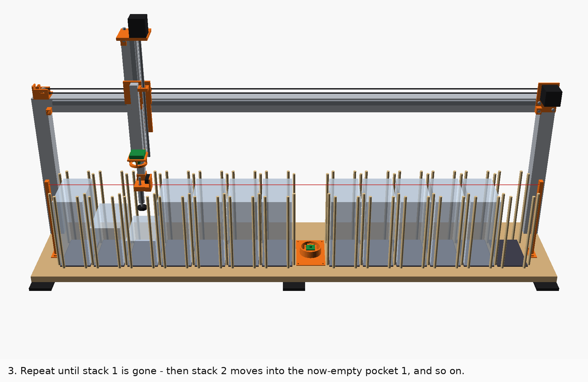
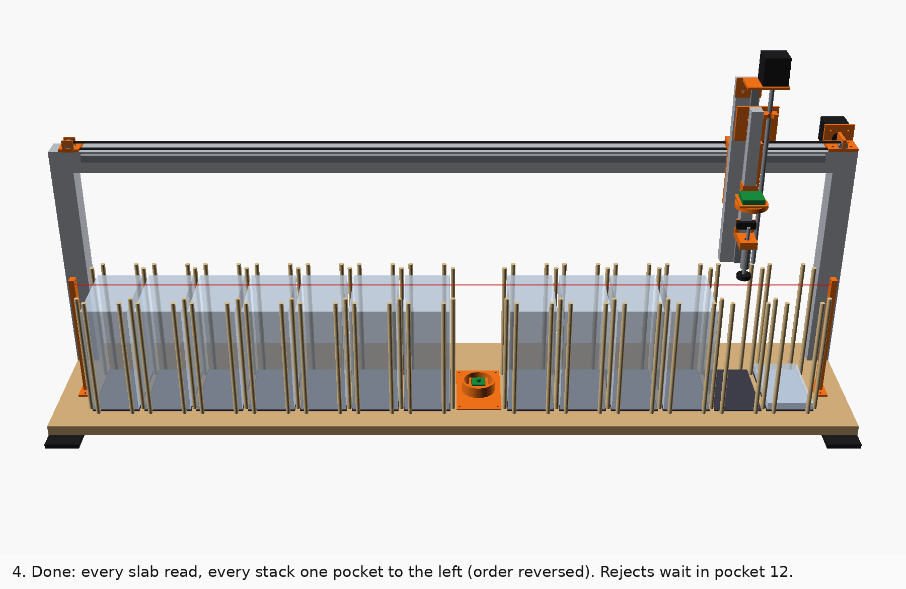

# Operating SlabRail

Weekly use: loading, running, reading the results, unloading, maintenance, and what to do when
it stops. The build and the acceptance tests are in [BUILD_GUIDE.md](BUILD_GUIDE.md). Commands
are run from `~/psa-slab-scanner/software` with the venv active
(`source .venv/bin/activate`).

Confidence tags: **[Certain]** = read in the code (`software/slabscan/`) or the CAD. **[Likely]**
= strong inference. **[Guessing]** = not yet measured on a real machine.

## Read this first

- **Only use it on inventory after every BUILD_GUIDE §13 test has passed.** [Certain that none of
  this has run on real hardware yet] Until then, every batch is a test batch.
- **`certs.csv` has one row per slab you loaded.** [Certain, `runner.py`] When two slabs come up
  together (DOUBLE PICK), the read one gets its row and the one underneath gets an extra
  `no_read` row whose note starts `UNREAD:`. That slab is in the **output pocket**, directly under
  the read one, not in pocket 12 (§5.4). Always check the count line in the summary.
- **Slabs without a PSA back-label QR stop the run.** [Certain, `runner._check_face_down`] Before
  the cup touches a slab, the head camera must see the back QR that proves it is face-down. Older
  PSA labels (before 2017) and CGC slabs have none, so each one stops the run until you check it
  (§8.1). For stacks you checked yourself, start with `--all-face-down` (§3).
- **Only the E-stop removes motor power.** Ctrl-C twice halts the motors at once and nothing moves
  afterwards, but they stay powered. [Certain, `runner.hard_stop`]
- **A wrong cert is worse than no cert.** The software refuses to guess: two codes that disagree
  give `conflict`, and an ITF-only read with nothing to confirm it gives `needs_review`. Respect
  those statuses. Don't paste `needs_review` certs into your inventory unchecked.
- **The web page has no login.** [Certain, `web.py`] Use it only on your own home or shop network.
  Never port-forward it.

## Contents

1. [Before each run](#1-before-each-run)
2. [Loading rules](#2-loading-rules)
3. [Starting a run](#3-starting-a-run)
4. [What the machine does](#4-what-the-machine-does)
5. [Reading the results](#5-reading-the-results)
6. [Unloading](#6-unloading-and-matching-rows-to-slabs)
7. [Maintenance](#7-maintenance-schedule)
8. [When it stops](#8-when-it-stops)
9. [Quick card](#9-quick-card)

---

## 1. Before each run

(2 minutes)

- [ ] **Wipe the cup lip with isopropyl alcohol** on a lint-free wipe, then let it dry for a
      minute. [Certain, DESIGN.md] The cup is the only part that touches your slabs.
- [ ] Pads clean: no grit, no lint. Use a lint roller.
- [ ] **Pocket 0 and pocket 12 are empty.** The run refuses to start otherwise. [Certain,
      `runner.survey`]
- [ ] Nothing is lying on top of the stacks, and nothing is above the fill line.
- [ ] Light roof on, if you fitted one. Lid closed, if you fitted the lid switch.
- [ ] E-stop released. Hands out of the bed.
- [ ] Using the command line? Stop the web service first (`sudo systemctl stop slabrail-web`):
      only one slabscan program may use the machine at a time, and the second one is refused.

## 2. Loading rules


| Rule | Why |
|---|---|
| **Face-down** (label and card facing the pad, the back facing up). A hard rule. | The cup only touches the back. Before the cup touches a slab, the head camera must see a PSA back-label QR; if it can't (a face-up slab, a pre-2017 label, a CGC slab) the run stops with nothing touched until you check it (§8.1). With `--all-face-down` that check is off and a face-up slab gets the cup on its front. [Certain, `runner.py`] |
| **Label end toward the front** (toward you) | It keeps the arm out of the camera's view of the label. [Certain, CONTRACT] |
| **Remove all sleeves and bags** | A smooth sleeve may well seal under the cup [Guessing], but the slab can then slide out of the sleeve during the 2 m/s² moves, and nothing detects a sleeve. A sleeve also slides on the stack. |
| **Pockets 1–11 only.** Pocket 0 and pocket 12 start empty. | Stack 1 moves into pocket 0. Pocket 12 collects exceptions. [Certain] |
| **Fill to the gauge, never above it.** Stand a `fill_gauge` in the front finger gap, its foot on the bed, against the stack. **The underside of its top bar is the MAX line.** The notches mark 0, 5, 10 … 30 slabs of 6.6 mm; the top notch (198 mm) is *not* the MAX line. | The bar underside is 210 mm above the bed, so 207 mm above the pad: the gauge errs 3 mm on the safe side because the bed sits 3 mm below the pad top. About 30 standard PSA slabs, or about 27 CGC. [Certain, `model.fill_gauge`, `layout.py`] Higher, and the overfill beam blocks the start. |
| **Each slab flat and centred** between the rods. Lower bundles of 5–10 with your fingertips in the front and back gaps (52 mm wide), following the bundle down; let go only when it rests on the stack. Never drop a bundle in. | A slab sitting on a rod stops the run ("taller than expected"). [Certain] |
| **PSA and CGC can be mixed**, in any order and any holder thickness | Both are read and stacked normally. [Certain, `certs.py`] Measure one CGC holder before the first CGC batch: it must be ≤ 82.6 mm wide. CGC slabs have no PSA back QR, so each one stops at the face-down check unless you use `--all-face-down`. |
| **BGS and TAG: measure one first.** Load them only if the holder is ≤ 82.6 mm wide (the pocket is 84 mm). They are then recognised and moved to pocket 12 as `other_grader`. | [Guessing] BGS holders may be wider than PSA's, and no width here has been measured. A wider holder rubs or jams on the dowels at every pick and placement. |
| **SGC: don't load.** Its holder is about 86 mm wide and the pocket is 84 mm. | [Likely, `layout.py`; measure one of yours] It won't go between the rods. Scan SGC by hand. |
| **Thick PSA holders are OK.** They are read and flagged "thick holder". | Fewer fit under the line, so trust the gauge, not a count. |

You don't need to sort, flip or order anything. The CSV records exactly where every slab ends up
(§6).

## 3. Starting a run

**Command line:**

```bash
python -m slabscan run --name "show-stock-oct"                 # asks one question, then runs
python -m slabscan run --name "high-value" --front-photo always  # also photographs every front (+~3 s/slab)
```

- `--front-photo always` is worth using on expensive slabs. A photo of both faces is your record
  against swapped cards and fake labels. [Likely, RESEARCH.md]
- `--all-face-down` turns the face-down check off for this batch (it is remembered on resume).
  Use it only when you loaded every stack yourself and checked it, for example a batch of older
  labels that would otherwise stop at every slab. A slab that is face-up after all then gets the
  cup on its front. The web page has the same choice as a checkbox.
- **The run refuses to start** until `calibrate z` and `calibrate x` have been done. [Certain,
  `cli.py`]

**Web page:**
1. On the Pi, run `python -m slabscan web`, or install the boot service with
   `bash setup_pi.sh --service`.
2. On your phone, open `http://<pi-address>:8080/`. The command prints the address.
3. Type a batch name.
4. Choose **front photo: only when needed** or **every slab (+3 s)**.
5. Press **Start run** and confirm.

The page shows:
- the counts, the current pocket and the last label photo;
- the last 10 slabs;
- the stop message;
- downloads of `certs.csv` and `certs.txt`.

**Stopping on purpose**

| You do | The machine does |
|---|---|
| **Stop after this slab** (web), or Ctrl-C once | It finishes the slab in the cup, parks with nothing held, and halts. Resume later. [Certain] |
| Ctrl-C twice | **Hard stop.** The motors halt where they are (feed hold, then a controller reset) and **nothing moves after that**. They stay powered. A slab in the cup stays on it, held by the pump; the program asks you to hold it and type `vent` (web: the Vent button), and you put it face-down on top of the pocket it names. The next run or resume homes first. [Certain, `runner.hard_stop`, `cli.hand_off_slab`] |
| **E-stop** | It cuts the 24 V: motors, pump and valves all stop. **The only stop that also removes motor power**: use it for anything dangerous. A held slab then hangs on the closed cup line for seconds to minutes only: take it off right away. §8.1. |

## 4. What the machine does

1. **Homes:** Z straight up, then X to the left switch.
2. **Survey** (1–3 min): it probes the top of every pocket. [Certain, `runner.survey`; time from
   the simulator]
   - It checks that pockets 0 and 12 are empty and that nothing is above the MAX line.
   - It measures every stack height.
3. **Shuffle one pocket left.** Stack 1 is moved slab by slab onto pocket 0, stack 2 onto pocket 1,
   and so on to stack 11 onto pocket 10.


**For every slab** [Certain, `runner.transfer`]:
1. A look from just above the top slab: the face-down check (a PSA back QR must be visible) and
   a first read of the back.
2. A slow probe down to it. Every downward move is a probing move, so anything unexpected in the
   way stops the head.
3. The cup line must read atmosphere, then the cup seals.
4. The lift is slow (2 mm/s) through the point where the cup leaves the slab, then pauses 0.5 s
   just above the stack, so the slab underneath stays behind.
5. It lifts to carry height, 248 mm, and takes two more photos of the back.
6. **If the back can't be read** (old label, glare), it carries the slab over the upward camera in
   the middle of the row and photographs the front, then decodes it (and runs OCR if needed) with
   the slab over its output stack.
7. It probes down onto the destination stack (slowly past the rod tops), measures the slab's
   thickness from the contact height, vents the cup and checks the vent worked before it lifts.

**Where each slab goes** [Certain, `runner.transfer`]:
- **`ok` and `needs_review`** go onto the next output stack.
- **`no_read`, `conflict` and `other_grader`** go to **pocket 12**, except the `UNREAD` row of a
  double pick: that slab came along under a read one and sits in the output pocket (§5.4).



When a stack is empty, the next stack moves into the pocket it just left.



**At the end:**
- stacks 1–11 sit in pockets 0–10, each one pocket left of where you loaded it;
- pocket 11 is empty;
- pocket 12 holds the slabs to check by hand;
- the head parks over pocket 0.

**Speed:** about 14 s per slab, so about 80 minutes for a full 330-slab load in the timing
simulation (`sim --slabs 330`). [Guessing until your first runs] Slabs that need the front camera and OCR take up
to 30 s longer, and every face-down-check stop waits for you. BUILD_GUIDE §13.1 measures the real
figure, which appears as `mean cycle` in the summary.

## 5. Reading the results

Everything is in `batches/<batch id>/`:

| File | What it holds |
|---|---|
| `certs.csv` | One row per slab, written row by row as it runs, so a crash loses nothing. |
| `certs.txt` | Only the `ok` certs, one per line, in machine order. Paste it into a spreadsheet or Card Dealer Pro. |
| `report.html` | Every row with its label photo(s). Opens on a phone. |
| `summary.json` | Counts per status, duplicates, the per-stack count check, `needs_attention`, the ITF format learned, mean cycle time. |
| `images/` | `NNNN_back.jpg` for every slab, plus `NNNN_front.jpg` when the front camera was used. NNNN = `position`. |
| `journal.jsonl`, `run.json`, `stop.json` | Machine log for `resume`, the run options, and why it last stopped. |

### 5.1 `certs.csv` columns

[Certain, `results.COLUMNS`]

| Column | Meaning |
|---|---|
| `batch_id` | Folder name: date-time plus your `--name` |
| `position` | 1, 2, 3 … the order the machine handled the slabs |
| `source_pocket` | The pocket the slab was loaded in (1–11) |
| `source_index` | Its place in that stack when loaded: **1 = top** |
| `out_pocket` | The pocket it is in now (0–10, or 12 for exceptions) |
| `out_index` | Its place in that pocket now: **1 = bottom**, so the top slab has the highest number |
| `cert` | Cert number, leading zeros stripped |
| `grader` | `PSA`, `CGC`, `BGS`, `SGC`, `TAG` or `unknown` |
| `status` | See 5.2 |
| `sources` | Which codes agreed, joined with `+`: `back_qr`, `back_barcode`, `front_barcode`, `front_qr`, `ocr` |
| `raw_payload` | Exactly what the code said, e.g. the QR's URL |
| `note` | Why it isn't plain `ok`, plus flags like "thick holder", "thin/odd step" and "DOUBLE PICK" |
| `image_front`, `image_back` | Photo paths, relative to the batch folder |
| `scanned_at` | Local time |

### 5.2 Statuses

[Certain, `certs.consensus` and `runner.transfer`]

| Status | Meaning | Where the slab is | What you do |
|---|---|---|---|
| `ok` | A machine-readable code read with confirmation. A QR, or a learned ITF read twice. | output stack | Nothing. It's in `certs.txt`. |
| `needs_review` | A cert was found but isn't trusted. The note says why: "ocr only - verify by eye", "ITF from one source only - confirm", "ITF only; padding vs check digit not learned yet", "ITF … but OCR read … - verify by eye", "read only in the frame from above the stack (a neighbour's label?)", "N-digit PSA cert, but Phase 0 saw only … digits", "grader not confirmed", or **DOUBLE PICK**. | **output stack** (the default `needs_review_to = "output"`) | Check the photo against the slab, and type the cert in yourself. |
| `no_read` | Nothing decoded on either face | pocket 12. **Exception:** a row whose note starts `UNREAD:` is the hidden slab of a double pick; it is in the output pocket the row names (§5.4) | Scan or type it by hand. Look at the photo: glare? damaged label? |
| `conflict` | Two codes on the slab disagree (e.g. QR ≠ barcode), or the cert was already recorded earlier in this batch | pocket 12 | **Check it carefully.** It can be a misread or a neighbour's label in view, but it's also what a doctored label or a reused cert number looks like. |
| `other_grader` | BGS, SGC, TAG … | pocket 12 | Handle outside SlabRail. |

**`needs_review` slabs stay in the output stack by default.** To send them to pocket 12 instead,
put `needs_review_to = "exceptions"` in `config/calibration.toml`. [Certain, `config.py`]

### 5.3 The summary lines

Shown at the end of the run and in `summary.json`:
- **Repeated certs:** the second slab with a cert already in the batch becomes a `conflict` row
  (note "cert … was already recorded at #N in this batch") and goes to pocket 12. Either you
  loaded the same slab twice, the camera saw a neighbour's label, or a fake reuses a real cert
  number. [Likely, RESEARCH.md] Pull both slabs and compare them. The `duplicates` line counts what
  is left after that rule and is normally "none".
- **`count check`:** for each stack, the slabs counted against its surveyed height ÷ the measured
  slab thickness. "Every stack matches" means within one slab. Anything else says "check these
  stacks by hand". [Certain, `runner.count_check`]
- **`needs attention`:** every non-`ok` row with its pocket and position counted from the bottom.
  That is your to-do list.

### 5.4 Double picks

Sometimes two slabs cling together and come up as one. The machine can't see the lower one, but
it notices at set-down: the contact step is ≥ 11.6 mm instead of about 6.6. [Certain,
`t_double`]

- The read slab's row gets `needs_review` and the note **"DOUBLE PICK: an unread slab is directly
  under this one in pocket N"**.
- **The slab underneath gets its own row:** status `no_read`, the note starting
  **`UNREAD: lifted together with #position`**, the same `position` number as the read slab, the
  same `out_pocket`, and `out_index` one lower. [Certain, `runner.transfer`]
- **It is in the output pocket, not in pocket 12**, directly under the read slab.
- **To do:** take that slab out and scan it by hand (or put it in the next batch).
- The count check still matches, because the machine counts a double as two. [Certain, simulator]

### 5.5 The exception pocket

- **What lands there:** every `no_read`, `conflict` and `other_grader` slab (except the `UNREAD`
  rows of double picks), in the order they arrived. Its rows have `out_pocket = 12`; `out_index` 1
  is the bottom.
- **When it fills:** it holds about 28 before the machine stops with "Exception pocket 12 is full".
  [Certain, arithmetic: it stops when the next two thick holders would cross the MAX line] Empty
  it and resume (§8). Counting there restarts from what is left.

## 6. Unloading and matching rows to slabs

**Where the stacks are:** stack *k* is now in pocket *k − 1* (stack 1 in pocket 0 … stack 11 in
pocket 10). Pocket 11 is empty and pocket 12 holds the exceptions. **Each stack's order is
reversed:** the slab that was on top is now at the bottom (`out_index` 1), and the **top slab of
every pocket has that pocket's highest `out_index`**. [Certain, by construction]

**Never lift a whole stack out or turn it over.** A full pocket is about 200 mm and 2 kg of slick
slabs, and fingertips in the gaps only reach their top ends: slabs slip out of the middle, and
their fronts slide across each other's backs.

**How to unload one pocket:**
1. Have a tray or box ready next to the machine.
2. Take slabs off the **top**, **at most 5 at a time**, fingertips in the front and back gaps.
3. Put each bundle in the tray **face-down, as it came out**, each new bundle behind (or under)
   the previous one, so the order is kept.
4. The first slab you take is that pocket's highest `out_index`; count down from there. In
   `certs.csv`, sort that pocket's rows by `out_index` from high to low: that is the order you
   unload them in.
5. Do pocket 12 the same way.

**To find one slab** (for example a `needs_review` row):
- Look up its `out_pocket` and `out_index`.
- Count up from the bottom of that pocket (`out_index` 1), or down from the top (the highest
  `out_index`). A DOUBLE PICK's `UNREAD` row has its own `out_index` (one below the read slab),
  so there are no gaps.
- Compare the slab with its `image_back` photo in `report.html` before you act on it.

**Next batch:** unload every pocket. The next run needs pocket 0 and pocket 12 empty again.

## 7. Maintenance schedule

| When | Task | Why / how |
|---|---|---|
| **Every run** | Wipe the cup lip with IPA (§1) | Grit on the lip is the main scuff risk. [Certain, DESIGN.md] |
| Every run | Look at the cup lip | Replace it if it's nicked, flattened or hardened |
| Every run | Lint roller over the pads | Grit under a stack's bottom slab |
| **Weekly**, or every ~1,000 slabs | Wipe the pads' microfiber with a slightly damp microfiber cloth, then let them dry | DESIGN.md: pads weekly |
| Weekly | `python -m slabscan selftest -i` | Watch the trends: seal time and the `leak` kPa/s. A creeping leak means a fitting or the cup is going. |
| Weekly | Check the vacuum tube's slack at the cup, and the Z cable loop | The buffer rod rises 25 mm on contact (WIRING.md §11) |
| **Monthly**, or every ~5,000 slabs | **Belt:** deflection check, 100 g lifts the lower strand 13–23 mm (BUILD_GUIDE §6.6). Check the pulley grub screw too. | If you re-tension, re-run `calibrate x`. |
| Monthly | Rails: wipe, then a little lithium/PTFE grease on both | Dry rails get notchy. [Likely] |
| Monthly | Spot-check frame bolts, the gate post screws, the camera bracket and the lens lock nut | Vibration. Re-run `focus head` if the lens moved. |
| Monthly | Contact-sensor check: `selftest -i` probe trigger | The flag can bend in a knock |
| Monthly | **E-stop check:** machine idle, press the E-stop. The software must report the controller lost, and a meter on the 24 V switched bus must read 0 V. Release, `home`. | The contact switches the 24 V capacitor inrush and can weld closed without any sign (WIRING.md §1.3). If the bus stays live, stop using the machine and replace the contact blocks. |
| **Replace cup pads** | When the lip is damaged, the seal gets slow, the leak grows, or after any slab shows a mark. Spare SMC ZP25UU pads are in the BOM. | **Re-run `calibrate z` after every pad change**: the new pad's face height differs. [Likely] |
| Replace pad facing | When the microfiber is worn shiny or stained | Re-glue a new facing (BUILD_GUIDE §5.5) |
| After any crash or a knock to the head | `calibrate z`, `calibrate x`, `focus head`, `focus station --save`, `selftest -i --motion` | Positions and focus may have moved |

Keep a copy of `config/calibration.toml` off the Pi.

## 8. When it stops

When the machine stops on its own:
- the message says what happened and what to do;
- it's saved in `batches/<id>/stop.json` and shown on the web page.

What happens to a slab in the cup [Certain, `runner.secure`, `cli.hand_off_slab`]:
- **After a planned stop or an unexpected error** (a camera dropping off USB, a decoder bug, a
  controller error), the head first re-reads its real position, lifts straight up, and puts the
  slab back on top of the stack it came from, so it gets read again. If the vacuum is low, it
  carries the slab back slowly and probes it down.
- **When moving is unsafe**, nothing moves at all: Ctrl-C twice, the controller lost (E-stop or
  USB), a controller ALARM, a failed vent, a vacuum sensor fault, a slab already hanging on the
  cup. The pump keeps holding the slab while the Pi has power. The command line then asks you to
  hold the slab and type `vent` (the web page shows a **Vent** button); put it face-down on top of
  the pocket the message names. Never just close the program with a slab on the cup: the valves
  then shut and it hangs only until the line leaks down.

**After fixing the cause:** `python -m slabscan resume batches/<id>`, or **Resume** on the web
page. Resume asks "hands clear?" first (skip it with `--yes`). Resume:
1. reconnects and homes;
2. probes every pocket again and compares it with what the journal expects;
3. continues.

Every slab still appears exactly once. [Certain, in the simulator: `tests/test_resume.py`, 8
passed when I ran it on 2026-10-22]

### 8.1 The table

Messages are quoted from the code, shortened where marked "…". [Certain]

| Message (start of it) | What happened | What you do |
|---|---|---|
| **Before the start** | | |
| "… has no pad_trigger_c / offset_x yet. Run `calibrate z` and `calibrate x` first" | Not calibrated | BUILD_GUIDE §12.1–12.2 |
| "Close the lid to start." | Lid switch open | Close it |
| "The overfill light beam is blocked with the head at the top: a stack is above the MAX line, something is lying across the stacks, or the laser and its receiver are out of line …" | Something is taller than 214 mm, or the beam is out of line | Check every stack with the fill gauge and look for a slab lying on top. Then `selftest -i` for the beam. |
| "The cup line holds vacuum … (… kPa; an empty cup reads …): a slab may be stuck to the cup. Nothing will move, and the pump is switched on …" | A slab is left on the cup, or the sensor zero drifted | Hold the slab, vent (the prompt, or the web Vent button), put it face-down on top of the stack it came from, then start again. If the cup is empty: `selftest -i` stores a new zero. |
| "Another slabscan process is using the machine … (stop it with: sudo systemctl stop slabrail-web) …" | The web service or a second window has the machine | Stop the other one first |
| **During the survey** | | |
| "Pocket N (empty_start / exceptions) must start empty but is … mm tall." | Something is in pocket 0 or 12 | Empty it and restart |
| "Pocket N is filled above the MAX line …" | Overfilled | Take slabs off and restart |
| "Pocket N: probe never touched anything (not even the pad)." | The contact sensor didn't trip | Check the flag and the sensor (`selftest -i`). **Don't resume until the probe test passes.** |
| "Pocket N: the cup sealed on something but the contact sensor did not trip. Contact sensor fault …" | The second, vacuum-based contact check caught a dead sensor | Same as above |
| "Pocket N: the cup sealed (… kPa) before the head moved down - a slab is hanging on the cup. Nothing will move …" | A slab stuck to the cup from before | Hold it, vent (prompt / Vent button), put it face-down back on the stack it came from, start again |
| **While moving slabs** | | |
| "Pocket N: the top slab could not be confirmed FACE-DOWN before touching it (no PSA back-label QR was seen from above / a … code is visible from above …). … nothing touched it." | A face-up slab, or an older label or CGC slab with no back QR | Look at the top slab of pocket N. Face-up: turn it face-down, then `resume`. Face-down: `resume --face-down-ok` (web: tick "the top slab it stopped on is face-down"). That confirms this one slab only; for a batch of older labels you checked, start it with `--all-face-down`. |
| "Unexpected contact over pocket N at … mm while moving down to … mm [with a slab in the cup]: something is higher than it should be …" | A crooked, added or dropped slab, or a slab lying on the rods | Look before you touch anything. Fix it, then resume. |
| "Pocket N is … mm taller than expected - was a slab added or is one sitting crooked?" | A slab is on a rod, or someone added one | Seat it flat (or take the added slab off), then resume |
| "Pocket N: no contact where the stack should be (predicted … mm). Check the contact sensor, then resume." | The stack is lower than expected: a slab was removed, or the sensor is weak | Count the stack against the CSV. `selftest -i`. Resume. |
| "Pocket N: cup will not seal on the top slab (dirty cup, warped slab?)." | No seal, even after a second try | Wipe the cup with IPA. Check the slab is face-down, flat and unsleeved. Resume. |
| "Vacuum lost after peel / in transit / at the read station (… kPa). A slab may have dropped." plus one of: "… It was carried back slowly and set down on top of pocket N …", "… the slab was NOT on the cup any more: it fell somewhere between pocket N and where the head was …", or "… nothing was found on top of pocket N. The head waits at the safe height with the pump on." | Vacuum dropped while holding. The machine never lets go in mid-air: it carries the slab back slowly over its own pocket and probes it down. [Certain, `runner._set_down_weak`] | Do what the second part says. Find and check any dropped slab. Run `selftest -i` (leak) before resuming. |
| "Vent failed …: the cup line still reads … kPa …" or "A slab came up with the vented cup …" | The vent path (GPIO 22 module, coil or wire) did not let go. The slab rests on the stack, still sealed to the cup; nothing moves. | Hold the slab and pull the vacuum tube off the cup fitting (or unscrew the cup). Never slide the slab sideways. Fix the vent, `selftest -i`, resume. |
| "Vacuum sensor fault: … Without it the machine cannot tell whether a slab is held or let go, so nothing moves." | The sensor reads outside its range (an open wire, a lost 5 V) | If a slab is on the cup, hold it and vent. Fix the sensor wiring (WIRING.md §5), `selftest -i`, resume. |
| "Exception pocket 12 is full. Empty it …, then resume." | About 28 exceptions | Unload pocket 12 (§6) and resume. It recounts from what's left. |
| "Placing onto pocket N: no contact - output stack lower than expected." | The output stack is lower than recorded | Check that stack for a fallen or removed slab, then resume |
| "Placing onto pocket N: contact … above the stack - something is in the way." | An object, or a crooked slab, on the output stack | Clear it, then resume |
| "Placing onto pocket N: the cup touched … mm above the stack, as if nothing is in the cup. The slab from pocket N may have fallen off on the way …" | The slab fell off, or the vacuum sensor reports a seal that isn't there | Look at the cup and the bed (rods, stacks, read station). Find the slab, then resume. |
| "Lid opened - run paused with nothing held." | Lid opened | Close it and resume |
| "Stopped on request - nothing held. Resume to continue." | You pressed Stop | Resume when ready |
| **Controller and power** | | |
| "The controller lost power or its USB link (E-stop pressed, or the cable came out). The head stopped where it was. If you did not press the E-stop, the motors may still be powered: press it now before reaching in. [A slab from pocket N is still on the cup …]" | E-stop, or the USB came out. The Pi keeps the pump and valve switched on; after an E-stop they have no power, so the slab hangs on the closed cup line only for a short while. [Certain, `runner.lost_note`] | Press the E-stop if you didn't. **Take the slab now** (after an E-stop the vent has no power either: hold it and pull it off gently), or vent at the prompt / Vent button if the pump still runs. Put it face-down on top of pocket N. Release the E-stop, then resume. It reconnects and homes first: Z straight up, then X. |
| "The controller is still not answering … check the USB cable and the 24 V supply" | The CH340 didn't come back within 15 s | Wait 10 s and resume again. Check the E-stop is released, the 24 V supply, and the USB cable. |
| **Anything else** | | |
| "Hard stop (Ctrl-C twice): the motors were halted where they were and nothing moved after that. … [A slab from pocket N is on the cup; the pump keeps holding it …]" | You stopped it hard | Hold the slab, type `vent` at the prompt (web: Vent), put it face-down on top of pocket N. Resume homes first. |
| "Interrupted (Ctrl-C) during the stop itself. The head may have stopped anywhere and a slab may be in the cup …" | Ctrl-C while the machine was putting a slab back | Check the head. If a slab is on it, the prompt asks you to vent. Then resume. |
| "Unexpected error: <ErrorType>: …. The slab that was in the cup was put back on top of pocket N; it will be read again on resume." | An unplanned error, e.g. a camera dropping off USB or a decoder bug. The slab was parked. | Fix the cause (§8.3), then resume. |
| "… Could not park the machine automatically (…). A SLAB from pocket N is still on the cup; the pump keeps holding it …" | The put-back failed, or the controller is in ALARM (for example "Probe Hard Limit") | Hold the slab, vent (prompt / Vent button), put it face-down on top of pocket N. Check the head, fix the cause, resume. A probe hard-limit alarm during a lift means the flag chatters or something touched the cup: BUILD_GUIDE §13.2. |
| "<ErrorType>: … The machine stopped without parking …" | Rare now: an error before the run's own guard started (for example while opening the hardware) | Check the head anyway, then resume. |
| **On resume** | | |
| "The stacks changed since the run stopped: pocket N: … mm now, … mm when the run stopped (±n slabs) …" | A slab was added, removed or moved while stopped | Put things back as they were. If it says "It looks like one slab went from pocket A to pocket B …", move that top slab back as told. Or use `resume --accept-heights` if you changed things on purpose: the count check will flag it. |
| "exception pocket 12 was emptied to … mm; counting continues from …" | Info: you emptied pocket 12 | Nothing |
| "resume: the run stopped before the first survey finished - starting it from the beginning" | Info | Nothing |

### 8.2 Venting the cup by hand

If the software is running and asks you to type `vent` (or the web page shows **Vent**), use
that. Only if a slab is stuck on the cup and the software isn't running, hold the slab with one
hand and open the vent valve for a second:

```bash
pinctrl set 22 op dh; sleep 1; pinctrl set 22 op dl
```

GPIO 22 is the vent valve. [Certain, CONTRACT] `pinctrl` is the Raspberry Pi OS GPIO tool
WIRING.md §15 uses. [Likely] Don't do this while `slabscan` is still running, because both would
drive the same pin. With the E-stop pressed the vent valve has no power: release the E-stop first,
or hold the slab and pull the vacuum tube off the cup fitting.

### 8.3 Repeated stops of one kind

| Pattern | Look at |
|---|---|
| "cup will not seal" on many slabs | A cup lip worn or dirty; a leak (`selftest -i` → `leak`) |
| "Vacuum lost in transit" more than once | A leak in the cup line; the pump; whether the slab is knocking a rod (watch a carry) |
| "taller than expected" on random pockets | Slabs placed crooked: X calibration (`calibrate x`), belt tension, a leaning rod |
| Camera errors | The head camera's USB extension in the drag chain (WIRING.md §16 risk 4) |
| Many `no_read` | Focus (`focus head`, `focus station --save`), a ring not lighting, glare. Fit the light roof. |
| Many `needs_review` "ITF only … not learned yet" in the first batches | Normal. It learns after 3 slabs where QR and ITF agree, and the setting is kept for that batch. [Certain, `ItfModel`] |
| A face-down-check stop at every older-label or CGC slab | Expected: they have no PSA back QR. Check the stacks yourself and start such batches with `--all-face-down`. |
| Every slab goes to the front camera (slow runs, many "confirmed by OCR") | The head crop is wrong: `cam_head.hfov_deg` / `row_axis` don't match the real camera, so the label is cut off (BUILD_GUIDE §12.3) |
| "Probe Hard Limit" alarms | The probe flag chatters at the slot edge during the slow lift, or something touched the cup: BUILD_GUIDE §13.2, WIRING.md §6 |

## 9. Quick card

Print this and tape it to the machine.

```
BEFORE   cup wiped (IPA) - pockets 0 and 12 empty - nothing above the gauge's top bar - sleeves off
LOAD     face-DOWN (hard rule), label toward you, pockets 1-11, bundles of 5-10 lowered by hand
         PSA+CGC mixed OK.  BGS/TAG only if <= 82.6 mm wide (go to 12).  NO SGC.
START    python -m slabscan run --name NAME   (web: Start run)
         slabs without a back QR (old PSA, CGC) stop the run: check, then resume --face-down-ok,
         or start a checked batch with --all-face-down
STOP     web "Stop after this slab" / Ctrl-C once = clean stop.
         Ctrl-C twice = motors halt NOW, nothing moves; a held slab stays on the pump -> hold it, type vent.
         E-STOP = the only stop that cuts motor power. Use it for anything dangerous.
RESUME   python -m slabscan resume batches/<id>    (or web: Resume)
AFTER    stack k is now in pocket k-1, order reversed: top slab = highest out_index.
         Unload from the TOP, max 5 at a time, face-down into a tray. Never lift or flip a stack.
         Pocket 12 = check by hand.  needs_review = check by hand (still in its output stack).
         DOUBLE PICK = an extra UNREAD row: that slab is in the OUTPUT pocket, under the read one.
WEEKLY   pads wiped, selftest -i.   MONTHLY  belt, rails, bolts, E-stop check.   NEW CUP PAD -> calibrate z
```
