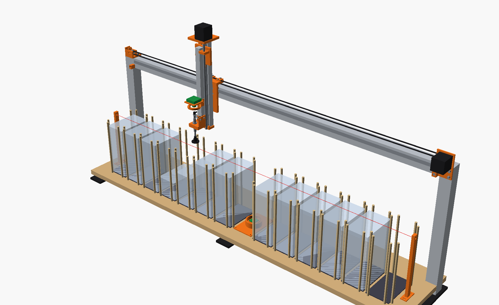

# SlabRail reviewer brief

Read this first if you received the SlabRail design-review package. It says what the machine is,
what has and has not been verified, and what we would most like an engineer to check.

**Nothing has been built.** Every result below comes from CAD checks, software tests, a simulator
or public label scans. No real slab, camera, cup, motor or wire has been tested yet.

Confidence tags are copied from the doc each number comes from: **[Certain]** = measured, computed,
or checked in the CAD or simulator; **[Likely]** = strong inference; **[Guessing]** = needs a real
test. Units are mm unless stated. "DESIGN §4" means section 4 of `docs/DESIGN.md`; "D-05" is a
drawing sheet (§9.2).

## 1. What it is

SlabRail reads the cert numbers of graded trading-card slabs, PSA and CGC, unattended. One
straight row of 14 cells sits under one 4040 gantry beam: 13 pockets formed by wooden dowels, and
an upward read camera in cell 7. The owner loads up to 330 slabs face-down in pockets 1–11 (11
stacks of 30). A suction cup lifts the top slab of a stack straight up, a camera on the head reads
the back label, and the cup sets the slab down in the empty pocket to its left, so every stack
ends up one pocket to the left. A slab whose back can't be read is held over the upward camera to
read its front label. Anything still unread or doubtful goes to pocket 12, the exception pocket.
The output is `certs.csv` (cert, grader, status, pocket and position) and a photo of every label.
There are two motors: X (belt, along the row) and Z (lead screw, up and down).

The owner is a student building it in a school shop with mechatronics instructors. The README
states the alternative plainly: **[Likely] a \$350–650 hands-free 2D scanner gets you 80% of the way
with no build** (20–30 slabs per minute by hand). The machine buys back about 10–15 minutes per
batch and adds a photo of every slab.

## 2. Requirements as the owner gave them

| Requirement | Where written | How the design answers it |
|---|---|---|
| Load 200–300+ slabs, walk away, get every cert number back | README ("Load up to 330 graded slabs … and walk away"); DESIGN §1–2 | 330 per load, one CSV row per slab, a count check; 79.4 min per load in the simulator. **But** until the learned face-down check is active, every slab without a back-label code stops the run for the operator (§5 step 3), and the build guide says not to leave it alone until three full runs pass with no unexplained stop and no wrong cert [Guessing threshold]. |
| PSA first, CGC too | README title; CONTRACT "Graders" | Both are read and stacked. BGS and TAG go to pocket 12 (load them only if ≤ 82.6 mm wide). SGC (about 86 mm) does not fit the 84 mm pocket. |
| Fewest moving parts | DESIGN §2 | One row, no Y axis: 2 motors. Moving parts: X belt axis, Z lead-screw axis, a spring-loaded cup, 2 valves, 1 pump. |
| Budget about \$2,000; \$2,500–3,000 acceptable | CONTRACT "Budget" | \$2,181.94 with a 15% allowance [Likely ±10%]; worst case about \$2,380 [Guessing] (BOM.md). |
| Built with school-shop tools | CONTRACT "Budget"; BUILD_GUIDE intro | Extrusions bought cut (Misumi, ±0.5 mm); printed parts; the rod holes are drilled through a printed template that the machine itself positions (BUILD_GUIDE §5B). 65–90 h of hands-on work [Guessing]. |

The docs also hold these as rules: the cup touches only the back of a slab (DESIGN §3); no slab
slides on another (DESIGN §2); a wrong cert is worse than no cert, so the software never guesses
(OPERATING); no motion parts are bought before both Phase 0 gates pass (BOM.md).

## 3. Status and evidence

**Nothing has been built.** The next step is two bench gates that decide whether it gets built:

- **Phase 0A, camera test** (≈ \$470, ≈ \$281 with a borrowed Pi). Both cameras and rings on a
  printed jig that holds the machine's own head parts where the machine does, on 30–50 of the
  owner's slabs. GO: ≥ 95% read, 0 wrong certs, and 0 wrong certs and 0 false face-down proofs when
  the machine's rules replay the captures (BUILD_GUIDE §1.9).
- **Phase 0B, cup test** (≈ \$155). The real SMC cup on a hand vacuum pump: seal, leak, and a 24 h
  marking test. GO: no mark that survives a dry microfiber wipe (BUILD_GUIDE §1.10).

| Evidence | What it shows | What it does not show |
|---|---|---|
| **CAD checks** `cad/checks.py`: **177/177 pass** [Certain], 23 Oct 2026; numbers in `cad/out/checks.txt` | Clearance and interference at every pick, place, travel, station, hard-stop and Phase 0 pose: last-slab pick clears full neighbours by 14.55, loaded travel clears the rods by 21.4, a double pick of two 11.5 holders by 5.33. Camera sight lines, card window, switch, carry-sensor and probe trips. | Loads, deflection, belt slack, cables and tube, real shapes of bought parts, switch-lever side load, frame brackets (not in the CAD), print accuracy. |
| **Software tests**: **299 passed, 1 skipped** (23 Oct 2026; the skipped real-image test passes alone) [Certain] | Parsing of real PSA and CGC payload strings, grader and face-down rules, carry-sensor logic, every stop path with a slab in the cup. | Real cameras, GPIO electrics, serial timing. The bench-test tool has run only on the simulator. |
| **Simulator**: 330 slabs, seed 7, default mix [Certain, sim]; raises `Crash` on any unsafe move | `ok` 324, `needs_review` 6, no wrong cert or grader in an `ok`. Face-down: 287 by back QR, 41 learned, 2 confirmed. Double pick, seal failure, overfill, Z stall, sensor faults end safely. | Real physics (air films, slip, leaks, stalls). The mix is [Guessing]. All simulated slabs are face-down: nothing about face-up safety. |
| **Real labels**: `tools/real_eval.py` on public scans of 64 real slabs [Certain for these images] | **0 wrong certs in an `ok`, 0 false face-down proofs.** Native: 60 `ok`, 2 `needs_review`, 2 `no_read` (BGS and SGC carry no code). At machine-camera scale: 60 of 61 `ok`. | The rules were written from these 64 slabs. Flat studio scans have no slab-plastic reflections. |
| **Decode sweep**: synthetic labels in the real formats | Back QR reads at ≤ 0.14 mm/px through blur and strong glare; the front barcode needs ≤ 0.05–0.08 mm/px (the station gives 0.039); no misread anywhere. | Real labels through real plastic. |
| **Hardware** | Nothing. | Camera reads through plastic, cup sealing and marking, motor margins, frame stiffness, wiring, real cycle time. Phase 0 comes next; the acceptance tests (BUILD_GUIDE §13) follow the build. |

## 4. The machine at a glance

| Parameter | Value | Source |
|---|---|---|
| Envelope | Bed 1416 × 289.5 (18 mm plywood on two 2040 base rails); about 1.42 m × 0.32 m × 0.65 m tall overall (not a CAD measurement) | `cut_list.csv`, BUILD_GUIDE §4.1, README |
| Frame | 2040 × 1416 base rails (2), 4040 × 401 uprights (2), 4040 × 1416 X beam (centre 400 above the pad), 2040 × 340 Z spine, 2020 × 285 drop arm. Joints are not in the CAD. | `cut_list.csv`, `layout.py` |
| Pockets, capacity | 13 pockets + 1 station cell, 92 pitch, centres X = 42 + 92·cell. Inside 84 × 139: ±1.85 / ±1.75 play on an 80.3 × 135.5 slab. 82 dowels (5/16 in, 7.94), tops 218 above the pad. 11 × 30 = 330 slabs; pocket 12 stops the run at about 28. | `layout.py`, CONTRACT, OPERATING §5.5 |
| Slab | 80.3 × 135.5 × 6.6 nominal, design max 82.6 × 136.5 × 7.0, ≤ 65 g; thick holders to 11.5 | `dims.py`, `layout.py` |
| Heights | MAX fill line 210, overfill laser 214, rod tops 218; travel (empty and loaded) c = 248; station read c ≈ 171.6 | `layout.py`, `machine.toml` |
| X axis | NEMA17, GT2 20T belt, 80 steps/mm; MGN12 rail 1300 on the beam; soft limits 22…1253, printed hard stops at cup X 15 and 1262; 15000 mm/min, 2000 mm/s²; 1.0 A | CONTRACT, FIRMWARE |
| Z axis | NEMA17 (1.5–2.0 A, ≤ 4 mH), integrated T8×8 screw cut to 340; MGN12 rail 330 on the spine; c = −12…250 used, hard stops c = −14 and 262; 6000 mm/min, 1200 mm/s²; run 0.8 A, hold 0.5 A | CONTRACT, FIRMWARE, `layout.py` |
| Cup and buffer | SMC `ZPT25UUK20-B5-A10`: Ø25 urethane cup, M10 spring buffer, 20 mm stroke. Probe trips at 2.0 ± 0.5 of buffer travel (about 1.2 N [Likely]). 19.1 N hold at −50 kPa, SF 30 on a 0.64 N slab [Certain]. Seal accepted at −35 kPa within 0.4 s. | CONTRACT, DESIGN §4, `config.py` |
| Vacuum | 24 V diaphragm pump; check valve and about 300 mL reservoir on the pump side; two Clippard EV-2-24 normally-closed valves (vacuum, vent); XGZP6847A sensor via ADS1115 on the cup side | BUILD_GUIDE §8.1 |
| Sensors | Optical contact probe (fail-safe, Rodent input); carry-height sensor (Pi GPIO 6, blocked from c = 246.5 up); vacuum sensor; overfill laser gate (GPIO 5); X home and Z top NC microswitches; optional lid switch | CONTRACT, WIRING §5–8 |
| Cameras, lighting | Head: ELP 8 MP USB, 3.6 mm lens, 140 above the held slab, 5 toward the label from the cup axis, 0.055 mm/px. Station: Pi Camera Module 3, 140 below, 0.039 mm/px. 12 V LED rings (40 mm head, 60 or 63 mm station); glare-free by mirror geometry, no polarisers [Certain] | CONTRACT, DESIGN §5 |
| Controller, computer | BTT Rodent (four TMC2160) with FluidNC v4.1.1+, over USB to a Raspberry Pi 5 4 GB; the Pi drives the pump, valves and rings through five MOSFET modules | CONTRACT, FIRMWARE |
| Power | IEC inlet with T3.15A fuse in a closed ABS box; Mean Well LRS-150-24 set to 24.5 V; E-stop (two NC blocks in series) in the +24 V line; fuses 5 A (Rodent), 3 A (pump, valves), 1 A (12 V buck). Pi on its own 27 W supply. Load ≈ 1.2 A typical, ≈ 3.4 A peak [Guessing]. | WIRING §1 |
| Cycle, batch | 14.2 s per slab; 79.4 min for 330, with 75 s of homing and survey [Certain, sim; Guessing until measured]. Front camera + OCR adds up to 30 s a slab. | DESIGN §6, OPERATING §4 |
| Cost | \$1,897.34 parts; **\$2,181.94 with 15% allowance** [Likely ±10%]; worst case ≈ \$2,380 [Guessing]; ≈ \$1,862 with school stock. Junk test slabs (\$150–400) extra. | BOM.md, SHOPPING_LIST.md |
| Printed parts | 25 STL files, 27 prints, 801 cm³; PETG for machine parts; ≈ 44.5 h printing | `print_list.json`, BUILD_GUIDE §3.2 |

## 5. One slab's trip

Once per run: home (Z up to its switch, then X left), refuse to start if the overfill beam is
blocked, then survey every pocket with the probe (pockets 0 and 12 empty, nothing above the MAX
line). In learned mode, one head frame over an empty pocket checks the camera's aim. Then for every
slab (`runner.transfer`):

| # | Step | Guarded by |
|---|---|---|
| 1 | Move over the source pocket at c = 248. | **Carry-height sensor** must read blocked before any sideways move. |
| 2 | Drop to just above the predicted stack top. | Every downward move is a `G38.3`: the **contact probe** stops it on contact. |
| 3 | One head frame: face-down check and a first read of the back. | **Head camera.** Not proven face-down: stop before touching. A front code seen: FACE-UP stop. |
| 4 | Probe to the real top, at most 12 past the prediction; > 4.5 taller than predicted stops the run. | **Contact probe**, fail-safe (a cut wire reads as touching, so FluidNC refuses to probe). |
| 5 | Grip: line at atmosphere, then pump and valve on; seal at −35 kPa within 0.4 s, one retry. | **Carry-height sensor** must read clear (a dark sensor reads blocked); **vacuum sensor**. |
| 6 | Peel: 20 mm/s while the buffer re-extends, then 2 mm/s through the release and 1 mm past, then 0.5 s low over the stack. | **Probe hard limit**: a probe edge outside a `G38` move is a critical alarm. |
| 7 | Lift to c = 248, take two head frames, decide the read. | **Carry-height sensor**: a Z stall over about 2.5 stops the run before it moves sideways. **Vacuum sensor**: alarm above −25 kPa. |
| 8 | If needed, detour over the station (c ≈ 171.6) for front frames; decode and OCR (up to 30 s) with the slab over its output stack. | **Station camera**; vacuum check. |
| 9 | Route: `ok`, or `needs_review` graded PSA/CGC, to the output pocket; everything else to pocket 12. | Rules in `slabscan/certs.py`; a full pocket 12 stops the run. |
| 10 | Probed set-down, 1200 mm/min through the rod tops. The contact step is the slab's thickness. | **Contact probe.** Step ≥ 11.6: DOUBLE PICK. Far too big: something in the way. Under half a slab: cup empty. |
| 11 | Vent 0.25 s; the line must be within 0.5 kPa of atmosphere within 1.5 s before the lift. | **Vacuum sensor.** Failed vent: nothing moves. |
| 12 | Write the CSV row, photos and journal. A code-proven slab whose read agrees becomes a learned-check reference. | Count check at the end. |

A slab whose back reads is in the air about 2 s per cycle (DESIGN §3).

## 6. Safety and failure handling

**Power and E-stop** (WIRING §1). Mains enters an IEC inlet with a T3.15A fuse [Likely; not yet
checked against the supply's inrush] in a closed ABS box, checked by an instructor before power-up.
The E-stop has **two NC blocks in series** in the +24 V line after the supply: it cuts the Rodent,
pump, valves and LED buck, not the Pi, which sees the controller vanish and stops the run. Two
blocks because the release inrush into the Rodent's and buck's capacitors can weld one closed
[Likely]; the ratings may be AC only [Guessing]; a monthly check is the only detection. On an
E-stop the motors go limp (Z should hold on detent [Likely]) and both NC valves close, so a held
slab hangs only as long as the cup line's leak allows; the reservoir is on the pump side and does
not help (DESIGN §3). Ctrl-C twice halts the motors but leaves them powered.

**Laser** (WIRING §8). A ≤ 1 mW Class 2 650 nm module, 4 above the MAX line, on whenever the Pi is
on, at about face height for someone bent over the stacks. The KY-008 from the receiver kit, usually
sold as 5 mW (Class 3R) [Likely], is excluded by name. Both posts carry a warning label.

**Pinch points and guarding.** No document analyses pinch points, and the CAD has no guard or
enclosure. Every downward head move is a probing move, so contact that pushes the cup up should
stop the head (about 1.2 N at the trip, about 1.6 N after a trip at full Z speed: DESIGN §3, §4)
[Likely; never tested against a hand]. Contact with other head parts is not sensed, and nothing
watches the X path. Moving hazards: the belt loop over the beam, the X carriage at its end bumpers,
the head between the dowels, the Z carriage at its stops, the drag chain. The rest is procedure:
hands out of the bed, a "hands clear?" prompt on resume, an optional lid switch, and "keep it where
nobody can reach into the bed" (BUILD_GUIDE §14).

| Failure | Detected by | What happens | Designed / tested |
|---|---|---|---|
| **Vacuum loss, drop** | Vacuum sensor, alarm above −25 kPa | Never lets go in mid-air: carries the slab back slowly over its pocket and probes it down. A fall from carry height is ≤ about 240 mm, ≈ 0.15 J [Certain, arithmetic]; a corner on a dowel top could chip [Guessing]. | DESIGN §3 / simulator (`test_safety_fixes.py`, `test_resume.py`); BUILD_GUIDE §13.3 drop, §13.4 power cut (≥ 60 s hold [Guessing target]) |
| **Double pick** | Placement step ≥ 11.6 | Read slab `needs_review` "DOUBLE PICK", plus an "UNREAD" row for the slab under it. Two 11.5 holders clear the rods by 5.33 at c = 248 [Certain, CAD]. | DESIGN §2a, §4 / simulator; §13.5 |
| **Z stall** | Carry-height sensor clear at travel height | Stops before any sideways move; a held slab is lowered straight onto its own pocket, or held. It does not prevent a stall. | WIRING §6a / simulator (40 and 10 mm losses); §13.6E; §7.8 100-lift test |
| **Misread** | Consensus: a QR names its cert; a barcode-only read needs a second printed symbol or OCR to agree and a confirmed grader; disagreeing codes are `conflict` | `conflict`, `no_read`, `other_grader` and grader-less `needs_review` go to pocket 12. | DESIGN §5 / unit tests; real labels 0 wrong; Phase 0A gate; §13.1 |
| **Face-up slab, or one not provably face-down** | Hover frame: a back-label code, or a learned card-window match with two references; a front code means FACE-UP | Stops before the cup touches it; the operator turns it or confirms that one slab. `--all-face-down` turns the check off. | DESIGN §3, §5 / simulator; real labels 0 false proofs; §13.8 |
| **Overfill** | Laser 4 above the MAX line at start; the survey | Refuses to start. A slab across the rod tops is caught by the survey's first probe window. | DESIGN §3 / simulator; `selftest` |
| **Sensor fault, unexpected error** | Fail-safe probe wiring; the run's guard | FluidNC refuses to probe (ALARM:4). After an error the slab is put back on its stack; where moving is unsafe, nothing moves and the pump holds it. | WIRING §6, OPERATING §8 / simulator; §13.6 |

## 7. What we'd like you to review

A short answer with the question number is enough.

1. **Frame joints.** The CAD has no brackets. BUILD_GUIDE §4.3 recommends [Guessing on the
   layout] two 4040 L brackets inside each beam-to-upright corner, a flat plate on the back face
   (none in front: the X rail ends 18 mm from each upright), and the uprights held to the base rail
   by L brackets bolted M5×30 through the plywood. Enough for a 1.9 kg carriage at 2 m/s², or should
   the uprights be end-tapped and bolted from the start? (D-01, D-02)
2. **Beam twist.** ≈ 0.8 mm at the cup at midspan from the 127 mm head overhang [Guessing on J]
   (DESIGN §4), against ±1.75 pocket play. A rear brace goes on only above 1.0 mm under a 0.75 kg
   load (BUILD_GUIDE §6.7). Credible for a 4040 loaded on one face? Right trigger? (D-04)
3. **Z torque at 0.8 A.** The lift needs 0.026 N·m on the T8×8; at 0.8 A (40–55% of rating) SF ≈
   2–4 [Likely] (DESIGN §4), and the BOM motor has no published torque curve. Higher current or
   lower speed from the start? Is the 100-lift test (BUILD_GUIDE §7.8) enough? (D-05)
4. **Z hold, power off.** Back-drive about 0.005 N·m against about 0.015 N·m detent [Likely] (DESIGN §4), an
   estimate. Design in a constant-force spring or brake now? Its mount is not in the CAD. (D-05)
5. **Switch side load.** Each home switch is worked by a striker sliding across its hinge lever (a
   45° lead-in, then a flat holding it 0.6 mm past the click, inside the 1.2 mm overtravel). The
   lead-in pushes the lever sideways about as hard as down; the datasheet rates only a straight
   push [Guessing that it holds]. Acceptable, or a roller on a cam? (BUILD_GUIDE §6.8; printed-part
   sheets for `x_switch_mount`, `z_switch_mount`)
6. **PETG parts, belt tension.** All machine parts are PETG; the load-bearing ones (`x_bracket`,
   `z_plate`, `z_motor_mount`, `x_motor_mount`, `head_foot`) have 5–6 walls, 40–50% infill. They
   carry the Z motor, the head and the belt (15–25 N [Guessing], BUILD_GUIDE §6.6) beside motors
   allowed about 50 °C. Nothing checks creep or stiffness. Which would you change? (D-07 on)
7. **Cup margin and marking.** 19.1 N at −50 kPa, SF 30 [Certain] (DESIGN §4), but the software
   accepts a seal at −35 kPa and alarms only above −25 kPa; the margin there is not computed.
   Marking is screened by 24 h on a hand pump, then 300 cycles + 24 h at mean ≤ −40 kPa
   (BUILD_GUIDE §1.10, §13.2). Enough for slab plastic? (Phase 0 jig sheet)
8. **Power-cut hold.** On power loss the slab hangs only on the closed cup line; §13.4 asks for
   ≥ 60 s [Guessing target], with a cup-side reservoir as the fallback (BUILD_GUIDE §8.2). Acceptable
   for unattended runs?
9. **E-stop and mains.** A DC-side E-stop with two NC blocks (maybe AC-rated only [Guessing]), a
   monthly check, a T3.15A fuse [Likely] not yet checked against inrush, one frame earth bond across
   anodised joints [Likely: serrated washers may be needed]. Acceptable, or E-stop on the mains side
   or a force-guided safety relay? (WIRING §1, §12)
10. **Sensor fail-safety.** The carry-height sensor's "OK to move" state is dark, so a dead emitter
    or cut GND is caught only at the next grip [Certain] (WIRING §6a). The probe flag may chatter
    during the slow peel; the fix is a Schmitt stage [Guessing] (WIRING §6). Acceptable? (D-05, D-06)
11. **Head camera aim.** The learned check needs the camera within 1.34° toward the cup; on a CGC
    slab in a pocket corner, about 0.01° toward the label puts over 2% of the card window on the
    holder [Likely]. The only adjustment is an M2 washer shim (about 0.5° [Likely]). What can the
    `camera_bracket` / drop-arm stack-up hold, and how would you measure it? (DESIGN §5; D-05)
12. **Guarding.** Nothing beyond an optional lid switch. What is the minimum you would require
    before it runs unattended in a home or a school?
13. **Tolerances.** Some drawing tolerances are marked proposed. The design's own fits: pocket play
    ±1.85 / ±1.75, rod holes drilled by the machine, Misumi cuts ±0.5 mm, printed holes 0.1–0.3 mm
    small [Likely], squareness targets [Guessing] (BUILD_GUIDE §4.5). Right for the function and
    holdable in a school shop? (D-00, D-02, D-03, D-06)
14. **Cables and tube.** Not in the CAD: the 1 m drag chain, the 350 mm Z service loop, the vacuum
    tube (about 1 mm under the head ring at full stroke [Guessing]) and about 4 m of head USB
    [Guessing], the weakest cable. Any routing or flex-life problem? (WIRING §11, §16; D-05)

## 8. Top risks

The full table, with what retires each risk, is DESIGN §7.

| Risk | Retired by |
|---|---|
| The owner's labels differ from the 64 real slabs seen | Phase 0A on 30–50 of the owner's slabs |
| The cup marks slabs | Phase 0B, then 300 cycles + 24 h on the machine. The fallback HT1 cup needs an adapter nobody has sourced: a mark means stop and ask. |
| Slabs without a back-label code stop the run | The learned check after a Phase 0 GO and 5 references: 2 stops in 330 in the simulator [Certain, sim; Guessing for real backs] |
| A face-up front is accepted as a card back | Two references per match; Phase 0's face-up pass; audit of every learned row in the first batches |
| Camera aim, or a CGC slab in a pocket corner, puts something in the card window | The aim check (toward the cup only); the owner's look at `face_down_window.jpg`. The 2% limit is a judgment, not a margin. |
| A Z stall drags a slab below the rod tops | Carry-height sensor, plus the 100-lift test |
| A switch lever is too long or wears under the side push | Measure and cut back past 23 mm; a 100-pass bench test |
| Beam twist larger than estimated | Dial-indicator check; rear brace |
| Another grader's 8-digit ITF reads as `ok PSA` [Guessing that one exists] | Run any non-PSA slabs through Phase 0 |

## 9. How to read this package

### 9.1 Documents

| File | What's in it | Read it if |
|---|---|---|
| `README.md` | Overview, verification summary, build order | You want the short version |
| `docs/DESIGN.md` | Architecture (§2), slab contacts and crash layers (§3), calculations (§4), reading and face-down logic (§5), verification (§6), risks (§7) | You review mechanics, margins or reading logic |
| `docs/CONTRACT.md` | Binding interface: layout, axes, heights, pins, CAD decisions | You need an exact number or pin |
| `docs/BUILD_GUIDE.md` | Phase 0 (§1), printing (§3), frame (§4), axes (§6–7), vacuum (§8), calibration (§12), acceptance tests (§13) | You review buildability or tests |
| `docs/WIRING.md`, `docs/img/wiring.svg` | Power chain, E-stop, fuses, every wire, fail-safe logic, open risks (§16) | You review electrical safety |
| `docs/FIRMWARE.md`, `firmware/fluidnc/config.yaml` | FluidNC currents, speeds, limits, homing, probing | You review motion control |
| `docs/OPERATING.md` | Loading rules, run sequence (§4), stop table (§8.1) | You want the operator's view |
| `docs/BOM.md`, `BOM.csv`, `SHOPPING_LIST.md` | Parts, prices, order plan, test-triggered upgrades | You review cost or parts |
| `docs/RESEARCH.md` | Existing products, slab facts, real label formats | You question the need or label rules |
| `software/` | Run loop, decoding, simulator, tests | You review the software |
| `cad/layout.py`, `cad/dims.py`, `cad/out/checks.txt` | Master dimensions; all 177 check results | You check a number at its source |

### 9.2 Drawing set

PDFs in `package/`. The index on D-00 is authoritative for sheet numbers.

| Sheet | Title |
|---|---|
| D-00 | Index and general notes |
| D-01 | General arrangement |
| D-02 | Frame and extrusion cut list |
| D-03 | Bed, pockets and guide rods |
| D-04 | X axis |
| D-05 | Z axis and head stack-up |
| D-06 | Flat parts (probe flag, carry flag) |
| D-07 onward | Printed parts, 2–4 parts per sheet |
| Last sheet | Phase 0 test jig |

### 9.3 CAD files

| File | What it is |
|---|---|
| `cad/out/assembly/slabrail_home.step` | Full assembly: head over pocket 1 at c = 248, stacks as loaded |
| `…/slabrail_pick_bottom.step` | Cup at c = 6.6 picking the last slab of pocket 11, neighbours full |
| `…/slabrail_carry.step` | Held slab at c = 248 between pockets 1 and 0 |
| `…/slabrail_station.step` | Held slab over the read station, c ≈ 171.6 |
| `cad/out/printed/` | STEP and STL of the 25 printed parts in print orientation; `print_list.json` with sizes and notes |
| `cad/out/probe_flag_blank.dxf`, `.svg` | Probe flag blank at 1:1 (24.4 × 55, 1 mm aluminium) |
| `cad/out/cut_list.csv` | Extrusions, lead screw, flag blanks, 82 dowels |
| GLB files (CAD zip in `package/`) | The assemblies for viewing without CAD software |
| `cad/*.py` | CadQuery source; `build.py` exports, `checks.py` re-runs the 177 checks (12–15 min) |

Bought parts are simplified envelopes, accurate where they meet other parts (`model.py`). Not in
the CAD: frame brackets and plates, cables, the vacuum tube, the electronics panel, the optional
light roof and rear brace.

### 9.4 Coordinates (`cad/layout.py`, mm)

- **X** left to right along the row; machine X is the cup axis. Pocket 0 at 42, station at 686,
  pocket 12 at 1238.
- **Y** front (−) to back (+). Y = 0 is the row centre line and the cup's fixed Y. Slab labels
  point to −Y, toward the operator.
- **Z** up. **Z = 0 is the top of the pocket floor pads.** Bed top Z = −3, base-rail underside −41.
- **c** is the machine's Z: the cup-face height above the pad top (§10).

## 10. Glossary

| Term | Meaning |
|---|---|
| **c** | Cup-face height above the pad top, the machine's Z. Calibrated at the probe trip, so the free cup hangs 2 below it (`CUP_HANG`). |
| **c_safe** | Travel height, c = 248: rod tops 218 + two 11.5 thick holders + 5 clearance + the 2 hang. |
| **Cell, pocket** | The 14 positions along the row. Cell 7 is the station; the other 13 are pockets 0–12, each 84 × 139 inside, two dowels per side. |
| **Output pocket** | Stack k is moved slab by slab onto pocket k−1. |
| **Exception pocket** | Pocket 12: `no_read`, `conflict`, `other_grader`, and `needs_review` without a PSA or CGC grader. |
| **Station** | Cell 7's upward camera, which reads a held slab's front label. |
| **Survey** | Start-of-run probing of every pocket; repeated and compared on resume. |
| **MAX line, overfill gate** | The 210 fill line, and the Class 2 laser beam at 214 that blocks the start. |
| **Contact probe** | Optical sensor on the head; a flag on the spring buffer trips it at 2.0 ± 0.5 of travel. Fail-safe. |
| **Probe window** | How far a probing move may go past the predicted contact: at most 12. |
| **Probe hard limit** | Firmware alarm on a probe trip during any non-probing move. |
| **Carry sensor** | Carry-height sensor on the Z spine, blocked from c = 246.5 up: blocked before every sideways move, clear at every grip. |
| **Peel** | The slow lift and 0.5 s dwell after the grip that lets a clinging slab fall back. |
| **Double pick** | Two slabs lifted together, detected by a placement step ≥ 11.6. |
| **Face-down check** | Before the cup touches a slab, the head frame must prove it face-down. Modes `learned` (default), `stop`, `off`. |
| **Back-label code** | A code printed only on the back label (PSA back QR, graded CGC QR, CGC 2020–23 back barcode). |
| **Card window** | A 55 × 5.5 mm strip of card back, between the label and the cup, that the learned check compares. |
| **Learned face-down check** | Accepts a slab without a back-label code when its card window matches two references from two different slabs. Active after a Phase 0 GO (threshold ≥ 0.55), 5 references and a clear aim check this run. |
| **Reference** | A card-window descriptor from a slab proven face-down by its own code or the operator, stored after placement. |
| **Camera-aim check** | One frame over an empty pocket per run; edges where only pad should show switch the learned check off. |
| **`ok`** | Cert and grader confirmed: a QR, two printed symbols, or an 8-digit ITF that OCR confirms (PSA). |
| **`needs_review`** | A read the rules can't confirm. Stays in the output stack only with grader PSA or CGC. |
| **Phase 0A / 0B** | The bench gates before motion parts are bought: cameras on the owner's labels; the cup's seal and marking. |
| **Rodent, FluidNC** | The motion controller board and its firmware. |
